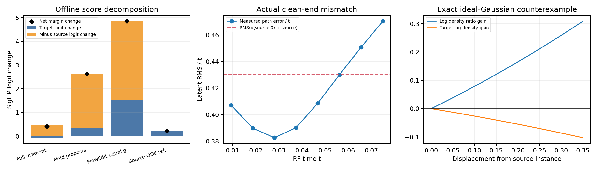

# FlowEdit 双方向研究：实验归因与理论修订

日期：2026-11-06。依据[实验报告](FlowEdit双方向理论_真实FLUX实验验证与失败分析_2026-11-06.md)、[前期理论](FlowEdit双方向深度研究_源耦合证书与干净域编辑_定理证明及闭环_2026-11-06.md)与真实运行的冻结产物。本轮只做既有数据的 CPU 复分析、数学推导和解析反例，**没有新增 FLUX／SD3 推理，没有修改原实验、阈值或生成轨迹**。

结论需要分成三层：源查询误差的数值控制有用；简单零噪声查询缺少已期待的实际模型局部精度；将速度差改造成可单调优化的径向标量，仍缺少可靠的目标任务含义。更准确求解未校准代理不能补齐最后一层。

新增分析代码：[analyze_results.py](../experiments/flowedit_theory_real_20261106/analyze_results.py)，原始数值与输入哈希：[analysis.json](../experiments/flowedit_theory_real_20261106/analysis_v1/analysis.json)。六项代数／一致性检查通过，不计作新增真实模型实验。

## 1. 按原研究假设逐项判定

| 前期假设／定理 | 实验证据 | 应得判断 |
|---|---|---|
| 随机配对会引入方向波动 | 8 个随机查询的经验波动约占方向二阶能量 53.8% | 有波动证据；未证明它是非编辑漂移的主要原因 |
| 去噪声的局部查询 αx 比源 ODE 具有 O(t²) 偏差 | 理想推导要求 v_s(x,0)=−x；实际缓存 RMS(v_s(x,0)+x)=.4305 | 该理想优势不能直接迁移到这张图、这个 FLUX 接口及 guidance |
| T1：同点条件差对应平滑密度比梯度 | 理想解析检查通过；实际场的局部 Jacobian 数值不对称 | 理想恒等式保留，真实 FLUX 的精确密度解释未建立 |
| T3–T4：径向构造补齐标量目标及转移界 | 标量和完整导数可计算；小尺度差分通过，图像却欠编辑／有伪影 | 程序目标明确；目标的语义含义、导数稳定性和模型误差界仍缺失 |
| T5–T6：源缺陷控制路径及编辑误差 | Euler2→8 的路径误差 .0656→.0183，编辑误差 .0127→.00840 | 数值趋势得到支持；全区间证书和真实语义收益未建立 |
| T8：有限步保持与代理推进 | 两条干净轨迹的所有提交状态通过实际值门，球约束未激活 | 代理层面成立；没有验证非编辑语义不变或激活约束后的恢复能力 |
| T9：正确动力学／边缘不足以选定合法编辑配对 | 源耦合短区间仍欠编辑，径向代理给伪影更高分 | 与理论边界一致；不能将其解释成对所有任务的实验定理 |

尤其应修订“已有理论闭环”的措辞：当前完成的是**带前提的动力学与已定义代理闭环**。真实编辑目标与保持观测尚未实现对应，不能按“理论已保证编辑，只剩调参”继续推进。

## 2. 最关键的目标缺口：分数比可以通过降低源兼容性提高

### 2.1 既有图像评分的重新拆解

令 L_s、L_a 分别是离线 SigLIP2 对完整源／目标提示的 logit，M=L_a−L_s。相对于未编辑 VAE 图，有恒等式 ΔM=ΔL_a−ΔL_s：

| 状态 | ΔL_a：目标提示变化 | ΔL_s：源提示变化 | ΔM：差值变化 |
|---|---:|---:|---:|
| 干净域完整梯度 | **−.06173** | −.47377 | +.41204 |
| 干净域便宜提案 | +.33418 | −2.29654 | +2.63072 |
| FlowEdit，相同 guidance | +1.54127 | −3.30067 | +4.84194 |
| FlowEdit，作者 guidance | +3.43935 | −1.41983 | +4.85917 |
| Heun32 源耦合参照编辑 | +.20773 | −.00947 | +.21720 |

完整梯度的差值改善时，目标绝对 logit 反而略降。便宜提案的差值改善中，约 87.3% 来自源 logit 下降，目标 logit 的增加仅约 12.7%。配合图像中的棕色主体与头部彩色伪影，说明只看差值会遗漏重要信息。

这些比例是**评分器上的代数分解**：不是因果贡献，不是真实条件概率，也不意味着降低源兼容性本身一定错误。正确类别转换本来就可能降低源类别兼容性；问题在于它不能代替目标实现或图像自然性。

### 2.2 即使理想模型完全准确，密度比也没有目标绝对进展保证

令 F=log p_a−log p_s，沿精确梯度更新 y'=∇F。记 s_a=∇log p_a、s_s=∇log p_s，则

\[
\frac{dF}{d\tau}=\|s_a-s_s\|^2\ge0,
\qquad
\frac{d\log p_a}{d\tau}=\|s_a\|^2-s_a^Ts_s.
\tag{R1}
\]

第二项没有一般非负保证。

**精确反例。** 取 p_s=N(0,1)、p_a=N(0,4)，源实例 x=1。则

\[
F(y)=\tfrac38y^2-\log2,\quad
\nabla F(y)=\tfrac34y,\quad
\frac{d\log p_a}{d\tau}=-\tfrac3{16}y^2<0.
\]

从 y=1 沿该方向走向 1.35，始终位于半径 .35 的源球内，F 增加 .3084375，目标 log 密度却降低 .1028125。两个分布都是正规光滑密度，场严格保守，不涉及网络误差、随机配对或求积不准确。

因此，T1 证明的是“方向确实优化哪个理想目标”，并没有证明“这个目标足以定义正确编辑”。真实数据中两个评分 logit 的变化与这个漏洞相容；它们不能证明实际 FLUX 内部似然就是这样变化的。

即使另外要求绝对目标兼容性提高，也不自动保证姿态、背景或源实例细节；这些仍需独立的任务许可与保持观测，不能只把比值目标换成绝对目标后宣称闭环完整。

## 3. 径向构造的另一缺口：小的场值误差不保证梯度稳定

前期 T4 控制的是标量值：若实际场 b=∇F+e、||e||≤ε_0，则连续径向标量满足 |S−(F(y)−F(x))|≤ε_0||y−x||。这**不能直接对不等式求导**，得出完整梯度也准确。

若另有 ||J_e||≤ε_1，沿径向线段直接求导才可得到

\[
\|\nabla S-\nabla F\|
\le\varepsilon_0+\tfrac12\varepsilon_1\|y-x\|.
\tag{R2}
\]

证明：将误差积分 ∫e(x+rd)^Td dr 对 y 求导，得到 ∫[e+rJ_e^Td]dr，再取范数。这里 d=y−x。对有限求积，还应另加**梯度求积误差**；原先的标量中点余项本身不提供梯度误差界。

**精确反例。** 理想场为 (1,0)，实际场为

\[
b_\varepsilon(z)=\left(1+\varepsilon\sin(z_2/\varepsilon^2),\ 0\right).
\]

全空间场值误差≤ε。以原点为源锚，在 y=(a,0)、a>0 处，径向标量值仍恰为 a，但

\[
\nabla S(a,0)=\left(1,\frac{a}{2\varepsilon}\right).
\tag{R3}
\]

证明：S(y)=y_1∫[1+εsin(ry_2/ε²)]dr，直接在 y_2=0 求导即可。任意固定、甚至很小的 a>0，第二分量都随 ε→0 发散；固定中点求积的节点均值为 1/2，因此这个反例对本轮有限标量也精确成立。

它说明，“场预测大体准确→径向标量值大体准确→完整梯度可靠”中的最后一步缺少导数控制。真实结果中，完整梯度与 detach 方向余弦 .1056、与端点场余弦约 .0700，且有效差分尺度很小，与这种风险相容。

这里的高频是场对潜变量坐标的变化，不是对图像像素频率做滤波；该解析反例也不是实际彩色伪影成因的鉴定。

但当前数据尚未分离模型导数误差、实际非保守分量和两个节点造成的求积误差，不能宣布其中任一项就是唯一伪影来源。局部 Jacobian 不对称也不能单独推出场值误差很大：上述反例恰可在场值误差趋零时拥有很大的反对称导数。

**研究修订：** 径向构造可作为明确的诊断目标，暂不能只凭“可积且单调”将其用作主编辑目标；若继续研究，必须检查 J=2/4/8 的值及梯度稳定性、实际方向导数与任务响应，而不只增加求积节点后宣布问题解决。

## 4. 零噪声查询：实际模型中没有获得预期的局部阶数优势

前期小时间论证用到理想 RF 的 v_s(x,0)=−x。对一般光滑实际场，源 ODE 展开为

\[
q_s(t)=x+t v_s(x,0)+O(t^2).
\]

故确定性查询 L_t(x)=(1−t)x 满足

\[
L_t(x)-q_s(t)=-t\,[x+v_s(x,0)]+O(t^2).
\tag{R4}
\]

只有括号中的端点失配消失，才自动得到 O(t²)。既有真实缓存给出

\[
\operatorname{RMS}(x)=.68749,\qquad
\operatorname{RMS}(v_s(x,0)+x)=.43050.
\]

后者约为源潜变量 RMS 的 62.6%，因此不能作为可忽略的一阶项。

| t | RMS((1−t)x−q_Heun32(t)) | 误差／t |
|---:|---:|---:|
| .009375 | .003816 | .4070 |
| .018750 | .007308 | .3897 |
| .037500 | .014630 | .3901 |
| .075000 | .035265 | .4702 |
| .150000 | .086329 | .5755 |
| .300000 | .201945 | .6732 |

缓存曲线与存在一阶失配相容；不将有限点拟合当作渐近阶数证明。严格展开针对实际网络的光滑实数算子，表中是浮点和数值参照测量，Heun32 仍不是精确解。

去掉随机噪声确实减少了查询方差。对任意固定参考 q_s(t)、独立标准高斯 ε，有精确恒等式

\[
\mathbb E_\varepsilon\frac{\|(1-t)x+t\varepsilon-q_s(t)\|^2}{D}
=\frac{\|(1-t)x-q_s(t)\|^2}{D}+t^2.
\tag{R5}
\]

在 t=.3，确定性查询误差 RMS≈.20195，随机查询期望平方误差的平方根≈.36164。后一个数字是解析期望，不是新采样结果；它也不是随机误差范数的期望。这个方差分解对任何固定参考都成立，不能额外证明确定性查询具有实例语义知识。

因此，当前数据支持“去噪声降低随机距离项”，同时显示“αx 仍明显偏离该源模型轨迹”。这些量只覆盖固定源 x 与 t≤.3，**不能外推成主方案 t=1/3、后续 y 状态的实际误差**。

端点失配来自真实照片、源提示、蒸馏 guidance、端点训练覆盖或模型近似中的哪一项，本轮尚未隔离。它不足以否定有限 σ 的理想 T1，也不能认定所有 FLUX 查询都不可靠。

## 5. 源耦合方向到底恢复了什么

### 5.1 精确源耦合的连续极限就是部分反演编辑

按生成时间 t 写源轨迹 q_s'=v_s(q_s,t)，源到目标的直接变量满足

\[
y'=v_a(q_s+y-x,t)-v_s(q_s,t),\qquad y(T)=x.
\]

定义 z=q_s+y−x，链式法则立即给出 z'=v_a(z,t)，并有 z(T)=q_s(T)、z(0)=y(0)。因此，在源路径精确、位移系数 a(t)=1 的连续极限下，这恰是“源 ODE 反演到 T，再按目标 ODE 返回”。这是动力学等价关系，不是新的无反演算法。

源查询精度提高意味着接近这个既定耦合。**既定耦合本身是否保姿态／背景，仍是独立问题。** SelFix 的先前结果还包含特征注入和不同预算，不能据其效果把所有收益归因于源反演更准确。

若用近似路径 q̂，r=q̂'−v_s(q̂,t)，则 z'=v_a(z,t)+r。源缺陷以强迫项进入目标路径，这为 T5–T6 提供了更直接的动力学解释。

### 5.2 细化源路径，不会自动细化固定 8 步的编辑器

离散生成时间步长 Δt<0 时，严格代数关系为

\[
z_{k+1}=z_k+\Delta t\,v_a(z_k,t_k)+\rho_{s,k},\quad
\rho_{s,k}=q_{s,k+1}-q_{s,k}-\Delta t\,v_s(q_{s,k},t_k).
\tag{R6}
\]

本轮对全部三条缓存轨迹核对该恒等式，最大 RMS 残差约 1.76e−8。即使源轨迹取 Heun32，固定 8 步 Euler 编辑的 ρ_s 仍约 .0021–.0041；它含有编辑网格上的离散缺陷，不能称为精确目标 ODE 的 8 步重放。没有再细化目标编辑器，因此不能将剩余差异都归为源路径误差。

此外，T6 使用 ||e_s||+||e_a|| 控制两分支误差之差，会丢失共同误差的抵消。在 Euler2 对参照的第一步，两个速度误差余弦≈.9843，差的 RMS 仅为两误差 RMS 之和的约 8.85%。这解释了为何上界 .7298 远大于实际终点误差 .0127；不是“常数一大就证明系统失稳”。这个抵消只对已记录的成对误差成立，不提供新轨迹的预测证书。

### 5.3 欠编辑不是对源耦合假设的充分否定

标准 FlowEdit 从实际 t≈.91847 开始积分，24 步；源耦合实验只覆盖 [0,.3]，8 步，且没有做相同窗口的随机查询对照。它回答了“近似源路径怎样接近参照编辑器”，尚未回答“相同任务完成度下，源 ODE 查询是否比随机查询少漂移”。

## 6. 停滞需要分开分析：完整梯度与便宜提案不是同一种情况

### 6.1 完整梯度：固定归一化步长不控制局部线性误差

所有候选都未碰到 .35 球边界，原始恒定提案 RMS=.08。由未投影候选的 gᵀd 反算，未归一化标量梯度 RMS 约为 .09893→.34576→3.15052，而状态源位移仅为 0→.04→.04112。

在停滞点，RMS=.01 候选实际增益／线性预测仅 .00437；补充降到 6.25e−5 后约 .18970，仍低于 .25 门槛。这说明登记的有限回溯范围不足以获得通过的候选，不能据此判定没有上升方向。

差分通过的探针位移是 .08，并非轨迹停滞点 .04112；后者没有独立差分核对。因此，实际非线性与该点的数值梯度误差尚未完全分离。“完整梯度处处可靠，只需缩步”仍超出证据。

实现还有固定最小增益 1e−7，理论上无限缩步也不能自动保证接受：足够小的真实增益最终会低于这个门槛。当前记录的正增益候选远高于该下限，拒绝主要来自相对预测要求；下限不是本次已观察到的主要原因。

### 6.2 便宜提案：预测量不是真实目标方向导数

令代理提案 p=b(y)/D，暂忽略归一化正系数与不激活的投影。用 d=hp 时，原验收比较

\[
S(y+hp)-S(y)\ge a h\|p\|^2.
\]

但左侧的一阶项为 h∇Sᵀp。因此，即使 ∇Sᵀp>0，只要 ∇Sᵀp<a||p||²，充分小的步长仍会失败。**这不是完整梯度 Armijo 回溯的存在性结论。**

**精确反例。** 取二维场 b(y)=(I+2J)y，J 是 90° 旋转矩阵，源锚为原点。其精确径向标量 S(y)=||y||²/2；固定中点求积也精确。取 y=(.1,0)，则 b=(.1,.2)。沿 b 的更新有

\[
\frac{S(y+hb)-S(y)}{h\|b\|^2}=.2+.5h.
\tag{R7}
\]

h=.08/.04/.02/.01 时，比值=.24/.22/.21/.205，全部低于 .25，尽管所有步都增加 S 且在半径 .35 球内。于是同一规则可以把合法上升步全部拒绝。

真实便宜提案最后四个候选都使 S 增加，比值约 .0988/.1553/.2079/.2171，与这个机制相容；但未测 h→0 极限，不能断言其所有更小步都必然失败。

这部分应修正规则的含义：若保留便宜提案，应计算真实 ∇Sᵀd／可信方向差分作为预测量，或只要求经数值容差核对的实际标量增加，并放弃完整梯度收敛结论。该修正只能解除不合理的预测门槛，**不能解决 S 自身偏好伪影的问题**。

## 7. 研究方向修订：先识别因果，再增加复杂度

本轮 B 与原 FlowEdit 同时改变了随机量、源查询是否固定、源／目标是否同点、速度重标度、生成时间调度、更新方向以及优化目标；不能把它的失败单独归因于“无噪声”或“从干净域开始”。FlowEdit 的 y 原本也从 x 初始化。

下一轮最小因果比较应先固定同一编辑器

\[
y_{k+1}=y_k+h_k[v_s(q_s,t_k)-v_a(q_s+y_k-x,t_k)],
\]

只改变 q_s：①标准随机弦，②αx，③源 ODE 数值路径。所有分支使用同一时间网格、guidance、初始状态、目标位移系数和积分器；源路径额外成本单列。这样才直接回答“随机源耦合是否引起额外漂移”。

| 优先问题 | 最小可辨识对照 | 通过后才能推进的结论 |
|---|---|---|
| 查询耦合是否有保持收益 | 上述三个 q_s，固定其余动力学，在可比较任务进展下检查变化 | 源查询构造的独立作用；不要求先优化新的径向标量 |
| 简单 αx 是否足够准确 | 实测端点缺陷、有限 t 的源回映／ODE 距离，区别理想阶数与实际误差 | 是否需要部分源路径校正；部分反演必须如实标注 |
| 径向目标为何出现伪影 | 同点、同一方向，比较求积节点与完整方向差分，分别记录源／目标绝对兼容性 | 导数／求积／目标定义中的哪一环需更换 |
| 便宜方向为何停滞 | 记录真实方向导数、实际增益和旧预测量，区分预测门槛与可行性 | 修正规则的数值意义；不据此认证编辑收益 |
| 非编辑语义能否保持 | 对姿态、视角和背景的具体观测做许可／辨识校准，再做等完成度比较 | 从代理保持向实际非编辑保持转移 |

原 T2 的尺度权衡可继续作为假设框架，但 ε_v、平滑偏差及导数误差尚无有效估计；三处场幅度不能选出“理论最优 σ”。不建议用继续缩小 σ 解决当前问题，小尺度重标度本来就会放大差分误差。

对严格无源反演的目标，应继续把干净 y 作为编辑状态，研究与模型训练查询一致的有限尺度方向；**不把 ε=0、单调密度比或径向积分当作已经验证的必要组成。** 源 ODE 路线保留为耦合诊断与有成本的参照。

## 8. 回到最初的“均值导致样本细节丢失”判断

本轮没有证明 FlowEdit 必然趋向某种“众数均值”。条件均值速度是理想 RF 正确边缘输运的对象；后验平均、目标条件的姿态／外观偏好、随机查询波动、源实例耦合和数值误差是不同机制。

较强的当前结论是：**目标条件分布与合法实例编辑之间缺少确定的配对约束；仅消除随机性或恢复正确源动力学都不足以补上。** 实验中的转头、欠编辑与伪影分别提醒我们检查条件偏好、任务进展与实际查询／导数稳定性，而不是全部归为同一个“流形吸引”现象。

这次结果给前期研究提供的修订是明确的：保留源缺陷与传播分析；撤回把简单 αx 直接视为实际 O(t²) 源提升的期待；将径向单调代理降为待校准候选；修正便宜方向验收的预测量；用单因素查询对照重新检验用户最初的随机耦合假设。
