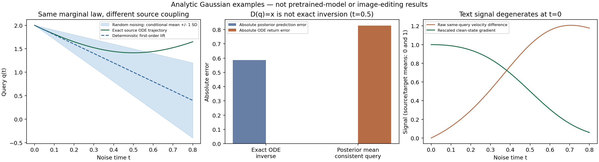

# FlowEdit 随机配对漂移与从干净源图出发：理论探索与验证方案

后续深度研究：[源耦合证书与干净域编辑：定理、证明及闭环](FlowEdit双方向深度研究_源耦合证书与干净域编辑_定理证明及闭环_2026-11-06.md)。补齐确定性查询的精确密度解释、实际网络标量目标、源缺陷证书与有限步验收，并提供 34 项可运行核对。本文保留第一轮探索及其证据范围。

日期：2026-11-06。范围：原论文核读、本地算法核对、数学推导与解析反例。**本轮完成 20 项解析／构造核对；没有运行新的 FLUX／SD3 图像编辑实验，没有证明任何候选改善真实编辑质量。**

本文接续[同 FLUX 的 FlowEdit／SelFix 对照](FlowEdit与SelFix高保真反演编辑_同FLUX真实图像对照_2026-11-05.md)。研究重点是用户提出的两个方向：随机加噪与预训练模型动力学的对应关系，以及从干净源图开始编辑。主候选保持冻结模型、无需完整源反演；使用部分反演、逐图优化或空间掩码的路线另行标明，不将它们隐去。

## 1. 当前最有价值的结论

1. **随机加噪符合训练边缘分布，不等于符合这张源图的确定性 ODE 轨迹。** 用户怀疑的失配更适合称为“源实例与查询轨迹的耦合失配”，不能直接等同于随机点不在数据流形上。
2. **FlowEdit 已从干净源图初始化编辑变量；带噪的是网络查询点。** 真正可改的是查询点构造与编辑动力学，而不是单纯把初始化变量改名为 x0。
3. **理想独立高斯线性 RF 在 t=0 的条件速度退化为 −x。** 对同一个干净输入直接取源／目标速度差，不能一般得到非零编辑驱动力。实际蒸馏网络可能不同，但这不构成理论保证。
4. **速度与随机弦方向不一致，不一定是模型错误。** 把这种残差强行压到零，既可能改变噪声分布，也可能找不到实际反演点；下文给出精确高斯反例。
5. **优先研究“干净编辑变量＋有限噪声查询＋源内容约束”。** 先区分源查询失配、目标查询位移失配、条件自身的语义耦合，再决定修正哪一项。

已有项目记录曾研究源关系、反馈和条件泄漏，见[源轨迹保持与条件泄漏](源轨迹保持与条件泄漏_新方向调研及理论分析_2026-10-06.md)、[原生配对观测](原生配对关系观测_理论推导与FlowEdit联合约束设计_2026-10-30.md)。本次不将既有失败的姿态代理重新当作已可靠的约束，也不将以下组合宣称为原创算法。

## 2. 先明确 FlowEdit 的实际状态

令 t=0 为干净端、t=1 为噪声端，α=1−t。x 是固定源潜变量，y 是直接编辑变量，d=y−x。每步构造

\[
q_s=\alpha x+t\epsilon,\qquad q_t=q_s+d,
\quad \epsilon\sim\mathcal N(0,I).
\]

在递增编辑时间 τ=t_start−t 下，编辑场是

\[
B(y,t;x)=\mathbb E_\epsilon[v_s(q_s,t)-v_t(q_t,t)],
\qquad y(0)=x.
\tag{1}
\]

离散实现为 y_{k+1}=y_k+h_k(v_s−v_t)，h_k=t_k−t_{k+1}>0。实际 guidance 包含在各分支 v 中。本地[运行脚本](../experiments/sota_inversion_20261105/run_comparison.py)每步重采样，n_avg=1、n_min=0，符合这一更新结构。

**y 是直接编辑域中的潜变量，q_s、q_t 是模型查询点。** y 从源图开始，不沿着一条普通“带噪图逐步去噪”的路径演化；但“直接编辑域”也不证明每个中间 y 都属于真实图像分布。

依据：[FlowEdit §4–5](https://arxiv.org/html/2412.08629v2#S5)。论文明确将随机配对平均构造视为启发式，未保证精确目标边缘或最优传输。以下推导均以明确假设为前提，不把启发式升级为精确生成定理。

## 3. 用户提出的“噪声与速度不一致”，应如何定义

### 3.1 应比较 ε−x 与 v，而不是直接比较 ε 与 v

固定一对样本 (x,ε)，线性弦 q(t)=αx+tε 的速度为 ε−x。理想平方回归模型得到

\[
v_c^*(q,t)=\mathbb E[\epsilon-X\mid Q_t=q,c].
\tag{2}
\]

同一个 q 可以对应许多 (X,ε) 对，因此通常

\[
v_c^*(q,t)\ne\epsilon-x.
\]

这正是条件速度与边缘速度的区别。[Flow Matching §3](https://arxiv.org/html/2210.02747)讨论由条件路径构造边缘场；均值场在理想条件下运输正确边缘，并不需要等于每条训练弦的速度。

定义 D_c(q,t)=q−t v_c(q,t)。在理想模型下它是后验均值；在一般冻结网络下先只视作代数上的干净预测。源弦残差满足

\[
r_s=v_s(q_s,t)-(\epsilon-x)=\frac{x-D_s(q_s,t)}{t}.
\tag{3}
\]

在精确模型里，给定 q 后仍有

\[
\mathbb E[\|r_s\|^2\mid q,c_s]
=\frac{\operatorname{tr}\operatorname{Cov}(X\mid q,c_s)}{t^2}.
\tag{4}
\]

所以 r_s 包含后验不确定性，不是纯网络误差，也不是精确的离流形距离。对固定源图做跨噪声平均时，它也不必均值为零；不能把训练回归的条件无偏性错误地换成给定 x 的无偏性。

### 3.2 三种一致性必须分开

| 一致性 | 具体对象 | 不能由它推出的结论 |
|---|---|---|
| 加噪边缘一致性 | 若 X 服从模型源分布，αX+tε 具有相应 p_t | 固定 x 的查询点属于 x 的 ODE 轨迹 |
| 源轨迹一致性 | q_s=Φ_s^t(x)，Φ_s 是源条件 ODE 流映射 | 目标条件下非编辑因素保持不变 |
| 任务保持一致性 | C(y)≈C(x)，C 表示任务应保留的信息 | y 已满足目标语义或具有高图像质量 |

对于 t>0 的非退化高斯卷积，密度通常全空间为正。此时“离开流形”应具体化为低概率查询、实际网络误差增大、源轨迹偏离或源特征损失，不能互换使用。真实照片及不完整源提示可能不服从理想 p_s，这是另外的模型／条件失配。

### 3.3 解析反例：D_s(q)=x 也不等于反演正确

取一维 X~N(0,1)、t=0.5、给定源 x=2。加噪边缘方差 V=α²+t²=0.5，精确源 ODE 轨迹为 q_inv(t)=√V x。此时 D(q)=q，而完整源 ODE 回映为 G_s^t(q)=q/√V。

| 查询点 | q | D(q) | 实际 ODE 回映 G(q) |
|---|---:|---:|---:|
| 真正源 ODE 反演点 | 1.414214 | 1.414214 | **2.000000** |
| 强制 D(q)=x 的点 | 2.000000 | **2.000000** | 2.828427 |

**单次后验均值重建最好，不等于多步动力学重建最好。** 如果噪声优化仅最小化式 (3)，应称为后验一致性优化，不能称为找到了源反演流形。

图左显示同一源样本的加噪条件分布与确定性 ODE 轨迹不同；若再对源 X 积分，两者具有同样的时刻边缘。图中间给出上述反例；图右显示干净端速度差退化与适当重标度后的信号。

## 4. 目标查询点还有独立的问题

若把 y 当作当前干净目标估计，它与 x 共享噪声后的查询应为

\[
q_y=\alpha y+t\epsilon=q_s+\alpha d.
\tag{5}
\]

FlowEdit 使用 q_t=q_s+d，两者相差 td。对 t<1，FlowEdit 目标查询也可写成

\[
q_t=\alpha\left(x+\frac{d}{\alpha}\right)+t\epsilon.
\tag{6}
\]

这意味着：**若坚持把 y 解释为当前干净目标估计，FlowEdit 查询的是更远的外推状态。** t 较大时，1/α 放大明显；但 d 初始为零，首步两种查询完全相同，不能将放大因子直接解释为首步漂移量。原 FlowEdit 的 y 是辅助直接路径变量，式 (6) 本身并不证明原算法数学错误。

这一方向已有直接近邻：[RIDGE §3.3](https://arxiv.org/html/2608.03059)对当前编辑状态共享加噪；[DRFS §3–4](https://arxiv.org/html/2509.05342)研究时间相关的目标位移。只把 d 换成 αd 已不能作为新的研究贡献。

建议统一诊断族为

\[
q_t=q_s+a(t)d,
\qquad a(t)=1\ \text{或}\ a(t)=1-t.
\tag{7}
\]

在固定状态下比较目标速度、后验预测和非编辑方向的响应，再进行完整轨迹比较。直接修改查询点而保留原更新，应明确是新算法变体；如果在光滑源／目标 ODE 路径上把 d 当作真正坐标变换，则必须有

\[
\dot d=\frac{v_t-v_s-a'(t)d}{a(t)}.
\tag{8}
\]

这条链式法则不适用于把逐步独立噪声硬视为可微轨迹，也不代表 RIDGE 必须使用式 (8)：RIDGE 的 y 被定义为迭代目标估计，并不是对原 ODE 的严格坐标重写。

## 5. 能否真正从 x0 开始

### 5.1 直接令网络时间 t=0 的困难

在独立、零均值高斯噪声的理想 RF 中，对条件分布支持内的 x，

\[
v_c^*(x,0)=\mathbb E[\epsilon-X\mid X=x,c]=-x.
\tag{9}
\]

若同一点处两个条件均有良好定义，v_s^*(x,0)−v_t^*(x,0)=0。对互不重叠支持或奇异数据流形，目标条件在 x 的端点值及极限可能无定义；这同样不能为 t=0 速度编辑提供保证。

对 0<t<1，理想 score 恒等式是

\[
v_c^*(q,t)=-\frac{q}{\alpha}-\frac{t}{\alpha}\nabla_q\log p_t(q\mid c).
\tag{10}
\]

同点条件差为

\[
v_s^*-v_t^*=\frac{t}{\alpha}\nabla_q\log\frac{p_t(q\mid c_t)}{p_t(q\mid c_s)}.
\tag{11}
\]

光滑、共同支持条件下，文本信号以 O(t) 消失。重标度可以恢复有限信号，但同时放大网络差分误差。若两分支误差为 e_s、e_t，则相应 clean-state 梯度误差为 α²(e_s−e_t)/t。实际 FLUX guidance 是蒸馏输入，不能用普通 CFG 线性等式恢复真实条件 score。

因此直接使用很小 t 并乘一个巨大系数，可能把文本信号与模型／数值误差一起放大。需测量跨探针一致性、精度敏感性和真实有限步编辑响应，而不是只看速度非零。

### 5.2 小噪声、确定性局部提升：一个具体候选

设 p_s 在 x 附近正且足够光滑，源流解对时间二阶以上可微。由式 (10) 可得

\[
\Phi_s^t(x)=(1-t)x-\frac{t^2}{2}\nabla_x\log p_s(x)+O(t^3).
\tag{12}
\]

于是最便宜的确定性查询

\[
L_t(x)=(1-t)x
\tag{13}
\]

在小 t 时距实际源轨迹为 O(t²)；随机加噪 αx+tε 的逐样本偏差通常是 O(t)，维数和噪声范数计入常数。

这是一个与用户方向直接对应的可检验想法：**不先把干净编辑变量带去高噪声区，只在有限的小噪声时间上作局部查询。** 可先比较 ε=0 查询与标准随机查询，在相同 t、相同条件驱动力强度下是否减少源结构改变。

边界必须明确：式 (13) 不是标准高斯加噪采样，ε=0 也不是高维高斯的典型样本；它是局部确定性提升近似。O(t²) 仅是理想、光滑场的小时间结论，不能外推到大 t、真实奇异分布或蒸馏模型。如果用多步源 ODE 或固定点求解改进 L_t，应标为**部分反演／局部逆解**。它可以有研究价值，但不再是严格不求逆的方案。

### 5.3 将编辑进度与噪声时间分开

令 s 是编辑进度，y(0)=x；t 只作为查询尺度，不再强制 s 与生成时间反向一一对应。一个有明确理想目标的候选为

\[
F(y)=\mathbb E_{t\sim\pi,\epsilon}
\left[w(t)\log\frac{p_t(\alpha y+t\epsilon\mid c_t)}
{p_t(\alpha y+t\epsilon\mid c_s)}\right]-\lambda R(y,x).
\tag{14}
\]

在允许交换微分与积分的理想模型下，

\[
\nabla_yF=
\mathbb E\left[w(t)\frac{\alpha^2}{t}
\{v_s(q_y,t)-v_t(q_y,t)\}\right]
-\lambda\nabla_yR.
\tag{15}
\]

两分支在**当前 y 的同一查询点**评价，源实例由 R 另外提供。它不是原 FlowEdit，也不是固定源查询的 DDS；应作为新的研究候选／理论参照，而非等价改写。

可执行顺序是：用预先限定的有限 t 集合获取同点条件差；从 y=x 进行有界更新；检查实际目标进度及源内容变化；只有低尺度确实无法推进时才探索更大尺度。并非所有任务适合低噪声：增删对象、大形变可能需要更大的生成自由度。

式 (14) 是分数比优化，不是目标分布采样保证。分数比可以通过降低源概率增长，并且可能无上界；应采用有限任务完成条件、源锚、自然性检查和停止条件。真实网络的场未必保守，式 (15) 的代理不能自动继承精确目标的收敛性质。

## 6. 从不同理论中选择解决手段

| 理论视角 | 可实施方向 | 能解决什么 | 不能省略的条件／成本 |
|---|---|---|---|
| 耦合与输运 | 源轨迹参照、目标共享加噪、局部流映射的位移输运 | 区分边缘正确与样本配对正确 | 精确轨迹需反演；正确边缘或低距离仍不识别语义保持 |
| 后验估计／Tweedie | 用 D_s、D_t 检查预测分歧和不确定性 | 诊断哪些内容未被抵消 | D_s−x 不是纯误差；D_s(q)=x 不是 ODE 逆解 |
| 随机近似／方差缩减 | 共享噪声、反变量探针、增加 n_avg | 降低平均场估计方差 | 不消除平均场偏差；反变量效果依赖场的相关性 |
| 熵正则控制 | 对噪声策略施加 KL 预算，优先选择低保持代价且有任务进度的方向 | 有原则地改变随机配对，而非盲目选择低重建残差 | 改变原均值场；需可靠内容与任务测量，多探针成本必须计入 |
| 连续延拓／局部展开 | 干净 y＋有限小 t 查询，逐级扩大可编辑范围 | 避免高噪声起步即丢失源辨识信息 | t=0 退化；小 t 放大误差；可能欠编辑 |
| 最优控制／约束动力学 | 对源内容水平集施加反馈，检查实际有限更新 | 直接针对“不应改变的事实” | 内容观测本身是未解决问题；合法形态与姿态不可混淆 |
| Schrödinger bridge／Doob 变换 | 引入有源内容条件的桥或软终点似然 | 从路径概率上表达源实例条件 | 需要桥函数／训练／近似求解；纯确定性 ODE 不能直接套非退化 SDE 公式 |

### 6.1 噪声优化必须承认改变了采样测度

考虑在固定当前 y、t 下，选择噪声分布 ρ，而不是仅减小 Monte Carlo 误差：

\[
\min_\rho\ \mathbb E_\rho[J(\epsilon;y,x)]
+\lambda_\epsilon\operatorname{KL}(\rho\|\phi),
\quad \phi=\mathcal N(0,I).
\tag{16}
\]

在归一化常数有限等条件下，Gibbs 变分解为

\[
\rho^*(\epsilon)\propto\phi(\epsilon)
\exp[-J(\epsilon)/\lambda_\epsilon].
\tag{17}
\]

J 应关注实际候选编辑 y+ηb_ε 的保持代价和任务进度，而不是只惩罚 \|v_s−(ε−x)\|²。比如在已校准 C、S 时使用

\[
J=\|C(y+\eta b_\epsilon)-C(x)\|_W^2
+\mu[\kappa-(S(y+\eta b_\epsilon)-S(y))]_+^2.
\]

有限 K 个候选的指数权重只是离散近似；既有保真指标也不能自动充当 C 的语义真值。K 个 paired probes 至少需要 2K 个 FLUX 分支调用，候选解码／特征计算另计。

若采用 ρ=N(m,σ²I)，则

\[
\operatorname{KL}(\rho\|\phi)=\tfrac12[\|m\|^2+D(\sigma^2-1-\log\sigma^2)].
\]

这说明“每个分量注入都很小／有界”不保证高维整体分布改动很小。噪声归一化也不恢复与源图的独立性。若通过重要性权重严格恢复 φ 下的期望，目标仍是原平均场，只改变估计方差；若希望消除其系统性漂移，就必须承认并评估所引入的场偏置。

### 6.2 跨步固定噪声是对照，不是理论上自动更好

相关噪声可使查询连续，却通常不是源 ODE 轨迹。即使每步噪声边缘仍是 N(0,I)，当前 y 已依赖历史噪声，后续条件分布也会改变。

构造例：d_1=hε_1，第二步 b(d,ε)=dε，ε_2=ρε_1+√(1−ρ²)ξ，则 E[b(d_1,ε_2)]=hρ，而独立噪声平均场在固定 d 上为零。故固定／相关噪声会改变适应性动力学，不能只称为“同一平均场的更平滑估计”。

### 6.3 真正的保持约束不能被流形投影代替

令 C(y) 是任务应保留的事实，S(y) 是任务进展。理想连续约束为

\[
\frac{d}{ds}C(y(s))=J_C(y)u=0.
\]

一个局部候选更新可以写成

\[
\min_u\tfrac12\|u-g\|_M^2,
\quad J_Cu=-k[C(y)-C(x)],\quad \nabla S^\top u\ge\kappa.
\tag{18}
\]

式 (18) 可能不可行，且只能约束被 C 准确读出的因素。实现时应加入测量容差、信赖域、不可行退出和实际有限步检查；不能把强制保留所有像素当作成功。项目既有记录已说明一般姿态／形态观测尚未过关。

二维反例足以否定“与重建速度正交即可保持源内容”：重建速度是 (1,0)，编辑速度是 (0,1)，两者正交；若应保留第二坐标，它仍被完全改变。自然图像流形内也包含转头、换背景等不合法编辑。源与目标边缘、精确循环一致性同样不够：对对称背景变量 n，(a,n)→(a+1,−n) 可以保持正确边缘并可逆，却改变了每个样本的 n。

## 7. 已有方法给出的直接参照

下表只使用原论文／官方论文集。核读范围与本地收益分开；未复现这些方法的本项目效果。各条是机制摘要，不以作者宣传语充当一般定理。

| 来源与核读范围 | 可借鉴机制 | 当前任务中的边界 |
|---|---|---|
| [FlowEdit](https://arxiv.org/html/2412.08629v2)，§4–5、附录 K | 随机配对、差分速度、共享噪声 | 基础基线；平均场没有源内容不变量保证 |
| [SNR-Edit](https://arxiv.org/html/2601.19180v2)，§3、算法 1、附录 B | 将分割得到的空间结构编码混入噪声 | 完整方法使用 SAM2；属于额外结构条件，不是仅使随机噪声“更高斯”。有界幅度不保证小 KL；其轨迹误差界以前提性的源代理误差为输入 |
| [RIDGE](https://arxiv.org/html/2608.03059)，§3、附录 A | 对当前干净编辑估计共享加噪，位移自然乘 α | 完整算法还含内部软掩码、目标预测引导和尾段采样；只取共享加噪必须标为消融版本 |
| [DRFS](https://arxiv.org/html/2509.05342v3)，§2–4 | 源／目标完整速度残差之差，时间相关查询位移 | 提供 DDS 与 FlowEdit 的连接；实际梯度含 Jacobian 近似，不能当作一般精确能量梯度 |
| [DDS](https://openaccess.thecvf.com/content/ICCV2023/html/Hertz_Delta_Denoising_Score_ICCV_2023_paper.html)，摘要及论文问题定义 | 从干净编辑参数出发，固定源参考抵消公共蒸馏偏差 | 需要噪声查询和迭代优化；不是纯 t=0 的编辑方向 |
| [FlowAlign](https://arxiv.org/html/2505.23145)，§3、附录 A | 将终点源相似性引入轨迹控制 | 整体源距离也惩罚必要编辑；随机查询不光滑不等于期望场不存在，不能直接据此否定 FlowEdit |
| [FlowCycle](https://arxiv.org/html/2510.20212v3)，§3 | 优化源／目标噪声，通过目标编辑与源回映建立循环 | 逐图、多轮优化；循环一致不证明中间目标保持姿态与背景 |
| [h-Flow](https://arxiv.org/html/2607.10800)，§3–4 | 利用等边缘随机过程、源／编辑桥函数与速度分解 | 不能将一个速度的正交补等同于全部非编辑特征不变；实际桥函数仍需近似 |
| [Generalized Schrödinger Bridge Matching](https://proceedings.iclr.cc/paper_files/paper/2024/hash/3e91dd686ea22cb51b8732e3c7e9fc8e-Abstract-Conference.html)，官方摘要 | 将任务状态代价纳入桥与随机最优控制 | 训练方法，只提供理论方向；不是冻结 FLUX 即可调用的算法 |
| [I²SB](https://proceedings.mlr.press/v202/liu23ai.html)，官方摘要 | 直接学习图像分布间条件扩散桥 | 支持“图像到图像不必经独立高斯端点”的可能性，但依赖专门训练 |
| [Trajectory Optimal Control](https://proceedings.iclr.cc/paper_files/paper/2026/hash/2c3b636b64ca1dfdae3e096e4deeaa42-Abstract-Conference.html)，官方摘要 | 用伴随传播优化终点奖励与保真 | 多轮轨迹优化；本次未核读完整实现，不据此提出可直接迁移接口 |

优先相关工作是 SNR-Edit、RIDGE、DRFS、FlowCycle。它们已覆盖“改噪声”“改目标查询”“从干净变量优化”等宽泛想法；可研究的贡献需要落在新的可观测失配、有效约束或经验证的成本／质量收益上。

## 8. 推荐的研究顺序与可直接实施的方案

### 8.1 第一优先：分离源耦合与目标查询，不先叠加复杂控制

对同一干净状态 y、同一实际 t，做下列查询矩阵：

| 源查询 | 目标 q_s+d | 目标 q_s+αd |
|---|---|---|
| 标准独立高斯加噪 | 原 FlowEdit | 共享加噪消融 |
| 同一个噪声贯穿／预设相关噪声 | 时间耦合对照 | 时间耦合＋共享加噪 |
| 小 t 的确定性 L_t(x)=αx | 局部源提升消融 | 干净估计的确定性共享提升 |
| 经源回映验收的 Φ_s^t(x) | 源轨迹参考 | 源轨迹＋位移收缩诊断 |

最后一行明确属于部分／完整反演的诊断参照；“源轨迹＋αd”也不是精确目标轨迹，不能称为 oracle 编辑器。若使用源流 Jacobian 输运位移 JΦ_s^t(x)d，需要额外 JVP 和源路径，只能作为更昂贵的局部几何对照。

先做固定状态查询，避免将候选造成的不同 y 混入局部因果比较；再做完整 rollout，检查局部优势是否保留到终点。把共同 y 上的差异与各自轨迹上的差异分别报告。

### 8.2 第二优先：有限尺度的干净状态编辑

以式 (15) 的同点条件差为方向候选，或者使用已明确身份的 DDS／DRFS 基线，不能混用它们的更新式。核心流程：

1. 初始化 y=x，设定有限 t 范围、步数／NFE 上限和保持容差。
2. 从预设尺度及共享探针获得候选方向，t 不取零；先保持源／目标 guidance 相同，再独立评估增强引导。
3. 使用源锚与有限更新半径；只在已有校准的因素上施加式 (18)。对未能可靠观测的头部姿态，不宣称硬保持保证。
4. 检查实际解码候选的目标进度和源保持；尺度过低欠编辑时才扩大查询尺度。
5. 达到任务要求即停止；不可行或低信噪比时记录失败，不把停留原图计为优良保真。

主干方向通常为每探针两次模型调用；多尺度、反变量、多候选和梯度／JVP 均额外计费。该方案未在真实模型实现，本轮提供的是可审查的理论定义和实验接口。

### 8.3 第三优先：源条件噪声策略

只有当第一阶段确认“不同噪声在相近任务进度下具有可预测的保持差异”时，再用式 (16) 控制噪声。否则噪声优化很可能只是在不可靠代理上选样本，并把欠编辑误当作保持。

不建议直接最小化 ||ε−v||，不建议把 D_s−x 当作精确 ODE 回映残差，也不建议仅对白化后的修改噪声宣称分布匹配。采用源 ODE 回映 G_s^t(q) 作为检验时，应报告其积分精度与成本；若进一步求 G_s^t(q)=x，就是逆问题。

## 9. 与当前熊图实验连接的预登记方案

### 9.1 已有证据及混杂

当前主对照统一 FLUX.1-dev，但 FlowEdit 使用 guidance=1.5/5.5，SelFix 主图为 1/2 且有源 Value 注入。FlowEdit 的 1/2 控制背景保持强、目标变化弱。因此这组结果既没有独立确认随机配对为主因，也不能把 SelFix 优势完全归于源轨迹。

此前[SD3 的 CFG=1/1 对照](FlowEdit_CFG均为1_全轨迹频谱对照_2026-10-10.md)同样表现出欠编辑。不要把降低总驱动力作为新方案收益重复报告。

### 9.2 必要诊断

| 诊断 | 记录内容 | 如何解释 |
|---|---|---|
| 恒等编辑 | 相同文本、相同 guidance、y=x，检查每步速度差 | 原算法应为零；噪声方案不得无故破坏此性质 |
| 源回映 | G_s^t(q_s) 与 x 的实际差；另报 D_s(q_s)−x | 前者是有限动力学重建，后者是后验预测，分开记录 |
| 目标位移 | q_s+d 与 q_s+αd 的速度／候选图差 | 诊断目标查询几何，不能当作全部漂移来源 |
| 条件作用 | 同一点、相同 guidance 下 v_s−v_t | 区分文本效应与状态差、引导强度差 |
| 噪声影响 | 固定 y,t 的跨噪声均值、协方差及背景变化一致性 | 均值中的漂移与单次估计方差分开 |
| 全轨迹 | 草地、足部、水流、朝向和任务完成度 | 局部较好不保证终点更好；大形变任务另列 |

已有 SelFix 轨迹使用 15 步，FlowEdit 用 28 步偏移网格。不能按数组索引强行配对；应取实际相同时刻，或另行构建并验收匹配时刻的源逆解。未经检查的线性插值不作高保真轨迹真值。

建议先用熊图及已具备的多对象／车辆任务作开发集，另留源图和种子作验证。测试 t=0.05、0.10、0.20、0.40 可作为局部探索网格，**这些数值是候选设计，不是已经校准的通用阈值**；实际模型调用必须按训练时间参数化与调度接口一致传入。

完整比较分别报告相同 NFE 的成本曲线、以及达到相近任务完成度后的保持曲线。保留所有种子与失败配置；固定离线背景窗口可用于诊断，不能混作编辑输入掩码。黑熊任务不等于只改颜色，必要形态变化也不能统一算成错误。

判别标准：若源回映大幅改善但非编辑漂移不降，应降低“源随机配对是主要原因”的判断，转向条件耦合和保持观测；若位移收缩仅欠编辑，也不能计为成功；若小 t 下代理方向不稳定，先解决精度／模型误差问题，不能通过无限放大方向强行推进。

## 10. 本轮核对与交付状态

可运行脚本：[解析核对](theory_checks/FlowEdit随机配对与干净起点_解析核对_2026-11-06.py)；结果：[20 项记录](theory_checks/FlowEdit随机配对与干净起点_解析核对_2026-11-06.json)；可导出[诊断图](theory_checks/FlowEdit随机配对与干净起点_解析核对_2026-11-06.png)。

检查覆盖：精确 score／velocity 恒等式、不可约弦残差、同边缘不同耦合、后验一致点不等于反演点、t=0 退化、小 t 的一／二阶展开、目标查询位移差、单独替换源速度破坏恒等编辑、坐标链式法则、噪声测度变化、相关噪声的适应性偏置、条件自身的非编辑方向耦合、干净域目标梯度有限差分、循环与正交性反例、有限步保持误差。

20 项均通过。这些结果验证代数和反例，**不验证 FLUX 编辑收益、观测语义正确性或研究方案原创性**。

本轮建议保留的主假设是：**在干净源图锚定下，使模型查询更接近源实例可追踪的有限噪声邻域，同时单独控制目标查询外推和非编辑因素变化。** 源耦合、目标查询、语义保持应分别验证；仅把随机噪声换成更“像数据”的向量不足以完成这三件事。
