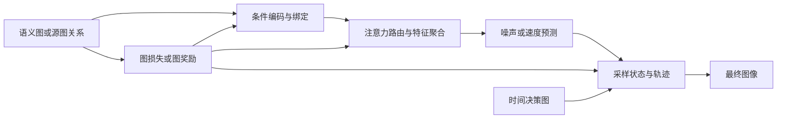

# 图论视角的扩散与流模型：图像生成、图像编辑及预训练模型优化

日期与本轮检索截止：2026-10-21。

后续专题：[DiT token 优化：编辑质量、推理加速、重要性与锚点](DiT_token优化_编辑质量与推理加速_图关系几何概率流_文献调研与总结_2026-10-21.md)。按用户后续确认，该专题只调研和总结已有方法及其图论／几何／概率流含义，不设计新方案；本文原有候选推导保留为历史分析，不因后续调研而获得实验验证。

承接[编辑耦合的跨学科数学框架](编辑耦合的跨学科数学框架_条件交互几何控制图输运与路径优化_2026-10-14.md)第 6 节“图论与谱”、第 8 节“后续传播”及第 9 节“路径优化”，并结合[DiT 注意力关系报告](不完整描述编辑_条件耦合与DiT注意力关系约束_理论调研_2026-10-14.md)。

**本报告的结论：图论已经用于语义条件编码、注意力上的连续优化、图割合成、概念传播、计算剪枝、时间调度和训练数据／奖励设计；这些机制优化的对象不同。目前核对的文献，没有直接验证“仅源图和不完整源／目标描述、无额外 LLM、无训练、无反演、无任何空间／注意力区域掩码”的完整 FlowEdit 图关系控制方案。** 这里的“没有直接验证”是本轮证据范围，不是不存在相关方法的证明。

本轮完成文献与数学分析，未下载模型权重、未运行新的图像实验。文献中的结果是作者报告，不能视为本项目复现。下文标明“统一写法”“本文推导”“可迁移设想”的公式均不冒充原论文算法。

## 0. 阅读路线与证据边界

若重点是原项目，优先阅读：第 4.1 节 LOCATEdit → 第 5.2 节 Generative Photomontage → 第 6.4 节 MeanCache → 第 8–10 节方法比较与 FlowEdit 迁移。若重点是场景图生成，阅读第 2–3 节；若允许训练，阅读第 7 节。

检索采用 scene graph、graph Laplacian、graph cut、random walk、PageRank、shortest path 与 diffusion／flow matching／image editing 等交叉关键词，并沿论文相关工作追溯。主要依据 arXiv 作者全文、CVF／AAAI／PMLR 论文、作者项目与官方代码；聚合网页仅作发现入口，不作为技术结论依据。2026 年的预印本不因时间较新而自动获得较高证据等级。

| 证据标记 | 含义 | 本文如何使用 |
|---|---|---|
| 全文 | 已核对方法正文或作者全文 | 可以分析变量、目标、求解与模型接口 |
| 全文＋代码说明 | 另核对官方仓库／项目中的训练与使用说明 | 可补充权重冻结、输入条件和复现边界；不表示已执行代码 |
| 局部正文／摘要 | 只能获取出版社摘要或检索可见正文片段 | 只归纳其中明确内容，不补造公式与实现 |
| 未完成证据 | 原文仍有实验待补等表述 | 仅作为方案线索，不当成已验证的性能结论 |

注意两个名称问题：SGDiff 在本报告中特指 Yang 等人的 **Diffusion-Based Scene Graph to Image Generation with Masked Contrastive Pre-Training**，不是 AAAI 2025 同名的分割／描述方法；SG-Adapter 的 2024 预印本与 ICCV 2025 的 **Scene Graph Guided Generation: Enable Accurate Relations Generation in Text-to-Image Models via Textural Rectification** 是同一工作谱系，不重复计数。[SGDiff 官方代码](https://github.com/YangLing0818/SGDiff)、[SG-Adapter 预印本](https://arxiv.org/abs/2405.15321)、[ICCV 正式记录](https://ieeexplore.ieee.org/abstract/document/11445652)。

## 1. 首先分清：图到底在哪里，优化到底改了什么

### 1.1 六种图不是同一个数学对象

| 图对象 | 节点 | 边 | 典型操作 | 代表工作 |
|---|---|---|---|---|
| 场景语义图 | 对象、属性，有时把关系也作为节点 | 主体—谓词—客体、属性归属 | 消息传递、三元组编码、图编辑 | SGDiff、R3CD、SG-Adapter、DisCo |
| 语言依存／组合图 | 词、短语、实体、修饰语 | 语法依赖、属性绑定 | 子结构编码、正负关系约束 | StructureDiffusion、SynGen、CoBind |
| 图像 patch／注意力图 | 图像 token／patch | 自注意力、特征相似度 | 拉普拉斯平滑、随机游走、中心性 | LOCATEdit、AT-EDM |
| 空间标签图 | 图像／特征位置 | 邻域及拼接边界代价 | 最大流最小割、多标签图割 | Generative Photomontage |
| 概念语义图 | 词表／上下文中的概念嵌入 | 语义相似或关联 | 多跳邻域、热核传播、目标簇选择 | GrOCE |
| 时间／决策图 | 采样时刻、缓存状态、候选动作 | 跳步、复用、计算选项 | 动态规划、预算最短路径、minimax | ShortDF、LeMiCa、MeanCache、CoTj |

另有图作为**训练样本和奖励的组织结构**：CompGen 对图复杂度采样；CAST 把图的节点、属性和边转成可验证事实。它们不要求把生成网络本身改成 GNN。

这里至少存在三种“扩散”：生成模型的加噪／去噪，图上热扩散，以及一般的消息传播。三者可以组合，但名称相同不表示方程相同。类似地，图割中的最大流是组合优化；RF／flow matching 中的流是连续生成动力学；GFlowNet 中的 flow conservation 又是另一套对象。

### 1.2 “优化预训练模型”至少有五种含义

令预训练去噪器为 \(\epsilon_\theta(z_t,t,c)\)，流模型为 \(v_\theta(z_t,t,c)\)。

| 优化接口 | 变量 | 是否更新生成主干权重 | 实际改变 |
|---|---|---|---|
| 图条件适配 | 图编码器／adapter 参数 \(\eta\) | 可以冻结 \(\theta\) | 把结构化条件映射到模型能接收的表示 |
| 模型训练／微调 | \(\theta\)、LoRA 或其它参数 | 是，或通过 LoRA 改变有效模型 | 学会新的关系、任务或采样行为 |
| 推理状态优化 | \(z_t\)、干净状态 \(y\) | 否 | 选择更满足图约束的生成轨迹 |
| 激活／条件干预 | 文本嵌入、Q/K/V、注意力、标签 | 否 | 改变信息路由、内容聚合或区域复用 |
| 计算图与调度优化 | token 集合、跳步／缓存计划 | 否 | 用较少计算近似原模型输出 |

因此，**主干冻结不等于方法零训练；零训练不等于无推理优化；用户不画 mask 不等于方法内部不用 mask。** 本文的兼容性分析始终针对完整流程，而非只看标题中的 training-free。

### 1.3 一个统一的因果链条，但不是因果识别结论

同一个图条件可在多个接口起作用。判断贡献时应沿这条计算链指出：图结构在哪一步进入，梯度／离散决策回到哪里，以及输出依赖哪些额外模型。图中箭头仅表示算法依赖，不表示已经识别真实世界的因果关系。

## 2. 图作为生成条件：学习对象、属性与关系的绑定

### 2.1 SGDiff：先学习图—图像表示，再训练图条件 LDM

来源与证据：Yang 等，[作者论文](https://arxiv.org/abs/2211.11138)，2022 首发；[官方代码](https://github.com/YangLing0818/SGDiff)。已核对全文与训练说明。

SGDiff 把对象作为节点、谓词作为有向边，以图卷积更新节点和边表示。其关键不是对已有注意力做图平滑，而是学习能预测图像的图嵌入：局部的 masked autoencoding 重建被遮挡的图像区域；全局的 contrastive learning 区分匹配与不匹配的图—图像对。

所得条件再进入 LDM，论文比较了与时间嵌入拼接、通过 cross-attention 注入等方式。官方使用说明明确要求扩散训练阶段，不能拿原始 SD 检查点跳过训练直接获得 SGDiff。

**优化分析。** 图的归纳偏置在“表示与条件学习”，优化变量包括图编码网络以及所训练的图条件去噪模型；复用预训练自编码器不等于整个去噪主干冻结。修改节点／边后能得到不同生成结果，说明条件可控，不自动说明真实源图的身份、背景和姿态保持。对本项目可借鉴关系表征和图—图像对齐的评估思路，完整方法不符合零训练范围。

### 2.2 R3CD：图 Transformer 加关系对比控制，关注非空间交互

来源与证据：Jinxiu Liu、Qi Liu，**R3CD: Scene Graph to Image Generation with Relation-aware Compositional Contrastive Control Diffusion**，AAAI 2024；[作者全文](https://brandon-liu-jx.github.io/assets/R3CD.pdf)。

R3CD 用 T5 初始化实体和关系，以 SGFormer 在节点—边邻接上计算注意力并更新表示。它同时考虑局部邻接与更全局的关系上下文，而非只把图压成一个布局框。

其关系控制利用对比目标：相同关系、不同对象的注意力作为正样本；对象接近而关系不同的注意力作为负样本；另对去噪预测进行关系层面的对比学习。三元组级组合生成用于缓解对象遗漏。

**优化分析。** 图结构参与可训练条件编码与扩散学习，关系标注还决定训练正负对。重点是“骑、吃、握手”等不能由框的相对位置充分确定的关系；不能把“两个节点相连”简化为“视觉特征越相似越好”。其完整方法需要训练，且生成关系正确不等于编辑源实例保持。原项目最值得借鉴的是：保持损失应避免把必要交互变化当作关系漂移。

### 2.3 SG-Adapter：用 token—三元组连接修正文本嵌入

来源与证据：[2024 作者全文](https://arxiv.org/html/2405.15321)，[ICCV 2025 正式记录](https://ieeexplore.ieee.org/abstract/document/11445652)。以下机制以已阅读的预印本为准。

论文针对 CLIP 序列上下文化引起的关系／属性泄漏：例如后面的 woman token 可能带入前面 man 的“holds a cake”。它独立编码 \((s_k,r_k,o_k)\) 并组成三元组表示，使原文本 token 只连接所属三元组。

适配层的接口可以写为：

$$
c'=f_\eta(c,E_G,M_G),\qquad
\min_\eta\;\mathbb E\|\epsilon-\epsilon_\theta(z_t,t,c')\|_2^2.
$$

这里 \(M_G\) 是 **token—三元组的语义连接限制**，不同于图像编辑区域 mask；但它仍是一个注意力连接 mask。图嵌入给 K/V，原文本嵌入给 Q。主干不必更新，adapter 需要训练。

论文还测试过直接替换预训练 CLIP 的 causal attention mask，观察到分布不匹配问题。因此“图结构合理”不意味着可直接改任意预训练注意力拓扑。对本项目，它支持“错误耦合可以来自条件编码”的判断，但不提供源图中未提及姿态的观测，也不能作为零训练方案。

### 2.4 SGG-IG：把图表示对齐推进到去噪过程内部

来源与证据：Fuyun Wang 等，**Scene Graph-Grounded Image Generation**，AAAI 2025；[官方论文](https://ojs.aaai.org/index.php/AAAI/article/download/32823/34978)。核对官方正文可见部分，包括框架、表示学习和损失说明。

SGG-IG 使用关系嵌入学习和图节点的 masked reconstruction，强化全局图表示；再通过图—图像对比约束，以及去噪中的 image-scene alignment，减少图语义与视觉潜表示之间的偏离。

**优化分析。** 它把图论价值放在结构化监督与跨空间对齐，不以一个确定的中间框布局承载全部交互。论文有预训练与微调两个阶段，不能归为冻结模型上的直接推理控制。它进一步提醒：最终 noise prediction loss 较低，并不能保证结构化条件被准确使用；需要独立关系观测。但图语义对齐仍不提供对某一源实例的硬保持。

### 2.5 DisCo：图的布局与交互语义分支，加对象级注意力限制

来源与证据：**Scene Graph Disentanglement and Composition for Generalizable Complex Image Generation**，2024 预印本；[全文](https://arxiv.org/html/2410.00447)。

DisCo 通过 triplet-GCN 的 SL-VAE，从同一图采样多个合理的布局与交互语义。布局不是推理时必须手工提供的唯一答案；对象语义还包含非空间交互。随后以 Compositional Masked Attention 将对象条件注入扩散网络，限制对象条件与视觉 token 的连接，缓解属性串扰。

Multi-Layered Sampler 把对象视为图层，通过布局转换出的非重叠 mask 组合局部去噪结果，支持节点增加、属性修改等操作。其训练包括扩散、KL 与布局重建损失。

**优化分析。** 图先控制“生成条件的可行联合分布”，再控制“哪些视觉 token 接收哪个对象条件”。冻结 CLIP 与不手画布局都不意味着零训练或无内部 mask。其价值在于避免将复杂交互全部等同于几何布局；其代价是增加可训练模块和对象级空间划分。完整冻结图像关系会阻碍这类必要对象变化，原项目必须区分任务允许的边与应保持的边。

### 2.6 LAION-SG／SDXL-SG：用结构化数据和 GNN 条件补足关系学习

来源与证据：[2024 作者全文](https://arxiv.org/html/2412.08580)、[官方实现](https://github.com/mengcye/LAION-SG)。

LAION-SG 是结构标注数据工作，同时给出 SDXL-SG 基线。CLIP 初始化三元组和独立对象；GNN 更新对象、属性及关系表示，再以可学习缩放与原三元组表示融合，送入 SDXL。关键接口是：

$$
E_G=\operatorname{concat}(e_{triplet}+\alpha e_{GNN},e_{single}),
$$

其中 \(\alpha\) 从零初始化，以便逐渐引入图条件。独立对象表示值得注意：只编码关系三元组可能遗漏没有连边的对象。

**优化分析。** 主要通过训练图编码器和结构标注条件提高生成组合性，不是每幅测试图上求拉普拉斯近端解。数据中的关系真实性、覆盖度与标注错误都影响收益。其图编辑示例不能代替严格真实图编辑基准；尤其不能把 graph-conditioned 再生成直接等同于源实例保持。

### 2.7 LAION-Comp 的 FLUX-SG／SD3.5-SG：直接覆盖流模型，但仍有训练阶段

来源与证据：**LAION-Comp: Unlocking Controllable and Compositional Generation with Structural Annotations**；[OpenReview 作者稿](https://openreview.net/pdf?id=PFhrOUJZ5o)。本轮获取到索引中的方法与附录正文片段，完整页面受访问验证限制；以下只采用明确可见内容，不断言当前正式录用状态。

可见正文把场景图编码扩展到 diffusion 与 flow matching 基干，附录明确包括 FLUX-SG、SD3.5-SG，给出编码器维度、训练硬件与训练设置。另有基于 RF inversion 的图编辑流程。

**优化分析。** 这是“图条件可以训练到预训练流模型上”的直接证据：把图映射为条件，学习其与速度预测所需表征的接口；流模型应使用与实际参数化匹配的训练目标，而不能机械照抄所有 DDPM 的噪声公式。测试时编辑可无需额外微调，但其所依赖的图条件模型先前已训练，真实图流程还涉及 RF 反演。因此不能从“training-free editing”推出“原始 FLUX 权重＋任意图可以零训练无反演编辑”。

LAION-SG 与 LAION-Comp 有显著作者／研究主题延续，本文把它们分清为已核对的两个版本来源，不假定二者数据、实现或所有实验完全相同。

### 2.8 SGCond：图转 ControlNet 空间条件，或图 token 接入门控注意力

来源与证据：Frank Fundel，**Scene Graph Conditioning in Latent Diffusion**，2023 预印本；[作者全文](https://arxiv.org/html/2310.10338)、[官方代码](https://github.com/FrankFundel/SGCond)。

论文比较两条接口：CLIP／GCN 编码后预测场景布局，接入 ControlNet；或直接由图嵌入接入 Gated Self-Attention。原扩散层冻结，图编码／解码和新增控制模块承担学习。官方仓库明确区分 semantic map 的 ControlNet 路线与 bounding box 的 GLIGEN 路线。

**优化分析。** 图消息传递负责条件组织，预训练控制接口负责把条件映射到图像。这是“尽量保留已有生成能力、学习图到控制接口”的早期直接先例。应分别检查论文设想、实际训练及仓库已经提供的路线；不能把论文所有变体均视为成熟、等量验证的实现。完整方法含图条件训练和几何控制，也不提供对真实源图的无反演身份保持。

### 2.9 DiffuseSG：先生成 grounded graph，再由条件生成器成像

来源与证据：Bicheng Xu 等，**Joint Generative Modeling of Grounded Scene Graphs and Images via Diffusion Models**，2024 首发、TMLR 2025；[更新全文](https://arxiv.org/html/2401.01130)、[官方代码](https://github.com/ubc-vision/DiffuseSG)。

将联合分布分为 \(p(G,I)=p(G)p(I\mid G)\)。前项用 graph Transformer 去噪对象类别、框和有向关系；后项可用 LayoutDiffusion。更新版本还给出 Relation-ControlNet：把对象和关系位置写入不同控制通道，并用关系文本增强条件生成。

**优化分析。** 主要创新是学习合理图先验；把预训练／已有图像生成器用作后端，与直接优化图像去噪网络不是同一贡献。Relation-ControlNet 则属于需训练的关系控制分支。重要边界是：若只把图投成对象框并丢掉边，最终图像生成阶段并没有充分使用“谁与谁是什么关系”；完整框布局并不等价于完整语义图。

本报告因此保留这类有明确成像后端的图生成工作，但不泛收 DiGress、GDSS 等一般图／分子生成论文。它们生成图这一事实，本身不回答如何改进预训练图像扩散或流模型。

## 3. 图作为推理时生成约束：冻结模型，改变条件或采样状态

### 3.1 StructureDiffusion：组合树／场景图指导多个 Value 的聚合

来源与证据：Feng 等，**Training-Free Structured Diffusion Guidance for Compositional Text-to-Image Synthesis**，ICLR 2023；[论文](https://arxiv.org/abs/2212.05032)、[官方代码](https://github.com/weixi-feng/Structured-Diffusion-Guidance)。

方法用句法树或场景图提取多个短语，分别用冻结文本编码器编码，再对齐到原句 token 位置。保留整句的 Key／注意力用于空间关联，聚合多套短语 Value。主形式可表达为：

$$
A=\operatorname{softmax}(QK_{full}^{\top}/\sqrt d),\qquad
O=\frac1{K+1}\sum_{k=0}^{K}AV_k.
$$

**优化对象。** 没有训练新模型，也不必对潜变量求梯度；图结构改变条件分解与内容聚合，降低全句嵌入中不同对象的属性混合。它是一种结构化语言引导，不是图拉普拉斯算法。

**边界。** 它改善生成组合性，不使用源图建立保持量；如果原 attention 已经漏掉对象，仅改 Value 未必能修复布局。对 MM-DiT 不能直接套 U-Net 的独立 cross-attention 接口，应重新核对联合注意力中的图文竞争与图像子块。

### 3.2 SynGen：把词语依赖关系变成带正负边的注意力损失

来源与证据：Rassin 等，**Linguistic Binding in Diffusion Models: Enhancing Attribute Correspondence through Attention Map Alignment**，2023；[全文](https://arxiv.org/abs/2306.08877)。

SynGen 从依存句法中获取名词和修饰语集合：所属关系应有较重叠的空间响应，不相关词语应分离。令 \(p_i\) 为按空间归一化的 token 注意力，论文使用对称 KL 度量。其关系目标可以归纳为：

$$
E=\sum_{(i,j)\in E_+}d_{sKL}(p_i,p_j)
-\sum_{(i,k)\in E_-}\omega_{ik}d_{sKL}(p_i,p_k),
\qquad z_t\leftarrow z_t-\eta_t\nabla_{z_t}E.
$$

这是对原损失结构的统一记法，权重归一化仍以论文定义为准。模型权重冻结，优化的是 noisy latent；全文的默认方案在前 25／50 步进行干预。

**图论分析。** 可视为语言关系图上的吸引／排斥边能量。这种解释是本文的数学归纳，论文核心表述是语法绑定。它不同于所有边都平滑：实体“红色”与“球”需要绑定，两只不同对象不应被同一属性覆盖。负边也意味着目标通常不是凸的正半定拉普拉斯二次型。它没有源实例保持通道，关系代理优化成功仍需图像验证。

### 3.3 SceneGenie：图先预测空间条件，再对预训练模型做梯度引导

来源与证据：Farshad 等，ICCV 2023 Workshop；[正式全文](https://openaccess.thecvf.com/content/ICCV2023W/SG2RL/papers/Farshad_SceneGenie_Scene_Graph_Guided_Diffusion_Models_for_Image_Synthesis_ICCVW_2023_paper.pdf)。

图节点由 CLIP 丰富语义，SG2SEG 预测框与分割布局。采样时结合整体文本、对象框内 CLIP 以及分割等引导，向正确数量、位置和外观推进。图的关系通过布局预测和对象级损失间接进入去噪。

**优化分析。** 扩散采样阶段可以冻结生成模型，通过图像／潜变量梯度改轨迹；但 SG2SEG 有训练目标，包括框、mask 和布局损失。因而“采样不重训扩散模型”不能扩展成“整套系统不需要训练或空间条件”。它为将图能量加到采样器提供先例，但对本项目而言，布局／分割作为中间控制已经超出严格无区域条件的范围。

### 3.4 TopoDiff：用关系图描述相对空间，证据限于可获取摘要

来源与证据：Cao 等，**TopoDiff: Training-free image generation with topological layout control**，Expert Systems with Applications 291，2025，128556；[出版社](https://www.sciencedirect.com/science/article/abs/pii/S095741742502175X)。

摘要明确使用 graph-based topological prompt language 表达 above／below／beside 等关系，并在推理时对 cross-attention 和中间特征施加拓扑损失，不改 Stable Diffusion 的架构和参数。

**优化分析。** 图提供相对关系约束，避免必须先指定每个对象的绝对框坐标；作用对象是推理过程，而非权重。这里的“拓扑”按摘要所述指空间关系约束，不能无依据升级为持久同调、Betti 数控制或一般拓扑保证。本轮未获取完整求解细节，不补写其精确损失、步长和复杂度；它也没有由摘要证明真实源图保持。

### 3.5 CoBind：组合图＋分阶段潜变量优化，但实验结论尚不充分

来源与证据：**CoBind: Stage-Aware Compositional Binding for Training-Free Text-to-Image Generation**，2026-07-14 预印本；[作者全文](https://arxiv.org/html/2607.16307)。

方案构造实体—属性—关系图：早期处理对象完整性与空间关系，中期以实体空间支持绑定属性，晚期弱化结构引导；根据当前约束满足程度调节 latent 梯度。

**优化分析。** 图将一个全局文本匹配目标分成按类型、时刻激活的局部约束；生成主干冻结。内部实体支持和局部约束仍应审查是否构成原项目禁止的注意力区域控制。

**证据特别说明。** 当前可读稿在贡献和结果部分仍有“实验完成后补充精确提升”等待补表述，不能依据摘要把它作为已充分验证的多模型性能成果。本文仅纳入其机制线索，不报告确定数值，也不以其新颖性宣称替代正式比较。

### 3.6 GR-Diffusion：找到直接图—注意力对齐线索，暂不作强结论

**Graph-Guided Relational-Aware Diffusion via Attention Alignment** 出现在 [CVPR 2026 会议日程](https://media.eventhosts.cc/Conferences/CVPR2026/CVPR_main_conf_2026_15.pdf)及 [OpenReview 条目](https://openreview.net/forum?id=RuO14bluJc)。本轮未成功获取可核对的作者正文。

因此不将二手页面中的节点对齐、边强化、外积 mask、性能数字写成已核实算法。它是后续补读的重要条目；仅凭“名字含 graph”和会议日程，不能判定其冻结范围、输入框／mask 依赖或对 FlowEdit 的兼容性。

## 4. 图用于真实图像编辑：定位、规划与注意力正则

### 4.1 LOCATEdit：图拉普拉斯优化的是词对应的显著图，最终形成编辑 mask

来源与证据：Soni 等，ICCV 2025；[全文](https://arxiv.org/html/2503.21541)、[作者项目](https://locatedit.github.io/)、[官方代码入口](https://github.com/LOCATEdit/LOCATEdit)。这是与原报告第 6 节最直接的图拉普拉斯先例。

**构图。** 节点是图像 patch，节点信号是编辑词对应的 cross-attention 响应 \(m_0\)；边是 self-attention 的对称化：

$$
W=\frac{S+S^\top}{2},\qquad D_{ii}=\sum_jW_{ij},\qquad L=D-W.
$$

原始显著图还给出对角置信矩阵 \(\Lambda\)。源／目标两分支分别优化：

$$
m^*=\arg\min_m\;(m-m_0)^\top\Lambda(m-m_0)+\lambda m^\top Lm
=(\Lambda+\lambda L)^{-1}\Lambda m_0.
$$

此处复述论文核心优化，\(\Lambda\) 来自显著响应的 sigmoid 及平方。正的置信权重使二次问题严格凸；它不是只解无锚定的 \(m^\top Lm\)。

**怎样影响预训练模型。** 源／目标细化图逐元素取最大并阈值化为 \(M\)，然后混合两分支潜变量：

$$
\widehat z_{t-1}^{a}=M\odot z_{t-1}^{a}+(1-M)\odot z_{t-1}^{s}.
$$

完整流程还包括源 cross-attention 注入、预训练 IP-Adapter 的图像条件，以及文本嵌入差的选择性剪枝。图优化本身不训练生成主干。

**图论究竟解决什么。** 强 self-attention 边连接的 patch 应有协调的编辑显著度；置信项保留高可靠响应，图项抑制孤立噪声。改进的关键通路是“编辑定位更准确 → mask 混合更准确 → 非编辑区域更少漂移”，不是证明语义和身份已经解耦。

**本文进一步分析。** 当 \(\Lambda=I\)，设 \(L=U\operatorname{diag}(\lambda_i)U^\top\)，该解为图滤波：

$$
m^*=U\operatorname{diag}\!\left(\frac1{1+\lambda\lambda_i}\right)U^\top m_0.
$$

它衰减图高频，保留常数分量；若图误连主体和背景，也可能把响应扩散过去。锚定和图质量都是收益的前提。“闭式解”意味着无需梯度迭代优化显著图，不意味着大图求逆免费，实际应解线性系统而非显式求逆。

**对原项目的边界。** 它直接违反“无内部编辑区域 mask”；额外 IP-Adapter 也不是当前原始 SD3／FLUX 的既有通道。可以借鉴由源特征构图、置信加权和正定近端结构，但如果改成在干净 \(y\) 上约束关系，则是新的迁移设计，不能声称已由 LOCATEdit 验证。

### 4.2 SGC-Net：图关系解决“究竟编辑哪一个同类对象”

来源与证据：Zhongping Zhang 等，**Complex Scene Image Editing by Scene Graph Comprehension**，BMVC 2023；[作者论文](https://arxiv.org/abs/2203.12849)、[BMVC 全文](https://bmvc2022.mpi-inf.mpg.de/BMVC2023/0451.pdf)、[代码](https://github.com/Zhongping-Zhang/SGC_Net)。arXiv 编号始于 2022，本文按 2023 公开方法版本讨论。

第一阶段利用场景图与关系预测 RoI；例如多只鸟中，依靠“位于某物上方／旁边”识别目标，而非仅依靠 bird 类别。第二阶段把预测位置及图像提示交给条件扩散编辑器。

**优化分析。** 图主要用于关系条件下的定位与控制输入，训练的不只有解析器；论文对 Stable Diffusion 的区域编辑任务进行适配，以图像提示辅助重建。自动预测 RoI 降低用户交互，不消除空间控制。对不完整描述，关系确实能消除对象指代歧义；但如果关系也未被文字或解析器观测，就不能保证选对实例。完整方法不属于无训练、无区域约束的源图编辑。

### 4.3 SGEdit：图编辑界面，LLM 规划，按源图学习对象概念

来源与证据：Zhiyuan Zhang 等，TOG／SIGGRAPH Asia 2024；[作者全文](https://arxiv.org/html/2410.11815)、[项目](https://bestzzhang.github.io/SGEdit/)。

SGEdit 用 LLM 驱动的场景解析得到对象、关系、描述及 mask；通过详细描述、Textual Inversion 和扩散概念学习表示源对象。编辑图后，由 LLM 控制器决定对象移除、插入及其布局，再用 attention modulation 实施。

**优化分析。** 图负责离散编辑语义和操作规划；对象身份由实例概念学习与源特征复用承载，不是由图拓扑独立决定。移除中屏蔽被删区域的 K/V 影响，插入中引导目标区域注意力；真实图流程还使用 DDIM inversion。因而其代价来自额外解析模型、实例适配、反演和空间控制。

**可借鉴处。** “改变一条关系”有时必须被展开成移除原对象、选择新位置并重新插入，而非只替换一个文字 token。这揭示必要编辑耦合的真实复杂度。对本项目而言，不能将图界面的局部性当作底层算法已经无需 mask 或训练的证据。

### 4.4 VENUS：对源／目标图取交集与差集，拆分保持和编辑提示

来源与证据：Vo 等，2026-01-12 预印本；[全文](https://arxiv.org/html/2601.07219)。

MLLM 从源图得到 \(G\)，再按编辑指令得到 \(G'\)。三元组层面计算：

$$
R_{keep}=R(G)\cap R(G'),\qquad R_{new}=R(G')\setminus R(G).
$$

把共享关系串成源提示，将新关系优先置于目标提示，再带入 LEDITS++ 的反演与编辑流程；生成模型无需测试时微调。

**图论分析。** 这里的图操作是边／三元组集合的差分和结构化序列化，不是 GNN 学习，也不是 Laplacian 求解。图提供“哪些关系改变、哪些仍成立”的显式组织，使源提示不再必须逐字复述所有内容。

**限制。** 需要 Qwen-VL 等外部 MLLM，使用 noise inversion；完整编辑机制还应沿 LEDITS++ 的定位配置审查，不能凭其未手画区域就称无内部 mask。关系交集需要稳定对象 ID 与等价谓词，换一种表述不能直接按字符串判断关系消失；解析漏掉的源细节也不会出现在交集中。作者的背景／语义结果不能推出其适用严格 FlowEdit 设定。

### 4.5 全景场景图＋互斥注意力：利用节点对应区域的不重叠性

来源与证据：He 等，**Panoptic Scene Graph Grounded Training-Free Image Editing With Mutually Exclusive Attention Manipulation**，IET Computer Vision，2026；[出版社正文入口](https://ietresearch.onlinelibrary.wiley.com/doi/10.1049/cvi2.70069)。本轮核对可检索到的正文局部，未完整审计实现。

文章明确预测场景图节点的 mask，并把对象互斥性转移到注意力层，组织前景／背景及重建分支；真实图先反演。它用已有生成能力和注意力操作替代重新训练布局预测器。

**优化分析。** 约束的核心是对象区域的互斥与分配，防止多个实体的语义响应互相侵占。扩散权重可冻结，仍然依赖图解析、空间分区与反演。该先例适合论证“互斥性可以控制串扰”，不适合论证“源图关系在无区域条件下已经可识别”。不将全景分割节点的不重叠，扩大为真实对象、反射、透明物体或遮挡层在图像形成中总是互斥。

### 4.6 SimGraph：统一图界面，不等于统一扩散生成机制

来源与证据：**SimGraph: A Unified Framework for Scene Graph-Based Image Generation and Editing**，2026-01 预印本；[全文](https://arxiv.org/html/2601.21498)。

该稿以 MLLM 提取图，按面积显著性排序三元组，处理冗余关系；生成分支使用 Visual AutoRegressive 模型，编辑分支以图交／差构造提示并调用扩散编辑。图集合操作与 VENUS 接近，应并列比较，不将每种图界面都当作新的图数值算子。

**优化分析与文稿边界。** 生成分支是自回归 token 生成，不应统计为扩散生成；编辑算法写有反演和源／目标条件组合。稿件的统一 loss 段还描述扩散目标优化，故不能仅凭使用既有编辑器就把所有分支定为严格零训练。它支持图序列化作为通用接口，但并未证明图拓扑直接约束了 diffusion／RF 向量场。

## 5. 图割、热核与语义传播：与拉普拉斯平滑不同的用法

### 5.1 为什么离散图割和连续图平滑要分开

连续图正则通常优化每个节点上的实值信号，如 LOCATEdit 的 \(m\)。离散图割优化每个空间位置属于哪个来源／对象的标签 \(\ell_p\)。二者可以共享图邻接，却不应把“解线性系统”和“做最小割”混写。

### 5.2 Generative Photomontage：在扩散特征中做多标签图割，再注入 Q/K/V

来源与证据：Sean J. Liu 等，CVPR 2025；[作者全文](https://arxiv.org/html/2408.07116)、[实验室论文入口](https://www.cs.cmu.edu/~generative-intelligence-lab/publication/)。

输入是一组由相同 ControlNet 条件生成、不同种子的图像，用户用笔画选择希望保留的部分。节点是 self-attention Key 特征的空间位置，标签是选择哪一张图作为该位置来源；邻边惩罚不自然的拼接边界。

其图优化有经典的 unary／pairwise 结构：

$$
E(\ell)=\sum_p D_p(\ell_p)+\sum_{(p,q)}V_{pq}(\ell_p,\ell_q).
$$

Unary 强制满足用户选择，pairwise 利用 Key 特征的 PCA 表示，在各图的特征边界处降低切割代价。二标签可用最大流最小割，多标签用 \(\alpha\)-expansion；后者一般不能无条件称为任意多标签能量的精确全局最优。

**怎样优化预训练模型输出。** 图割给出空间标签，再按标签拼接缓存的 Q/K/V，在完整去噪过程中注入。基底图对应区域允许使用当前生成的 Q，以便边界继续协调；这不是把最终 RGB 做硬拼接。模型权重不需为每次合成训练。

**对编辑耦合的意义。** 离散“选择内容来源”与连续“协调成像”分两层求解；硬标签不能单独解决阴影、边缘和细节过渡。该方法需要多图候选、结构条件、用户笔画和区域标签，与原项目输入限制不兼容。可借鉴特征级缝合与必要自由度保留，不能直接照搬完整流程。

### 5.3 GrOCE：图最短距离和热核定位概念簇，再重写条件

来源与证据：Han 等，2025 首发、2026-04 的 v2；[作者全文](https://arxiv.org/html/2511.12968)、[CVPR 2026 正式论文](https://openaccess.thecvf.com/content/CVPR2026/papers/Han_GrOCE__Graph-Guided_Online_Concept_Erasure_for_Text-to-Image_Diffusion_Models_CVPR_2026_paper.pdf)。具体机制以下述已阅读 v2 为准。

构建概念相似图，在目标节点 \(c\) 的有限 hop 邻域上计算图扩散：

$$
s=\exp(-\tau L_{sub})e_c.
$$

依据传播得分选择相关概念簇，再用图距离衰减的语义投影贡献决定提示词的保留。**v2 正文的 Eq. 8–9 明确包含按聚合投影范数阈值删除 token、再编码提示的操作**；不能把它统一转述为“始终只对连续文本向量做正交投影”。

**优化分析。** 图处理条件空间中间接关联的概念，避免只删除目标词却留下同义／下位概念；权重冻结，图处理与条件重写在采样前完成。它研究的是生成概念抑制，属于预训练生成条件的控制，不是某张源图上的对象擦除编辑。

**数学审查。** 有限图上的热核传播不同于生成模型的去噪；图热核定位是相关性工具，不能证明语义方向严格正交。另需核对图是否对称：局部阈值可能使边有向，经典对称归一化 Laplacian 的谱结论需要相应假设。本文不把论文的“graph cut”解释升级为其实施了通用 max-flow／min-cut。

### 5.4 冻结扩散模型的谱分割：是构图证据，不是编辑性能证据

[Unsupervised Segmentation by Diffusing, Walking and Cutting](https://arxiv.org/html/2412.04678)，2024 首发，将 self-attention 看作随机游走转移，利用多步传播及递归 Normalised Cuts 做无监督分割。它与作者讨论的 DiffCut 是不同工作，不能混名。

这类研究表明预训练特征／注意力确实能产生有用区域结构，支持原报告“从源图内部构图”的可行性。但它不修改生成任务去噪器以提高编辑保持，不能统计为图控制编辑已经成功。分割准确、attention 连通和任务兼容的身份保持仍是三个不同的实验命题。若把分割结果用于隔离编辑区域，就已经引入内部区域 mask。

## 6. 图论优化计算与采样路径：流模型已有直接先例

### 6.1 AT-EDM：注意力有向图上的广义加权 PageRank，决定保留哪些 token

来源与证据：Hongjie Wang 等，CVPR 2024；[作者论文](https://arxiv.org/abs/2405.05252)、[正式全文](https://openaccess.thecvf.com/content/CVPR2024/papers/Wang_Attention-Driven_Training-Free_Efficiency_Enhancement_of_Diffusion_Models_CVPR_2024_paper.pdf)、[项目](https://atedm.github.io/)。

AT-EDM 把 token 间 attention 转成有向图，用 Generalized Weighted Page Rank 对 token 排序，剪去冗余部分；在 U-Net 卷积需要完整空间格点时，按注意力相似性恢复 token；DSAP 随去噪时刻调整剪枝预算。

**优化分析。** 图中心性决定计算资源，生成模型权重不变。PageRank 思想不是只看一个 token 的局部响应，而是递归考虑与它关联节点的重要程度。它优化单次模型调用的成本，不直接选择更符合任务的更新方向。

论文报告 SDXL 上 38.8% FLOPs 节省与最高约 1.53 倍加速；这是作者设定下的效率结果，不是对 SD3／FLUX 的直接测量。保留中心节点不等于保留身份／编辑必要信息：少见小物体或低响应细节可能很重要。迁移至 FlowEdit 还必须检查源／目标分支的剪枝对应性，避免两支近似误差不匹配而污染速度差。

### 6.2 ShortDF：把最短路径松弛写进训练目标，更新去噪器

来源与证据：Chen 等，**Optimizing for the Shortest Path in Denoising Diffusion Model**，CVPR 2025；[全文](https://arxiv.org/html/2503.03265)。

ShortDF 用时间步构建 step-reverse graph，将恢复误差写成可比较的距离与边代价。训练中随机取 \(k<t\)，若经 \(k\) 的误差代理优于直接在 \(t\) 重建，则利用类似最短路径 relaxation 的损失优化当前模型；主模型、EMA 模型与延迟更新的 graph 模型分别承担预测、稳定目标与边权估计。

其训练结构可以概括为：

$$
\mathcal L=\lambda\mathcal L_{noise}
 +\mathbf1_{relax}\,\mathcal L_{relax},\qquad \theta\leftarrow\theta-\eta\nabla_\theta\mathcal L.
$$

**关键区别。** 这是图论启发的模型学习，不是拿冻结 SD 在测试时跑 Dijkstra 选时间表。使用干净训练样本 \(x_0\) 比较重建误差，是其训练机制的一部分，不能把该参照替换成编辑中尚未知的目标图。图上的“optimal”属于所定义的误差代理及训练近似，不构成真实语义编辑的全局最优证明。

### 6.3 LeMiCa：全局输出误差做边权，字典序 minimax 控制最坏缓存段

来源与证据：Gao 等，2025 首发；[作者全文](https://arxiv.org/html/2511.00090)、[官方代码](https://github.com/UnicomAI/LeMiCa)。主要实验对象是视频，因此作为路径方法的相邻先例。

节点是去噪时刻，边 \((i,j)\) 表示某段复用缓存。边权通过“仅这一段用缓存”后的终点偏差评估，并在提示／种子上平均，形成可复用图。在给定完整计算次数下，比较路径中从大到小排列的误差向量，先压最低的最坏边，再比较次坏边。

**优化分析。** 它把原报告第 8 节强调的“早期小误差可能有更大后效”纳入边权，比仅比较相邻局部特征更接近终点风险；模型权重不训练，但离线图构建需要完整轨迹和重放成本。

**边界。** 对每个单独缓存段测得的终点影响，组合多个段后仍可能相互作用。字典序 minimax 的最优是对已给定图权重而言，不保证真实联合采样误差最小；其视频结论也不能直接证明图像编辑保持提升。

### 6.4 MeanCache：平均速度误差的多重有向图，预算约束最短路径

来源与证据：Gao 等，ICLR 2026；[作者全文](https://arxiv.org/html/2601.19961)、[官方代码与会议说明](https://github.com/UnicomAI/MeanCache)。这是预训练 flow matching 模型上直接使用图论的清楚案例。

**连续近似部分。** 用历史状态和速度构造区间平均速度的 JVP 近似，修正只复用瞬时速度引起的偏差。这是缓存差分近似，不要求每步通过自动微分显式计算完整 Jacobian。

**图部分。** 节点为采样时刻；边 \((t,s,K)\) 为以缓存跨度 \(K\) 从 \(t\) 到 \(s\) 的选择。不同 \(K\) 可连接同一时刻对，因此是 multigraph。边代价是平均速度与缓存估计的差，求解：

$$
\pi^*=\arg\min_{\pi:T\to0}\sum_{e\in\pi}c(e)^\gamma,
\qquad |\pi|\leq B,\quad\gamma\geq1.
$$

动态规划在 NFE 预算下选择路径，幂代价减小单条大误差边主导的风险。

**优化分析。** 权重冻结，优化“何时真正算模型、何时依靠缓存及如何修正”，目标是加速同时接近原采样。论文实验包含 FLUX.1 和 Qwen-Image 图像生成，以及 HunyuanVideo；并非只有传统 DDPM 才能使用时间图。

**迁移边界。** 边权来自预计算稳定性估计，不等于已知每条编辑轨迹的真实误差。FlowEdit 中每步源查询重新加噪，且用源／目标预测之差，历史平滑性未必等同普通生成轨迹。必须重新测量差分速度误差；沿用文生图时间表并不能保证源实例保持。

### 6.5 OTCache：指出加性边权代理会失效，以终点搜索和 OT 插值补足

来源与证据：Gao 等，2026-06-30 预印本；[作者全文](https://arxiv.org/html/2606.31026)、[代码](https://github.com/UnicomAI/OTCache)。本文不另断言其会议状态。

先在保守预算下用图最短路径得到可靠参考调度；低 NFE 下用 Optuna／CMA-ES 等黑盒搜索，以完整原始输出的 LPIPS 为终点目标；把两端调度转为连续单调曲线，通过受 OT 启发的 quantile interpolation 预测中间预算的调度。

**优化分析。** 仍冻结生成权重，主要优化调度。图方法是其第一阶段，并非全部算法。它明确承认：独立估计边误差相加，可能无法描述强加速时前后决策的耦合。

**对原报告的价值。** “图最短路全局求解”与“真实编辑风险全局最小”不是一回事。该稿的完整采样输出用于保真加速参照，在其问题设定中合理；若把这一固定图像直接当自由终点编辑的优化目标，就改变了原项目的任务。应借鉴端到端校准边权的思想，而非偷偷固定编辑结果。

### 6.6 CoTj：内容相关的 DAG 调度，需要审查额外预测器训练

来源与证据：Ping Chen 等，**Chain-of-Trajectories: Unlocking the Intrinsic Generative Optimality of Diffusion Models via Graph-Theoretic Planning**，2026-03-16 预印本；[作者全文](https://arxiv.org/html/2603.14704)、[代码](https://github.com/UnicomAI/CoTj)。

CoTj 用随时间变化的单步重建难度曲线“Diffusion DNA”作为低维代理，根据跳跃大小和难度构建 DAG 代价，再以固定步预算或自适应长度规划调度。

**训练范围核对。** 虽然摘要称 train-free，正文第 3.4 节明确训练轻量 regressor，由条件嵌入预测 DNA；不重训 diffusion 主干，与不训练任何模块不同。若不用预测器而对每个输入实际测难度，也要计入额外采样／标定成本，且生成时真实干净终点未知。

**理论边界。** 论文关于理想轨迹、可修正性及 off-manifold penalty 的结论有其假设；不能据此声称任意冻结图像流的所有跳步成本都只由时间决定，更不能推出图论已经解决语义编辑自由终点。对本项目可借鉴内容相关预算和状态摘要，但应重新验证状态是否充分。

### 6.7 应排除的同名“最短路径”：SPD 主要是信息几何

[Image Generation with Shortest Path Diffusion](https://proceedings.mlr.press/v202/das23a.html)，ICML 2023，以概率分布上的 Fisher 度量设计前向损坏路径，涉及频域滤波和相应训练。它不同于 ShortDF，也不是“对预训练模型的离散时间图求最短路”。

可以把它放在原报告的几何章节作为背景；若按标题把它统计成零训练图算法，会同时混淆图论／几何、训练／推理与前向路径／编辑路径三个层次。

## 7. 图组织训练课程与奖励：直接改变预训练模型能力

### 7.1 CompGen：图复杂度采样，生成课程，再通过 GRPO 微调

来源与证据：Shijian Wang 等，**Synthetic Curriculum Reinforces Compositional Text-to-Image Generation**，CVPR 2026；[正式记录](https://openaccess.thecvf.com/content/CVPR2026/html/Wang_Synthetic_Curriculum_Reinforces_Compositional_Text-to-Image_Generation_CVPR_2026_paper.html)、[作者全文](https://arxiv.org/html/2511.18378)。

图的对象数、每对象属性密度和关系密度定义组合难度：

$$
D(G)=|O|\max\!\left(1,\frac{|A|}{|O|}\right)
\max\!\left(1,\frac{|R|}{|O|}\right).
$$

通过可逆的节点／关系增删与 MCMC，采样落在指定难度范围的图；由图生成文本及对象、属性、数量、关系问题，经 VLM 评估后，以课程式 GRPO 更新生成模型。

**优化分析。** 图作用于训练分布与奖励设计，去噪器不必新增图注意力层。主实验包括 SD1.5 和自回归模型，不能自行扩展为其已经验证 FLUX 或 FlowEdit。它说明“使用图论提高预训练模型”还可以通过数据难度控制，而非只在网络内加 GNN。

**限制。** 图计数／密度是难度代理，同样节点数可以有完全不同的视觉难度；MCMC 的有效采样还依赖提议与接受概率。VLM 奖励的结构化并不消除奖励误判。对原项目可借鉴按关系复杂度构建评测分层，完整训练流程不兼容零训练。

### 7.2 CAST：图转可验证事实，把逐事实优势分配到空间策略目标

来源与证据：Shu Yu、Chaochao Lu，2026-09-30 预印本；[作者全文](https://arxiv.org/html/2609.39441)、[官方项目](https://opencausalab.github.io/CAST/)、[代码](https://github.com/OpenCausaLab/CAST)。

CAST 先采样 Causal Scene Graph，得到存在性、属性、计数和关系事实。冻结 VLM 分别评价每个事实，并通过 teacher-forced attention 给出证据热图。组内逐事实优势与热图组合为带符号的 patch 权重：

$$
M_p=\operatorname{clip}\!\left(\sum_k\widehat A_k w_{k,p},-5,5\right).
$$

该空间权重作用于 SDE 窗口内的策略优化目标；再以相对原模型的 KL 限制偏离。窗口由模型中结构形成阶段的诊断决定。论文对 FLUX.2-dev、Qwen-Image-2512 进行 LoRA 微调。

**优化分析。** 图把全局标量奖励拆成结构化事实，注意力把“哪里出错”转为训练信用分配，最终更新生成模型的有效权重。其核心价值是结构化监督与空间策略优化，不是图拉普拉斯滤波；有外部 VLM、额外训练和空间热图。

**边界。** “Causal”是作者使用的建模名称；图中有向关系、受控采样和教师 attention 不自动识别真实因果作用。单个事实的正负优势也可能在同一 patch 抵消；MMDiT 的局部均值仍依赖整个图像状态。其结果目前按预印本作者报告处理，不作本项目验证结论。

## 8. 逐方法横向比较：是否真的优化了预训练模型，代价是什么

### 8.1 条件生成与编辑方法

表中的“冻结”只表示所述阶段的生成主干；“不直接满足”不表示方法无价值，而是完整输入／训练／状态接口与原报告不同。对未完整获取正文者保留不确定性。

| 方法 | 图知识的直接作用 | 主要优化变量／动作 | 生成主干与训练范围 | 额外输入或组件 | 对严格 FlowEdit 范围 |
|---|---|---|---|---|---|
| SGDiff | GCN、图—图像局部／全局对齐 | 图嵌入和图条件扩散训练 | 需训练图编码与扩散模型 | 图—图像训练数据 | 不直接满足 |
| SGCond | GCN、图到空间条件／图 token | ControlNet／门控控制层 | 原层可冻；控制分支需训练 | 布局、框或图嵌入 | 不直接满足 |
| DiffuseSG | 图先验、关系控制通道 | 图去噪器及条件成像分支 | 训练式；图像后端依路线区分 | grounded graph、空间条件 | 不直接满足 |
| R3CD | 节点—边注意力、关系正负对 | 图编码与关系对比学习 | 训练式 | 图与关系标注 | 不直接满足 |
| SG-Adapter | token—三元组关联 | 条件适配器参数 | 可冻主干；需 adapter 训练 | 图解析、连接 mask | 不直接满足 |
| SGG-IG | 图重建及图—视觉对齐 | 表示预训练和扩散适配 | 有微调阶段 | 图—图像数据 | 不直接满足 |
| DisCo | triplet-GCN、布局／语义分支 | SL-VAE、CMA、分层采样 | 需训练 | 对象布局及内部 mask | 不直接满足 |
| SDXL-SG | GNN 图条件 | 图编码器参数 | 冻结主干的条件学习路线 | 结构化数据 | 不直接满足 |
| FLUX-SG／SD3.5-SG | 流模型的图条件扩展 | 训练图条件，反演后编辑 | 先有模型训练；编辑可不微调 | 图条件、RF 反演 | 不直接满足；全文审计待补 |
| StructureDiffusion | 树／图子结构分解 | 多 Value 聚合 | 冻结、零训练 | 语言 parser | 无源实例保持；需改接口 |
| SynGen | 属性—实体依赖 | attention loss 对 \(z_t\) 的梯度 | 冻结、零训练 | 句法 parser、额外反传 | 可借鉴关系能量；非原接口 |
| SceneGenie | 图转几何与对象约束 | 采样状态梯度 | 冻结采样器，但布局网络需训练 | 框／分割与 CLIP | 不直接满足 |
| TopoDiff | 相对空间关系 | 推理拓扑约束 | 摘要称冻结、零训练 | 图式关系提示 | 完整实现待核；无源保持证据 |
| CoBind | 组合关系和阶段结构 | \(z_t\) 与动态引导强度 | 方案称冻结、零训练 | 实体空间支持 | 实验待补；非完整兼容先例 |
| LOCATEdit | Laplacian 置信平滑 | 显著图闭式解、mask 混合 | 冻结；使用预训练 IP-Adapter | 区域 mask、额外图像条件 | 不满足无 mask |
| SGC-Net | 图关系定位指代对象 | RoI 网络、区域扩散编辑 | 有训练适配 | 自动 RoI、图像 hint | 不直接满足 |
| SGEdit | 图编辑与操作规划 | 概念学习、对象移除／插入 | 实例适配 | LLM、mask、反演 | 不直接满足 |
| VENUS | 图交集与差集 | 条件拆分和既有编辑器 | 编辑主干冻结、零训练 | MLLM、反演与编辑器定位 | 不直接满足 |
| 全景图互斥编辑 | 节点区域互斥 | attention 及重建分支控制 | 文中称 training-free | 图解析、mask、反演 | 不直接满足 |
| SimGraph | 三元组排序、图集合操作 | AR 生成／diffusion 编辑 | 各分支需分别核对 | MLLM、反演 | 不直接满足；AR 分支不算 diffusion |
| Generative Photomontage | 多标签图割 | 离散来源标签、Q/K/V 拼接 | 冻结、无需每次训练 | 多图、ControlNet 条件、笔画 | 不直接满足 |
| GrOCE | 图距离、图热核、概念簇 | 生成前重写提示条件 | 冻结、零训练 | 概念图及目标概念 | 生成概念控制，非源图编辑 |

### 8.2 计算、路径与学习能力的方法

| 方法 | 图算法 | 优化对象 | 是否训练 | 主要证据域 | 对原文的直接启发 |
|---|---|---|---|---|---|
| AT-EDM | 广义加权 PageRank | token 保留／恢复、剪枝预算 | 不训练 | SDXL 图像生成 | 计算资源分配；勿把低中心性当不重要 |
| ShortDF | 最短路径 relaxation | 去噪模型参数 | 训练 | 扩散图像生成 | 图可设计训练损失，不是冻结调度 |
| LeMiCa | DAG、字典序 minimax | 缓存段选择 | 不训练；需离线标定 | 视频生成 | 单步误差需按终点后效加权 |
| MeanCache | 多重图、预算最短路 | 缓存时间和 JVP 近似 | 不训练；需稳定性标定 | FLUX／Qwen 图像及视频 | 流模型直接先例；需重测编辑速度差 |
| OTCache | 图参考＋终点搜索＋OT 插值 | 跨预算调度 | 不训练；需搜索 | 流模型图像及视频 | 加性边权是代理，会受历史耦合影响 |
| CoTj | 内容相关 DAG 规划 | 时间表及其条件预测 | 主干不训；预测器有训练 | 图像及视频 | 状态摘要与条件相关预算 |
| CompGen | 图难度、可逆增删、MCMC | 课程分布与 GRPO 更新 | 训练 | SD1.5 与 AR | 图可组织训练难度及评估分层 |
| CAST | 图事实分解与空间信用分配 | SDE 策略目标、LoRA | 训练 | FLUX.2、Qwen 图像 | 分开评价任务事实与源保持事实 |

**GR-Diffusion 暂不入上述机制表**，原因是未获取可核对的一手方法正文。这样避免把“检索到了论文”当作“已经核实其算法”。

### 8.3 相邻注意力方法：能用图解释，不都是真正采用图论的论文

| 工作 | 已有机制 | 本文中的地位 |
|---|---|---|
| [Prompt-to-Prompt](https://arxiv.org/abs/2208.01626) | cross-attention 共享／编辑 | 路由控制基础；不是 Laplacian 或图割论文 |
| [MasaCtrl](https://arxiv.org/abs/2304.08465) | 目标 Q 查询源 K/V，配合消歧策略 | 可看作跨源／目标节点取值，但不能据此改称显式图算法 |
| [Stable Flow](https://arxiv.org/html/2411.14430) | vital layer 选择和源注意力特征注入 | 流模型保持基线；真实图包含反演 |
| [HeadRouter](https://arxiv.org/html/2411.15034)、[官方实现](https://github.com/ICTMCG/HeadRouter) | 按头的源／编辑响应差自适应增强，图文 token 细化 | 多头可解释为多层图，但该解释不使其成为谱图算法 |
| [ReFlex](https://arxiv.org/html/2507.01496) | 联合注意力／残差特征分析与注入 | 子块控制先例；反演和 mask 依赖随配置分别审查 |
| [FIA-Edit](https://arxiv.org/html/2511.12151) | FlowEdit 中的频率交互与源特征注入 | 与本项目接口接近，应作直接基线；频率处理不等于图频率滤波 |
| [DiffCut](https://arxiv.org/abs/2406.02842) | 扩散特征＋递归 NCut | 构图／可观测性背景，非图像编辑收益证据 |
| [DSG](https://arxiv.org/abs/2310.18235) | 用依赖图组织原子问答，减少评价矛盾 | 评估工具；若只用于打分，不自动优化生成模型 |

表中总体机制承接本地既有报告与上述一手来源，本文没有重新执行这些实现。区分“能把计算画成图”和“实际使用了图上的算法”，可以避免把所有 Transformer 论文都收为图论贡献。

## 9. 统一数学分析：图是表示、代理约束与决策空间，不自动给出语义保证

以下为本文归纳与推导，不是声称上述所有论文都采用这些统一公式。

### 9.1 消息传递：拓扑限制可用上下文，但不能创造缺失的观测

一般关系图编码可写为：

$$
h_i^{l+1}=f_l\!\left(h_i^l,\operatorname{Agg}_{j\in\mathcal N(i)}
g_l(h_i^l,e_{ij}^l,h_j^l)\right).
$$

它将归属、指向和局部依赖嵌入条件。层数决定可访问的邻域，多跳传播可以编码组合关系；过多混合也可能使对象表征趋同。图编码器必须保留边类型与方向，“人骑马”和“马骑人”的无向邻接相同，不能用纯无向相似度替代。

另一方面，若源图的视角、毛发细节和身份完全没有进入节点／边标签，两个不同实例可以共享同一场景图。即使图条件生成完美，也无法单凭这个图确定应保留哪个实例。改善文字图的结构完整性，与保存源图未提及内容是互补问题。

### 9.2 Laplacian 约束有三种含义，不能互换

设 \(B_G\) 为固定源图的关联矩阵，\(W_e\succeq0\) 为边权，则 \(L=B_G^\top W_eB_G\)。以下比较均在节点对应固定的前提下。

| 形式 | 数学对象 | 实际意义 | 主要盲点 |
|---|---|---|---|
| 信号平滑 \(\operatorname{tr}(F(y)^\top LF(y))\) | 当前节点特征 | 当前图上邻接信号接近 | 可能抹平边界／纹理，源关系未被比较 |
| 增量平滑 \(\operatorname{tr}(U^\top LU)\) | 本步特征增量 \(U\) | 相邻节点协调变化 | 共同偏移为零代价 |
| 源关系保持 \(\|W_e^{1/2}B_G[F(y)-F(x)]\|_F^2\) | 相对源图的边差变化 | 保护所选边上的差异结构 | 仍然看不见所有节点共同的特征平移 |

第三种也等于相对源差分的图能量，它比单独平滑当前图更接近保持，但并没有消除 Laplacian 的核空间。

若图连通，\(L\mathbf1=0\)；对 \(U_i=a\) 的共同变化，Dirichlet 能量为零。这是原报告警告“平滑不等于保持”的直接代数原因。多个连通分量还允许每个分量独立共同漂移。需要源观测锚定或其它可观测约束补充，不能直接把所有零能量方向认作安全。

### 9.3 图谱不自动区分姿态、纹理和附带变化

图 Fourier 高低频由构图决定。空间网格上的高频、语义相似图上的高频、RGB Fourier 高频、score Jacobian 的大奇异值，是四种不同对象。

例如关联很强的前景与反射需要不同幅度的外观变化，可能构成图高频，却是合理编辑；全图亮度一起漂移属于图低频，却可能不符合任务。因此不能据图特征值阈值删掉某个频段，再声称完成语义解耦。

还要区分“保谱”和“保关系”：\(L'=\Pi L\Pi^\top\) 与 \(L\) 有相同特征值，但节点可能被置换。只比较谱不能可靠保持哪一个物体在哪里。关系相似度、Gram 矩阵也有不变性：\(F\) 与 \(FQ\) 在 \(Q\) 正交时有相同 \(FF^\top\)，表征内容却可以不同。对源实例保持，最好评价固定对应的节点、位置与多种关系，而非只保存谱或全局相似度。

### 9.4 随机游走解释有价值，但注意力不是完整信息传播算子

对 row-stochastic \(P\)，\(P^k\) 描述在固定核上走 \(k\) 步的概率；\((I-\alpha P)^{-1}\) 则聚合有衰减的多步联系。在真实网络中，这些是**关系代理**。

一层注意力 \(O=AV\) 的扰动为：

$$
\delta O=(\delta A)V+A\,\delta V.
$$

即使 \(A\) 不变，Value 变也会改变内容；即使 \(A\) 漂移，Value 的冗余也可能使图像变化较小。完整网络还包括输出投影、残差、门控、MLP，以及不同层不相同的 A。故不能以同一 \(P^k\) 替代真实多层 Jacobian。

方向也应说明：\(A_{ij}\) 常表示 query \(i\) 读取 key/value \(j\)。随机游走按 \(i\to j\) 定义时，实际聚合的信息从 \(j\) 流向 \(i\)。中心性和传播解释必须固定约定，不能一边按 attention 行构图，一边把边方向当成内容因果流向。

### 9.5 时间图的最优，只对充分状态与所选边代价成立

预算最短路的典型递推为：

$$
D[b,j]=\min_{i\to j}\{D[b-1,i]+c(i,j)\}.
$$

它要求在该图模型中，后续可选动作与成本可由节点状态决定。如果同一时间的特征取决于此前缓存／编辑历史，则“时间相同”不代表“状态相同”。要么扩展节点以包含缓存和状态摘要，要么承认边权是离线平均的代理。

这与原报告误差传播式一致：

$$
\delta_N\approx\sum_k\Pi_{N,k+1}a_k.
$$

即便每个 \(a_k\) 的误差已知，终点平方风险中仍有不同 \(k\) 之间的交叉项。简单把 \(\|a_k\|\) 相加，不会自动得到真实终点图像损失。OTCache 对强加速的观察与这个一般问题一致，但并不是对所有编辑路径的不可优化证明。

### 9.6 四分支交互可以迁移到图观测，但仍不等于有害耦合

沿用原报告的四个速度分支。令 \(\mathcal R(q,c)\) 为在相同时间、噪声和层／头读取的图关系观测，可定义：

$$
H_G=\mathcal R(q_a,c_a)-\mathcal R(q_a,c_s)
-\mathcal R(q_s,c_a)+\mathcal R(q_s,c_s).
$$

它测量图关系的条件—状态交互，可用来定位何时、哪些层的路由对编辑状态特别敏感。它不会自动告诉我们该交互是必要阴影变化、合理形变还是身份漂移。也不能把 \(\mathcal R\) 非线性映射后的差直接当成速度交互 H 的精确图像后果；需要独立的任务与保持观测。

## 10. 对本项目的可实施研究方向：图观测先行，任务兼容的干净状态修正

本节是由已有方法启发的理论迁移，不是已验证的新算法或原创性声明。继续遵守原文输入限制，不引入外部 LLM 描述、参考图、轮廓、空间／注意力编辑区域 mask，不锁定输出为某张目标图。

### 10.1 先明确研究对象：源 patch 关系，而非必须生成对象场景图

可以从源图冻结特征或 DiT 图像 attention 建立源图 \(G_x\)，节点固定为空间 patch，边来自特征相似及局部邻接；不先把节点硬聚类成对象区域。图本身不包含“这里允许编辑、那里禁止编辑”的区域选择。

可把局部邻接边与少量远程相似边组合成稀疏图；对每个观察时刻，将 \(G_x\) 固定作为源参照。如果每次由当前图重新构图且自由更新参照，错误姿态可能被新图吸收，使损失变小而保持变差。

不过固定空间对应也不总正确：对于物体移动／形变任务，某些对应本来需要变化。应先以换色／材质等较少改变位置的任务检验观测能力，再研究可变对应。自动计算软对应不需要外部参考图，但会引入错配、遮挡和置换歧义，不能假定已经解决。

### 10.2 在联合注意力中先分离模态竞争，再比较图像关系

对 MM-DiT 图像 query 行，令：

$$
m_i=\sum_{k\in T}A_{IT,ik},\qquad
P_{ij}=\frac{A_{II,ij}}{1-m_i},\qquad
B_{ik}=\frac{A_{IT,ik}}{m_i}.
$$

则注意力输出为：

$$
O_i=(1-m_i)\sum_jP_{ij}V_j^I+m_i\sum_kB_{ik}V_k^T.
$$

可优先把 P 作为图像内部关系观测，单独诊断 m 与 B。这样不会把“目标文字获得更多总权重”全部算成图像连接结构变化。它只消除了当前层 softmax 分母的模态竞争；图像 Q/K 仍受前层文字、条件调制和当前状态影响，不是纯视觉结构。

比较源／当前图时，应在同一条件下先做配对观察，以减少直接条件差引起的混杂；然后再测试不同条件下的任务适应。使用源提示也可能漏掉实例细节，使用空条件也不必然更准确，需要实测稳定性。

### 10.3 观测量至少同时覆盖节点、边关系与位置

可以候选地定义：

$$
\phi(y)=\begin{bmatrix}
\phi_{node}(y)\\
W_e^{1/2}B_GF(y)\\
\phi_{pos}(y)\\
\phi_{route}(y)
\end{bmatrix}.
$$

这里节点特征、边差、位置敏感量与图像路由分别检查，不要求每个分量一开始就可用。\(\phi_{pos}\) 可来自固定位置的冻结特征关系，无需生成编辑区域。对未知几何任务，也不能将所有位置变化都作为损害。

不能只保 \(FF^\top\)，不能只保 L 的特征值，不能只保全局 CLIP／SigLIP。过去本地实验已经出现“代理改善但姿态仍失败”，本次图方法必须首先证明它比旧代理更能识别这些失败。

### 10.4 在干净 y 上加入图度量和源观测，同时约束任务响应

继续使用原文接口：

$$
q_s=(1-t)x+t\epsilon,\qquad q_a=q_s+y-x,
$$

$$
\Delta=-h\,[v_\theta(q_a,t,c_a)-v_\theta(q_s,t,c_s)].
$$

令 \(F(y)\) 为节点特征，\(J_F\) 为其对干净状态的 Jacobian，保持残差 \(r=\phi(y)-\phi(x)\)，\(A=D_y\phi\)，任务响应 \(C=D_y\psi\)。在当前一步固定图和线性化，考虑：

$$
\min_u\frac12\|u-\Delta\|_2^2
+\frac\lambda2\|r+Au\|_W^2
+\frac\mu2u^\top J_F^\top(L\otimes I)J_Fu,
\qquad Cu=b.
$$

\(b\) 可取原提议的任务响应 \(C\Delta\)，或经验证的局部目标进展。它没有指定终点图像。图项让相连节点的本步变化更协调，源观测项补足共同漂移，任务约束防止把必要编辑一并压掉。

取 \(W\succeq0\)、\(\lambda,\mu\geq0\)，定义：

$$
M=I+\lambda A^\top WA+\mu J_F^\top(L\otimes I)J_F,\qquad
f=\Delta-\lambda A^\top Wr,\qquad u_0=M^{-1}f.
$$

当 \(L\succeq0\)、\(b\in\operatorname{range}(C)\) 时，M 正定，严格凸问题有唯一位移解：

$$
u^*=u_0+M^{-1}C^\top(CM^{-1}C^\top)^\dagger(b-Cu_0).
$$

这是原报告第 3 节二次控制结构加入图能量后的直接实例，KKT 推导沿用原文；不将其组合称为已确认原创方法。可用 JVP／VJP 和稀疏图乘法计算，不构造全维 Jacobian。

**保证范围。** 保证所选线性代理下的最优与约束成立，不保证真实语义正确。若 \(\phi\) 冻结了任务必须改变的内容，目标函数仍会错误地拉回源图；若 C 无法辨认目标，满足 \(Cu=b\) 也可能欠编辑。图正则不能修复错误观测。

### 10.5 有限步验收与采样闭环

先在 \(\bar y=y+u^*\) 重新计算实际任务／保持代理，必要时缩步或在信赖域中重求解。接受后同步：

$$
y_{next}=y+u,\qquad
q_a(t_{next})=q_s(t_{next})+y_{next}-x.
$$

如果需用本步速度解释，则有效速度差为 \(-u/h\)。不能只改 y 的展示图而让下一次查询仍沿未修正 q 继续，也不能在 noisy attention 上直接加一个未按参数化换算的 score gradient。

一般 score 引导到 flow velocity 引导的系数取决于概率路径与时间方向；在 FlowEdit 的 y 空间求位移、再同步查询，可避免机械移植 DDPM 噪声修正式，但仍需验证模型时间表、CFG、随机噪声与积分实现。

### 10.6 稀疏实现与预算不能忽略

本地 [SD3 Medium 配置](../pretrained_models/sd3-medium/transformer/config.json)为 24 层、24 头、头维度 64、latent 通道 16、patch size 2。对于产生 64×64 latent 的 512×512 图像，图像 token 数为 1024。

单层 24 头的 1024×1024 图像 attention，以 BF16 完整保存约 48 MiB；全部 24 层约 1.125 GiB，尚不含文字、双分支、梯度、Q/K/V 和其它激活。这只是张量大小核算，不是实测峰值显存。若为读 attention 而关闭高效 attention kernel，实际开销可能明显增加。

优先在少量层、少量头读取低维观测；稀疏图约 \(O(nk)\) 存储，而完整边图为 \(O(n^2)\)。对正定系统使用迭代求解并报告残差。新增反传、四分支与完整轨迹重放都要计入 NFE、VJP 次数、wall time 和显存；不能只数主采样步。

## 11. 后续验证顺序：先证实图能看见问题，再证实它能改好问题

这是可执行的研究顺序，本轮没有启动下列图像实验。

### 11.1 第一阶段：可观测性与必要变化的对照

在现有四图失败案例及少量留出样本上，配对比较以下变化：目标正确的颜色／材质变化、错误姿态／视角漂移、全图亮度偏移、背景替换、对象位置变化。先人工核对哪些变化对具体任务必要，再评价候选图观测。

评价至少包括：观测对已知损害的敏感性、对必要变化的误罚、重复噪声稳定性、不同条件／层／头的一致性。应单独测试共同漂移与近似等谱变化，避免图谱代理只是重复旧全局特征盲点。

### 11.2 第二阶段：固定任务进展的局部反事实

比较原提议与图修正后的候选，在相近真实目标完成度和相近位移幅度下，是否减少源关系损害。必须有：无图的同型二次控制、仅图平滑、图＋源锚定、任务约束开关，以及随机／空间局部图对照。

“图项让源图更近”很容易通过缩小编辑获得；如果不控制任务完成度，这不能证明图提供独立收益。

### 11.3 第三阶段：完整轨迹与直接编辑基线

基线首先保留原 FlowEdit，并比较与接口相近的 FIA-Edit 等源特征方法。对带反演、外部 LLM、区域 mask 的方法，可另列放宽设定的上界比较，不能混入同一输入预算下宣称胜出。

同时记录整体编辑完成、实例身份、姿态／视角、未提及内容、背景及必要阴影／反射变化；全局图文分数只作辅助。数据量不足时明确为先导结果，不凭少数可视化声称全面优越。

### 11.4 第四阶段：再研究图路径加速

只有保持观测通过前三阶段后，才将其写进时间图边权。例如比较包含误差后效、任务响应损失和源关系变化的候选转移代价。对同一时间但不同缓存／编辑历史，检查边权是否可复用；若不成立，扩大状态摘要或承认离线近似。

不能用“最短路找到了最优路径”作为不做真实图像验收的理由。图算法精确求解的是输入给它的离散目标，真正困难仍是构图、可观测代价和历史耦合。

## 12. 对原报告的对应修订与研究判断

| 原报告位置 | 本轮补足的文献证据 | 应保持的限定 |
|---|---|---|
| 第 6.1 节源图构图 | LOCATEdit、谱分割、AT-EDM | attention／相似边不等于对象真值 |
| 第 6.2 节图平滑不等于保持 | LOCATEdit 的显著图优化与最终 mask、本文核空间分析 | 需要锚定；不能把滤波效果当语义保持证明 |
| 第 6.3 节任务与图谱联合分析 | SynGen 的正负关系、DisCo 的任务关系控制 | 高／低图频率不具有固定语义标签 |
| 第 6.4 节信息传播 | PageRank、热核、随机游走，与 Q/K/V 干预比较 | 代理传播与完整模型 Jacobian 不同 |
| 第 8 节后续误差 | LeMiCa 的终点边代价、OTCache 的加性失效 | 单段风险无法自动表示多段联合作用 |
| 第 9 节路径搜索 | MeanCache／CoTj 的时间图、ShortDF 的训练松弛 | 时间调度、训练快捷边与自由终点编辑不同 |
| 第 3 节任务—保持二次控制 | 本文第 10.4 节图度量实例 | 局部代理最优不保证真实语义成功 |

据此可以给出三点研究判断。

**第一，图论最直接的已有成功用途是让关系明确进入算法。** 在条件学习中明确对象归属，在推理控制中明确关系能量，在合成中明确内容来源，在调度中明确计算决策。只把 attention 改名为 graph，而没有新的约束、算法或可检验预测，不足以形成图论贡献。

**第二，对当前项目，源图关系的观测比一开始选择某个图滤波器更关键。** 显式场景图生成工作多数优化组合生成，不能直接解决不完整描述下的源实例保持；LOCATEdit、SGEdit 等编辑工作又使用区域、反演或实例适配。值得研究的交叉点是：从源图内部建立可检验的关系观测，在允许目标必要变化的条件下控制干净状态。

**第三，当前不能宣称这个交叉点已经被验证，也不能宣称简单组合即原创。** 图拉普拉斯、源特征注入、token／三元组约束、近端状态控制和图路径优化均有先例。真正需要证据的是：新的关系观测是否弥补旧代理盲点、任务兼容机制是否优于单纯少编辑、无反演 y 接口是否稳定，以及完整预算下是否有真实质量收益。

### 文献使用与状态记录

第 8 节总表列出 30 项主要方法／版本，此外记录谱分割、信息几何等背景与 GR-Diffusion 待补读线索。LAION-Comp、SGG-IG、TopoDiff 与全景图互斥编辑的访问范围已在各节说明。其余主要方法核对了可访问的作者全文，部分另核对作者代码／项目说明；没有把摘要、会议名称或二手解读当作完整实现审计。

数值收益仅在少量必要位置复述作者结果；不同数据、模型、硬件及输入预算下的数字不能横向排序。未执行文献算法复现，未运行新图像实验。数学迁移公式的假设、可行性与保证边界均在对应小节列明；未确认完整候选原创性。

本轮另以 NumPy／FP64 做了 32 个小型随机线性案例核对：含冗余任务约束的图度量闭式解与独立 KKT 最小二乘解最大差为 8.9e-15，任务约束最大残差为 1.3e-14；图平滑线性系统与谱滤波表示最大差为 1.7e-15，并核对 Laplacian 的常数核空间。该核对只验证局部代数，不验证观测语义或编辑质量。
