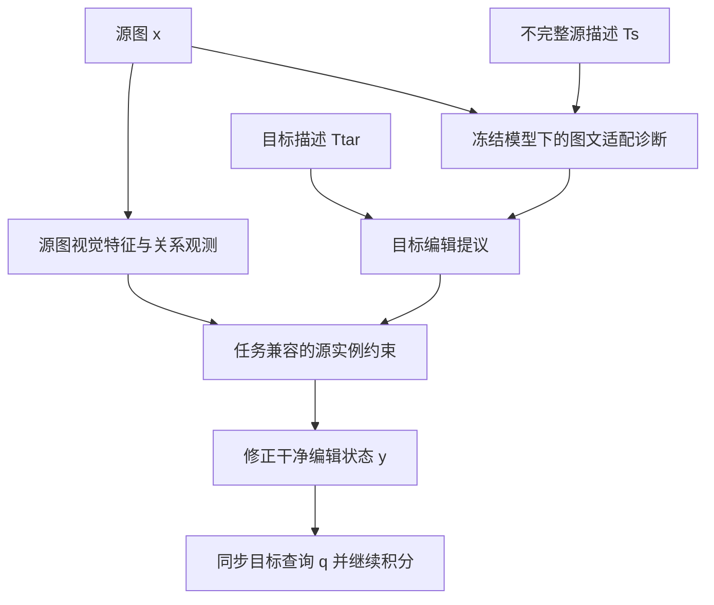

# 源描述与源图关联：描述偏差校准与未提及内容保持

日期与检索截止：2026-10-14。

研究目标：只使用源图、可能不完整的源描述和目标描述，在冻结预训练模型的前提下，提高编辑准确性，减少未要求的姿态、视角、身份、背景、光照和纹理变化。不增加描述补全 LLM、外部参考图、轮廓或空间／注意力编辑区域掩码，不固定编辑终点。本轮为文献调研与理论审查，没有启动新的图像实验。

## 0. 调研范围与阅读方式

沿以下问题检索并追踪引用：source-prompt dependence、caption gap、prompt-image alignment、text embedding leakage、identity preservation、visual feature injection、edit-friendly inversion、inversion-free editing、diffusion image-text matching、implicit preservation。覆盖扩散／流编辑、图文关联诊断、视觉对应、精确重建和近期预训练编辑器。

下文各表提供论文、官方会议／期刊页面或作者仓库的一手链接。重点核对正文的方法与补充材料；EditInv 的出版社全文受限，关于它的判断限于官方摘要。技术报告和近期预印本单独标注，不把检索页面的时间或未经核实的录用声明当作正式发表。调研是围绕问题的系统覆盖，不表示穷尽全部已发表文献，也不构成原创性的完全证明。

**三个需要分开回答的问题：**

1. 源描述是否正确地指向源图中的对象、属性和关系？
2. 源实例信息通过什么通道进入目标生成过程？
3. 哪些信息能够保持，同时允许目标要求的必要变化？

当前最有依据的研究方向是：**诊断文字条件的适配性，以源图自身建立实例信息通道，再控制该通道与目标编辑的冲突。** 单独提高图文匹配、反演精度或源图相似度，都不足以回答第三个问题。

## 1. “描述偏差”并不是单一现象

| 现象 | 例子 | 需要解决的问题 |
|---|---|---|
| 正确但不完整 | “一只棕熊”，未提及侧身、雪地、树的位置 | 未描述信息仍在图中，需要视觉通道携带 |
| 事实错误 | 图中侧身，文字写正面 | 源图与源文字冲突；不能强行提高错误文字匹配 |
| 属性绑定错误 | “红球与蓝杯”被理解为蓝球与红杯 | 词级关联、对象绑定和文本编码纠缠 |
| 条件分布关联 | 黑熊类别在训练数据中常伴暗背景 | 目标条件改变不相关因素的统计偏好 |
| 数值／重建误差 | 反演离散化、CFG 失配 | 即使文字准确也可出现重绘 |
| 视觉表征遗漏 | 全局向量看不见小标志、细纹理 | 保持代价没有观测到真正需要保持的内容 |
| 编辑任务本身含糊 | “换成黑熊”是否同时允许外形和姿态变化 | 任务没有唯一理想终点，需限定研究范围 |

不完整描述不等于错误描述；文本没有提及的内容也不自动等于可以逐像素固定的内容。例如换材质可能需要改变反射，移动物体会改变遮挡和阴影。合理目标应是保持**未被任务要求或必要物理后果改变的源实例因素**。

### 1.1 FlowEdit 对“源描述是主要原因”的反证

[FlowEdit 官方补充材料，附录 I](https://openaccess.thecvf.com/content/ICCV2025/supplemental/Kulikov_FlowEdit_Inversion-Free_Text-Based_ICCV_2025_supplemental.pdf)专门比较原始源描述、改写描述和空描述。在其 SD3 测试中，CLIP-T 分别为 0.344、0.343、0.343，LPIPS 为 0.181、0.181、0.192；整体变化较小。

这说明：源描述不完整可以是某些失败的因素，但**尚无依据把所有附带变化主要归因于它**。该结果也不意味着文字在所有图像、编辑任务、模型和 CFG 下都无影响。后续应以描述干预实验分离其贡献，避免根据几张失败图直接指定唯一机制。

### 1.2 三个容易混淆的保证

$$
\text{准确重建源图}
\;\not\Rightarrow\;
\text{更换条件后准确编辑}
\;\not\Rightarrow\;
\text{所有未提及内容保持不变}.
$$

精确反演只保证原条件下的可逆重建。目标条件变化以后，同一个噪声或嵌入可以被不同的生成映射解释。不同模型的条件边缘分布也不唯一指定“这个源实例应该被编辑成哪个目标实例”。

## 2. 如何分析源图与源描述的关联

### 2.1 图文关联、组成关系和可观测性文献

| 工作与发表状态 | 关联分析的内容 | 对本研究的价值与限制 |
|---|---|---|
| [Winoground，CVPR 2022](https://openaccess.thecvf.com/content/CVPR2022/html/Thrush_Winoground_Probing_Vision_and_Language_Models_for_Visio-Linguistic_Compositionality_CVPR_2022_paper.html) | 相同词语、不同关系的图文配对 | 测试“词出现了”和“关系理解正确”的差别；其旧模型结果不能直接代表全部新模型 |
| [ARO，ICLR 2023](https://arxiv.org/html/2210.01936) | 属性、关系、词序及检索捷径 | 提醒不能用单个全局分数判断姿态和属性绑定；训练式改进不直接符合限制 |
| [Mind the Gap，NeurIPS 2022](https://proceedings.neurips.cc/paper_files/paper/2022/hash/702f4db7543a7432431df588d57bc7c9-Abstract-Conference.html) | 同一共享空间内的图像／文字模态间隔 | 图像向量减文字向量并不天然成为“未描述内容” |
| [FILIP，ICLR 2022](https://arxiv.org/abs/2111.07783) | patch 与 word 的细粒度交互 | 提供词级匹配先例；最大匹配能找到证据，不保证覆盖未提及细节 |
| [SigLIP 2，2025 技术报告](https://arxiv.org/html/2502.14786) | 图文对齐与稠密视觉特征的联合提升 | 当前已有模型可作为诊断；全局 logit 仍不是精确任务完成度或完整实例观测 |
| [CLIP Surgery，2023 论文](https://arxiv.org/html/2304.05653) | 背景激活、冗余特征与注意力语义不一致 | 冻结模型内修正相似图的思路；不能直接宣称其操作适用于 SigLIP2 或提供准确掩码 |
| [ComCLIP，NAACL 2024](https://aclanthology.org/2024.naacl-long.370/) | 将对象、动作及关系组成图文分数 | 使用额外描述／解析与局部图像处理；不符合当前无额外 LLM／定位通道的方案要求 |
| [CaptionQA，CVPR 2026](https://openaccess.thecvf.com/content/CVPR2026/html/Yang_CaptionQA_Is_Your_Caption_as_Useful_as_the_Image_Itself_CVPR_2026_paper.html) | 检查 caption 能否替代图像回答实际问题 | 支持“描述不是图像的充分统计量”；是评估工作，不是编辑保持算法 |
| [Diffusion Classifier，ICCV 2023](https://arxiv.org/html/2303.16203) | 以冻结扩散模型的条件去噪误差近似比较条件适配性 | 可借鉴到源图—源描述诊断；其实用评分不是精确似然 |
| [DiffusionITM，NeurIPS 2023](https://arxiv.org/html/2305.16397) | 条件误差减去无条件误差，减少图像熟悉度带来的匹配偏差 | 冻结版本可用；HardNeg 版本包含微调，不作为零训练方案 |
| [DIFT，NeurIPS 2023](https://arxiv.org/html/2306.03881) | 冻结扩散模型的中间特征建立视觉对应 | 可从原图取得超出 caption 的视觉证据；原实现为 U-Net，不等于已验证 SD3 DiT |
| [Diffusion Hyperfeatures，NeurIPS 2023](https://arxiv.org/html/2305.14334) | 聚合不同时间与层的特征，改善视觉对应 | 其聚合网络经过训练；原始多层特征可以研究，不能把完整方法称为零训练 |

### 2.2 三种关联量分别回答什么

**全局匹配**回答“图中是否有与描述相关的整体语义”。它的优点是计算便宜；弱点是不能可靠区分对象绑定、姿势、小物件和背景照明。将其对潜变量求梯度，得到的是这个评分函数的局部提升方向，而不是“只改变目标对象”的真实方向。

**词—视觉局部关联**回答“哪个视觉表征支持哪个词”。文本响应弱，可能因为内容未被写出，也可能因为编码器不敏感、梯度饱和或信息存在于其他层。因此不应再次使用“小响应即背景、应强约束”的假设。注意力是计算路由，不是因果归属标签。

**生成模型条件适配性**回答“在源图的加噪观测下，这个条件是否让冻结模型更接近已知的源图插值目标”。它不要求补全文字，且能在当前流模型上定义；但不能由适配分数直接获得全部应保持的因素。

### 2.3 可在 SD3／FLUX 上计算的源条件适配诊断

以下是由线性 flow-matching 目标推导的诊断量，不宣称为新编辑算法。

令 $x$ 为源图 VAE 潜变量，$\varepsilon\sim\mathcal N(0,I)$。以噪声比例 $t$ 为时间坐标：

$$
q_s(t,\varepsilon)=(1-t)x+t\varepsilon,
\qquad v_{\mathrm{pair}}=\varepsilon-x.
$$

若实际 scheduler 使用 $\sigma(t)$，改用 $\sigma$ 坐标；若对物理时间求导，监督速度应乘 $\dot\sigma(t)$，不能混用两种速度。

定义对条件 $c$ 的拟合风险：

$$
L_x(c)=\mathbb E_{t,\varepsilon}
\left[w(t)\left\|v_\theta(q_s,t,c)-(\varepsilon-x)\right\|^2\right].
$$

这里的监督是源图与随机噪声之间的已知插值速度，不是待编辑目标图的监督。冻结网络，仅前向推理即可估计此量。

定义模型的单步干净估计：

$$
\mu_\theta(q_s,t,c)=q_s-t v_\theta(q_s,t,c).
$$

对 $t>0$，有精确代数关系：

$$
\mu_\theta(q_s,t,c)-x
=t\left[(\varepsilon-x)-v_\theta(q_s,t,c)\right].
$$

因此速度拟合误差也等价于按 $t^{-2}$ 重标定的干净估计误差。源条件相对空条件的拟合收益可定义为：

$$
B_x(c)=L_x(\varnothing)-L_x(c).
$$

**必须保留的解释边界：**

1. RF 的这个 MSE 不自动等于条件负对数似然、ELBO 或语义正确率。
2. 在固定同一张源图上，减去 $L_x(\varnothing)$ 是减常数，**不会改变候选源描述的排序**；它用于解释条件相对无条件的收益，或比较不同图像的偏差。
3. 高噪声时，即使描述正确，贝叶斯最优条件预测也可能偏离实际源实例；残差包含实例不确定性，不能全部归为描述错误。
4. 应按噪声区间报告，而不是只用一个平均数。低噪声更能观测实例，但条件效应可能弱；高噪声更能观测条件先验，但源实例更不确定。
5. 使用共同的 $(t,\varepsilon)$ 比较条件，减少随机估计方差；同时报告配对差值的不确定性。
6. 当前诊断优先采用原模型条件预测、CFG=1；额外测 CFG 敏感性。CFG 场一般不是原训练条件均值，不应混入同一概率解释。

对于源文字 token 的局部影响，可研究 $D_e L_x(c)$ 或离散删词前后的风险差。前者是连续嵌入敏感性，后者是换条件干预，两者都不等于真实对象归属，也不需要采用 $e_{tar}-e_s$ 作为语义梯度定义。

## 3. 如何补偿描述不足：文本嵌入、反演与残差通道

| 工作与状态 | 补偿的信息放在哪里 | 对当前问题的判断 |
|---|---|---|
| [Null-text Inversion，CVPR 2023](https://arxiv.org/html/2211.09794) | 每步优化的无条件文本嵌入 | 冻结模型、逐图优化；能吸收 caption 不足，重建成功不等于编辑定位成功 |
| [Prompt Tuning Inversion，ICCV 2023](https://arxiv.org/html/2305.04441) | 图像特定的条件嵌入，再与目标条件插值 | 无须完整源 caption；仍需反演与嵌入优化，强拟合可抵抗编辑 |
| [Negative-prompt Inversion，WACV 2025](https://arxiv.org/html/2305.16807) | 用源条件替换 CFG 的负分支 | 避免 NTI 优化；依赖相邻步近似，源文字仍无法完整携带实例 |
| [Dynamic Prompt Learning，NeurIPS 2023](https://arxiv.org/html/2309.15664) | 每步名词 token，与注意力平衡／对象分离约束 | 同时优化 null-text；含背景掩码，不是当前无掩码方案 |
| [StyleDiffusion，CVMJ 2024；作者实现](https://github.com/sen-mao/StyleDiffusion) | 图像编码经逐步映射网络生成交叉注意力 V 输入 | 很直接地处理短描述；**训练图像特定映射网络**，不符合严格不训练要求 |
| [SPDInv，ECCV 2024](https://arxiv.org/html/2403.11105) | 隐式反演方程的固定点状态 | 减少离散反演导致的额外 prompt 纠缠；并未数学消除所有条件依赖 |
| [DCI，NeurIPS 2025](https://papers.neurips.cc/paper_files/paper/2025/hash/00da4ead8d212a0bd5818a83bf380c9e-Abstract-Conference.html)；[正文](https://arxiv.org/html/2506.02560) | 源图导出的参考校正与固定点反演 | “reference image”是源图自身，不是额外参考图；需审查参考噪声的数学定义 |
| [EditInv，IJCV 2026](https://link.springer.com/article/10.1007/s11263-025-02691-1) | 按层与时间展开的提示嵌入，重建／编辑交替优化 | 面向结构、外观、全局任务的分层处理；本轮只核对官方摘要，不断言其全部实现满足限制 |
| [P2L，ICML 2024](https://proceedings.mlr.press/v235/chung24b.html) | 反向采样中的文本、潜变量与像素交替优化 | 证明提示可以与视觉观测联合拟合；其超分／去模糊等有明确观测算子，自由编辑没有同等监督 |
| [DATE，NeurIPS 2025](https://arxiv.org/html/2510.23974) | 每步对干净预测的评价函数求文本梯度并更新嵌入 | 冻结模型、无需权重训练；目标评分提升不能证明未提及实例因素保持 |
| [TFinv，2026 预印本，9 月更新版本](https://arxiv.org/html/2606.01380) | 优化噪声分布与附加文本后缀 token | 直接讨论 caption gap；推理优化、后缀可复用，局部保持增强版本含掩码 |
| [ResEdit，CGF／EGSR 2026](https://arxiv.org/html/2606.16457) | 补充源实例信息的残差 token，配合对抗 probe 去条件泄漏 | 与本问题非常接近；会训练辅助 probe，不能称为严格零训练 |
| [Pix2pix-zero，CVPR 2023](https://arxiv.org/html/2302.03027) | 自动 caption、编辑方向与交叉注意力引导 | 使用 BLIP 描述、文本集合／生成；“无手工源 prompt”不等于无额外描述系统 |
| [NEAF，CVPR 2026](https://openaccess.thecvf.com/content/CVPR2026/html/Kim_NEAF_Natural_Image_Editing_with_Attention_Fusion_for_Generalizable_Test-time_CVPR_2026_paper.html) | 对齐 caption、null-text 反演、可学习注意力融合权重 | 正文确认使用 BLIP-2；测试时学习融合模块，不能按当前限制原样引入 |
| [UniEdit-I，CVPR 2026](https://arxiv.org/html/2508.03142) | VLM 对源图／指令做理解并构造语义变化 | 额外理解／对齐路径与当前限制冲突；可作输入接口对照 |
| [STBridge，2026 预印本](https://arxiv.org/html/2607.17140) | 理解目标文字与图像生成共享目标通道 | SFT／RL 训练式改善，不是现有 SD3 的零训练纠错 |
| [ReSpec／OCCUR-Bench，2026 预印本](https://arxiv.org/html/2607.07051) | 显式保持指令与历史视觉证据 | 研究未显式要求改变的内容；依赖额外 VLM 编排及历史图，不能直接用作当前单图方案 |

### 3.1 NTI：文本不匹配仍可重建，是关键证据

[NTI 正文](https://arxiv.org/html/2211.09794)展示：即便使用随机、不对齐的 caption，优化后的重建仍可接近 VAE 重建；但基于交叉注意力的编辑需要被修改的对象出现在描述中。

这是两个不同机制：无条件嵌入可以记住源图信息，而文字是否正确绑定编辑对象决定后续控制是否容易实现。不能把低重建误差理解为“源描述已经充分准确”。

### 3.2 TFinv：更长的自动 caption 不保证更好的保持

[TFinv 表 4](https://arxiv.org/html/2606.01380)比较 PIE-Bench 描述与 LLaVA 描述。三后缀设置下，LLaVA 描述略提高全图／编辑区 CLIP，但结构距离由 16.36 增至 19.89，PSNR 由 25.52 降至 23.93。

这是作者的特定配置结果，不是本仓库实验；它至少表明“增加 caption 细节即可消除附带变化”不成立。附加 token 拟合重建也没有自动证明其与被编辑属性统计独立。

### 3.3 SPDInv：固定点准确，不代表源 prompt 依赖消失

论文将反演步骤写成隐式固定点，降低用错误时间／状态预测噪声所引入的偏差。下面是对其保证范围的独立数学审查。

令给定条件的生成映射为 $G_c$，准确反演满足：

$$
G_c(z_c)=x.
$$

假设 $G$ 可微、$D_zG_c$ 可逆，对条件微分：

$$
D_zG_c(z_c)\,D_c z_c+D_cG_c(z_c)=0,
$$

$$
D_c z_c=-\left[D_zG_c(z_c)\right]^{-1}D_cG_c(z_c).
$$

一般不为零。因而精确固定点可以减少**数值导致的额外纠缠**，但“完全 prompt 独立的反演噪声”需要额外假设。论文的经验改善与这个限制并不矛盾。

### 3.4 DCI：源图自身可以参与校正，但需谨慎解释参考噪声

DCI 同时使用文字预测、由源图构造的校正和固定点更新。它的参考图就是源输入，不能因为名字含 reference 而判为需要额外图像。

不过正文式 (5) 写为 $\epsilon_{ref}=E(z_0)$，并把 $z_0$ 也称作源潜变量；这个定义的表示空间／记号需结合实现进一步核对。**VAE 编码结果不自动是某时刻的正确加噪噪声。** 本报告采用其“视觉约束纠正粗文字”的方向，不把这条式子当作可直接迁移的精确监督定理。[DCI 正文](https://arxiv.org/html/2506.02560)

### 3.5 ResEdit：最接近“补足未描述内容”，也是原创性审查的必读工作

ResEdit 将身份细节放入额外残差 token，并训练 probe 预测要改的条件，通过梯度反转降低残差中的条件泄漏。主实验为经过条件扩展的 SD3.5 上的内禀属性编辑；文本示例使用原版文本模型，支持单词修改。

其主干冻结不等于没有训练：逐图 probe 更新了参数，快速残差编码器也需要训练。因此应作为“实例残差必须同时防止阻碍编辑”的重要先例，不能作为严格零训练方案直接采用。[ResEdit 正文与补充材料](https://arxiv.org/html/2606.16457)

还有一个独立的理论审查点：逐图优化时，如果被预测条件始终为固定 $C_0$，且 probe 能输出常数，则：

$$
\inf_{\phi}\|g_\phi(R)-C_0\|^2=0
$$

对任何 $R$ 都可以成立。有限迭代的对抗过程可能产生有用的编辑偏好，但单个条件标签无法单独识别 $R$ 与条件的统计独立性。论文报告的有限优化改善不能解释为完整条件解耦定理；当前零训练路线尤其不应以“去掉训练 probe 后残差仍然解耦”为假设。

### 3.6 DATE：有语义梯度更新先例，但没有补足保持信息

DATE 对当前干净预测的评价函数求文本嵌入梯度，在有限半径内进行近似最优更新。其局部评价提升结论和图文对齐实验不等于未描述内容的保持保证。若继续设计“每步通过语义梯度调整条件”，必须与它比较优化变量、目标函数、传导位置和验收条件，不能把该操作本身作为原创性。

## 4. 文本纠缠与属性泄漏：比补全 caption 更具体的方向

### 4.1 ALE，ICCV 2025

[ALE 正文](https://arxiv.org/html/2412.04715)分析了对象间属性泄漏和对非编辑内容的泄漏。它指出，在其 CLIP 文本编码设置下，EOS／padding 嵌入汇总跨对象属性，交叉注意力因此容易把某个对象的属性传播到其他对象。

方法由三个部分组成：对象描述分别编码并重组（ORE）、区域引导的交叉注意力限制（RGB-CAM）、背景潜变量混合（BB）。完整实现使用 Grounded-SAM 获得对象／背景掩码，不能原样纳入当前方案。

**可借鉴的是诊断而非整套算法：**在当前 SD3 内分别检查两个 CLIP 分支、T5 token 和 pooled conditioning 的影响。CLIP 的因果编码分析不能直接推广为 T5 的相同机制；也不能通过移除全部 EOS 或统一注意力就断言解决了泄漏。

### 4.2 Uniform Attention Maps，WACV 2025

[UAM](https://arxiv.org/html/2411.19652)在 U-Net 交叉注意力中使用均匀权重来减弱重建对文字变化的敏感性，仍保留 value 信息。它的完整编辑还用目标／源预测差生成自适应空间掩码。

这支持“重建所需视觉信息不必全部来自源文字路由”，但不支持把 SD3 联合注意力全部均匀化：后者会同时破坏图像间路由与目标文字控制。

### 4.3 本研究应检查的三种泄漏

1. **文本内部泄漏：**一个对象的属性进入别的对象或 pooled 文本条件。
2. **文字到视觉的路由泄漏：**目标属性影响本不需要变化的图像 token。
3. **视觉实例遗漏：**路由看似正确，但未提及的源姿态、纹理等没有稳定记忆。

第一种减轻后，第二、三种仍可能存在；所以仅修文本嵌入不够。当前更值得研究的是：在目标条件仍有效的同时，让源视觉关系参与目标计算。

### 4.4 条件消纠缠与自适应上下文的补充工作

| 工作 | 方法与价值 | 需要保留的边界 |
|---|---|---|
| [SSDV／Delta Vector，ICCV 2025](https://openaccess.thecvf.com/content/ICCV2025/html/Koh_Translation_of_Text_Embedding_via_Delta_Vector_to_Suppress_Strongly_ICCV_2025_paper.html)；[官方补充材料](https://openaccess.thecvf.com/content/ICCV2025/supplemental/Koh_Translation_of_Text_ICCV_2025_supplemental.pdf) | 在文本嵌入中抑制与目标概念强纠缠的已知内容，含零样本 delta 构造 | 需知道要抑制什么；真实编辑的局部保持包含 attention／difference blending mask。未知附带变化不能凭一个 delta 全部消除 |
| [Energy-Based Cross Attention，NeurIPS 2023](https://arxiv.org/abs/2306.09869) | 在 cross-attention 内对上下文后验能量求梯度，跨层更新文本上下文 | 上下文自适应已有先例；本轮核对官方摘要，未据此宣称源实例严格保持 |

SSDV 处理的是“已知不想出现的关联概念”，本研究处理的还有“没有被文字显式列出的源实例细节”。二者相关但不等价。后者仍需要从源图获得视觉证据。

## 5. 直接利用源图视觉信息：哪些方法与限制兼容

| 工作与状态 | 保持通道 | 值得借鉴与适用边界 |
|---|---|---|
| [SDEdit，ICLR 2022](https://arxiv.org/html/2108.01073) | 部分加噪的源图本身 | 不要求完整源描述；噪声强度越高，实例证据丢失越多 |
| [Prompt-to-Prompt，ICLR 2023](https://arxiv.org/abs/2208.01626) | 源／目标词对应与交叉注意力共享 | 适合已描述对象；不能单靠词对应保持全部未描述细节 |
| [Plug-and-Play Diffusion Features，CVPR 2023](https://arxiv.org/html/2211.12572) | 源空间特征和 self-attention Q/K | 真实图源特征可在空条件下提取；反演、特征注入，不需额外 caption 补全 |
| [MasaCtrl，ICCV 2023](https://arxiv.org/abs/2304.08465) | 目标 Q 从源 K/V 中检索外观 | 非刚性编辑与源外观兼容先例；mask-guided 扩展与基础方法要区分 |
| [FPE，CVPR 2024](https://arxiv.org/html/2403.03431) | 选择 self-attention 层做替换 | 编辑接口可不要求源 prompt；真实图反演的具体配置仍需核查 |
| [DiffuseIT，ICLR 2023](https://arxiv.org/html/2209.15264) | DINO self-similarity 与 patch 对比约束 | 视觉结构的显式代价；文本版本还用源文本／图文量，不能称全程源条件独立 |
| [Delta Denoising Score，ICCV 2023](https://openaccess.thecvf.com/content/ICCV2023/html/Hertz_Delta_Denoising_Score_ICCV_2023_paper.html) | 配对源／目标分支抵消共同模型偏差 | 已有源对照消偏思路；差分并不等于纯语义干预 |
| [Contrastive Denoising Score，CVPR 2024](https://arxiv.org/html/2311.18608) | 扩散模型特征的 patch 对比保持 | 无需额外训练视觉编码器；有助于保结构，但强保持仍可能抑制任务 |
| [Stable Score Distillation，ICCV 2025](https://arxiv.org/html/2507.09168) | 单一源条件锚定的 CFG 分类方向、null-text 稳定项 | 源内容约束与编辑强度分开处理；仍不能完整观测未提及因素 |
| [FreeDiff，ECCV 2024；官方实现](https://github.com/thermal-dynamics/freediff) | 渐进频率截断，限制编辑引导的过宽影响 | 无需额外视觉参考的有价值对照；频段不等于任务归属，低频也可能是必要编辑，高频也可能是身份细节 |

PnP 与 FPE 的关键启示不是“self-attention 就是结构”，而是：**源图中的实际视觉关系可以作为独立于源 caption 的信息输入。** 不同层／时间包含不同的结构与外观信息；过强、过深地共享会把应改变的旧外观也复制回去。

## 6. Flow／DiT 方法：面向当前代码的重点相关工作

| 工作与状态 | 源实例如何进入编辑 | 与当前研究的关系 |
|---|---|---|
| [FlowEdit，ICCV 2025](https://arxiv.org/html/2412.08629) | 源图直接加噪与共享噪声配对的速度差 | 当前必要基线；源描述可为空，短文字并不是算法必然失败条件 |
| [StableFlow，CVPR 2025](https://arxiv.org/html/2411.14430) | 选择影响保持／编辑的 vital layers 做注意力替换 | 主张选择层而非全层冻结；真实图仍需反演 |
| [ReFlex，ICCV 2025](https://arxiv.org/html/2507.01496)；[官方分支说明](https://github.com/wlaud1001/ReFlex) | 中期图像特征，I2I、I2T 与残差注入 | **存在无源描述且不做 latent blending 的分支**；提供源描述的局部版本会用注意力掩码。仍需反演 |
| [Exploring MM-DiT for Image Editing，ICCV 2025](https://arxiv.org/html/2508.07519) | 图像侧 Q/K 与目标文本侧分开控制 | 对任意源／目标 prompt 差异不必严格词对齐；区域混合为额外配置，应单独区分 |
| [HeadRouter，TOG 2026](https://doi.org/10.1145/3797956)；[论文](https://arxiv.org/html/2411.15034) | 根据 attention head 的作用分配保持与编辑 | 头选择已有先例；语义敏感头不等于纯语义子空间 |
| [FIA-Edit，AAAI 2026](https://ojs.aaai.org/index.php/AAAI/article/view/38145)；[正文](https://arxiv.org/html/2511.12151) | FlowEdit 中的源／目标频率交互及特征注入 | 最接近现有无反演、冻结主干接口；论文配置与当前 SD3 Medium 需逐项核对 |
| [FlowAlign，ICLR 2026](https://arxiv.org/html/2505.23145) | 终端源相似度驱动的轨迹正则化 | 当前正文使用终点相似度正则，不是固定终点；与逐步源保持控制存在直接重合 |
| [sync-SDE，ICML 2026](https://proceedings.mlr.press/v306/zhang26fb.html)；[正文](https://arxiv.org/html/2509.24223) | 构造与源轨迹一致的 Brownian 驱动，转用于目标反向过程 | 无学习／优化／掩码的耦合先例；不同条件的漂移仍会改动非目标因素 |
| [DirectEdit，ICML 2026](https://proceedings.mlr.press/v306/yang26cy.html)；[正文](https://arxiv.org/html/2605.02417) | 源状态与步间更新对齐 | 完整局部控制方案含 MLLM／SAM，不满足当前全部限制 |
| [Consistent-Inversion，2026 预印本](https://arxiv.org/html/2606.07145) | 目标状态再反向对齐源反演状态 | 循环约束提供保持信号；源循环正确不直接证明目标任务正确 |
| [LORE，2025 预印本](https://arxiv.org/html/2508.03144) | 优化反演噪声的目标注意力，masked value injection | 讨论源概念阻碍目标概念；依赖编辑区域掩码，不宜直接纳入 |

版本记录：FlowAlign 的[ICLR 2026 会议摘要](https://proceedings.iclr.cc/paper_files/paper/2026/hash/c613667b7f11fbf478293266a156aabe-Abstract-Conference.html)称 flow-matching loss，当前 arXiv 正文将方法表述为终端相似度正则。本文按当前正文讨论机制；复现实验需固定版本，不能把两个表述不加核对地视为同一公式。

### 6.1 ReFlex 的兼容性必须按分支判断

其官方仓库明确区分 `wo_ca`、`w_ca`、`w_mask`：没有源描述时，不用 I2T 注入和局部 latent blending；给源描述时，可自动生成注意力掩码；给外部 mask 时采用该 mask。

因此，ReFlex 的**视觉特征方案值得直接研究**；“完整方法所有配置都需要掩码”是过度概括。对本研究真正不满足的是反演要求，以及局部混合配置的掩码；不能把基础视觉复用思路一并排除。

### 6.2 sync-SDE 的保证也要分条件

源／目标使用同一随机驱动，可以减少随机项差异。若源条件与目标条件相同，并满足论文的理想分数／积分条件，可构造源重建一致性。但换条件后：

$$
d(X_a-X_s)
=\left[b_a(X_a,t)-b_s(X_s,t)\right]dt
$$

在相同扩散系数与共享 Brownian 增量时成立。随机项消掉了，漂移差没有消掉；未提及因素仍可能受目标条件关联影响。因此“同噪声”提供耦合，不自动提供语义选择性。正文附录也保留随机种子伪影和外观变化的失败例。

### 6.3 SD3 联合注意力的实际约束

SD3 不是旧 U-Net 的单向 cross-attention。对图像查询，输出包含图像和文字两类 K/V，此外 pooled 文本还有调制路径。

只固定 image-to-image 子块，并不能消除先前层文本对图像 Q/K 的影响；只处理 EOS，也不能消除 pooled 条件影响。层、头、时间和模态子块均需单独做干预对照。

联合注意力的条件化图像内部关系、模态占比与 Fisher／KL 分解见[前一份数学报告](不完整描述编辑_条件耦合与DiT注意力关系约束_理论调研_2026-10-14.md)。这些精确代数不等于已经识别出纯背景或纯结构。

## 7. 精确重建、噪声记忆与“硬保持”文献

### 7.1 源重建和多步噪声记忆

| 工作 | 保持机制 | 保证范围 |
|---|---|---|
| [EDICT，CVPR 2023](https://openaccess.thecvf.com/content/CVPR2023/html/Wallace_EDICT_Exact_Diffusion_Inversion_via_Coupled_Transformations_CVPR_2023_paper.html) | 两个耦合潜变量实现可逆变换 | 原条件下的代数可逆性；换目标条件后不保证所有实例因素固定 |
| [Edit Friendly DDPM Noise Space，CVPR 2024](https://arxiv.org/html/2304.06140) | 多时刻、相关的噪声状态存储源信息 | 可重放源轨迹；该编辑友好噪声不等同独立标准高斯样本 |
| [Direct Inversion，ICLR 2024](https://arxiv.org/html/2310.01506) | 记录源反演／重建差，把重建与编辑分支分开 | 低成本重建补偿先例；未描述因素在换条件后仍可能变化 |
| [InfEdit，CVPR 2024](https://arxiv.org/html/2312.04965) | 已知源图的虚拟反演与统一注意力控制 | 无显式反演的重要先例；完整局部控制与基础采样机制应分开评价 |

### 7.2 明确选择应保持区域或 token 的方法

| 工作与状态 | 未编辑内容如何保持 | 与当前限制的冲突 |
|---|---|---|
| [DiffEdit，ICLR 2023](https://arxiv.org/html/2210.11427) | 源／目标预测差得到自动编辑区域 | 自动 mask 仍是 mask，误差会进入选择结果 |
| [LEDITS++，CVPR 2024](https://arxiv.org/html/2311.16711) | 高质量随机反演和隐式局部引导 | 不需完整 source caption，但使用隐式 mask |
| [KV-Edit，ICCV 2025](https://arxiv.org/html/2502.17363) | 缓存背景 K/V，只生成选中区域并复用源 token | 对指定区域之外有更直接保持，但依赖区域选择；不等于自动识别所有无关变化 |
| [LOCATEdit，ICCV 2025](https://arxiv.org/html/2503.21541) | self-attention 图与 cross-attention 节点，Laplacian 改善定位 | 图几何用于完善局部 mask，并非无区域约束方案 |
| [SpotEdit，CVPR 2026](https://arxiv.org/html/2512.22323) | 感知相似度选择稳定 token，复用源条件特征 | 不需用户画 mask，但具有内部空间／token 选择；更偏计算跳过及源特征复用 |
| [SAMFlow，2026 预印本](https://arxiv.org/abs/2606.06228) | 源图／编辑提议与分割定位 | 无反演不等于无需区域定位 |
| [CEF，2026-09 预印本](https://arxiv.org/html/2609.33735) | CLIPSeg 连续编辑责任图、源噪声重放 | 连续门控也是区域支持的估计 |
| [OAVC，2026-09 预印本](https://arxiv.org/html/2609.06288) | 对象支持与背景更新控制 | 即使不称 masked blending，仍使用对象支持／阈值／区域输入 |
| [RefineEdit，2026-09 预印本](https://arxiv.org/html/2609.20633) | 非扩散生成模型中的位置／bit 选择，只改部分编码 | 无外部 mask 不等于没有内部选择；基础模型也不同 |
| [ALE，ICCV 2025](https://arxiv.org/html/2412.04715) | Grounded-SAM 对象支持、cross-attention 限制、背景拷贝 | 完整方法依赖分割掩码 |
| [NEP，NeurIPS 2025](https://papers.neurips.cc/paper_files/paper/2025/hash/bda970bcd6d14d48745ef114ad6cedfc-Abstract-Conference.html) | 任意顺序自回归模型只重新生成编辑 token | 基础模型需要训练，选择支持也必须提供／识别；不是当前 SD3 的直接推理方案 |

**硬保持能保证的是已知表示或已知区域的拷贝，不是自动理解任务。** 即便背景 latent token 完全相同，VAE 解码中的邻域交互也可能让边界像素变化。要保证原始 RGB 某些像素逐位不变，需要在 RGB 输出空间明确拷贝那些像素，这又要求知道允许变化的像素集合。

禁止掩码不会使任务无法研究，但会失去这种最直接的硬拷贝保证。研究目标应转为可观测实例因素的稳定保持，并清楚说明其范围。

## 8. 预训练图像条件编辑器：为什么比补全源 caption 更直接

| 工作 | 原图输入通道 | 对当前研究的含义 |
|---|---|---|
| [InstructPix2Pix，CVPR 2023](https://arxiv.org/abs/2211.09800) | 原图与编辑指令共同输入 | 不必运行时先生成完整源描述；主模型经过编辑数据训练 |
| [IP-Adapter，2023 论文](https://arxiv.org/html/2308.06721) | 分离的图像／文字 attention 条件 | 视觉身份与文字控制分通道的先例；adapter 本身已训练，不能给 SD3 随意加未训练模块 |
| [FLUX.1 Kontext，2025 技术报告](https://arxiv.org/html/2506.15742) | 源图 context token 与目标生成 token | 用完整视觉源条件减轻 caption 信息瓶颈；需更换为编辑训练过的模型 |
| [Qwen-Image，2025 技术报告](https://arxiv.org/html/2508.02324) | VLM 语义表征与 VAE 重建表征 | 语义与实例视觉信息互补；其内部 VLM 不等于额外 caption 对齐，但整体基础模型不同 |

应区分两种“零训练”：使用别人训练好的编辑器，仅推理，是运行时零训练；在当前 SD3／FLUX 生成器上不新增任何训练，则需要利用它们已经具有的视觉表示与计算通道。本研究关注后者。前者可以作为能力参考，不能把专门编辑训练产生的能力归因于某个无需训练的数学修正。

## 9. 数学上为什么“条件正确”仍会改变未提及内容

本节为独立推导；不是将某篇论文的经验结果提升为定理。

### 9.1 条件后验均值不是源实例，也不必是众数

在理想线性 RF 的平方误差最优预测下：

$$
v^*(q,t,c)=\mathbb E[\varepsilon-X\mid q,t,c].
$$

由 $q=(1-t)X+t\varepsilon$，有：

$$
q-tv^*(q,t,c)=\mathbb E[X\mid q,t,c].
$$

所以干净估计是条件后验均值。高噪声时源实例的证据变弱；即使源文字完全正确，后验仍可能对应多个姿态／背景／光照。目标类别的训练相关性进一步改变这个后验。

“朝众数中心移动”可以是直观描述，但不能据此设定一个必然存在、可由 score 谱识别的流形中心。后验均值、密度众数和编辑轨迹的最终样本是不同对象。当前问题不应再建立在“概率密度测地线必然保护实例”的假设上。

### 9.2 两个条件的共同 nuisance 分布也不保证梯度保持 nuisance

设理想语义因素为 $A$，应保持因素为 $Z$，观察图像是渲染 $I=R(A,Z)$。即使：

$$
p_s(A,Z)=p_s(A)p(Z),\qquad
p_a(A,Z)=p_a(A)p(Z),
$$

使对数密度比只依赖 $A$，在观察图像的欧氏坐标中沿该比值梯度移动，也不一定保持 $Z$。

一个完整的二维反例是：

$$
I=R(A,Z)=(A+\kappa Z,Z),\qquad
A=I_1-\kappa I_2,\quad Z=I_2.
$$

令对数密度比为 $\ell(A)$，则：

$$
\nabla_I\ell=\ell'(A)(1,-\kappa).
$$

沿这个方向更新有：

$$
\dot Z=-\kappa\ell'(A),
$$

一般不为零。真正固定 $Z$ 而改变 $A$ 的方向是 $(1,0)$。

这说明：**“语义比值只含目标属性”与“观察空间梯度只改变目标属性”不是同一件事。** 文本梯度、score 差和语义响应都可能受到渲染坐标、特征坐标及网络参数化的纠缠。合适的约束／度量可以处理已知纠缠，但从单张图与短文字中估计这些因素仍是研究难点。

### 9.3 不同条件分布下的图文差值没有公共零点

假设 $S(x,T_s)$ 与 $S(y,T_a)$ 都是全局匹配值。它们受描述长度、类别、图像组成、训练频率、评分器尺度和表征盲点共同影响，因此：

$$
S(y,T_a)-S(x,T_s)=0
$$

并不表示完成编辑，也不表示保持正确。将这个差作为主要优化目标，容易优化了条件间的评分偏差，而没有恢复实例细节。

同样，$f_I(x)-f_T(T_s)$ 不能天然解释为未描述内容；把残差投向目标文字的正交补，也不能自动获得应保持的图像因素。此前真实实验已揭示相关全局残差缺少独立实例可观测性，见[配对相关性结果报告](配对相关性与描述不完整_真实实验结果及方案调整_2026-10-14.md)。

### 9.4 只更换“更准确的源速度”也未必更好

在 FlowEdit 的主积分结构中，用统一记号写：

$$
q_s=(1-t)x+t\varepsilon,\qquad
q_a=q_s+y-x,
$$

$$
d_t=v_a(q_a,t)-v_s(q_s,t),\qquad
\bar y=y-hd_t,\quad h=t-t_{next}>0.
$$

定义 $\mu_a=q_a-tv_a$、$\mu_s=q_s-tv_s$，则：

$$
-hd_t=\frac ht\left(\mu_a+x-\mu_s-y\right).
$$

因此把源重建残差 $x-\mu_s$ 加到目标干净估计，在这一结构下已经是原更新的等价表达，不是新算法。

如果为避免源 caption 不足，把模型源速度直接替换为精确插值速度 $\varepsilon-x$，则：

$$
-h\left[v_a(q_a,t)-(\varepsilon-x)\right]
=\frac ht\left(\mu_a-y\right).
$$

它变成向目标单步干净预测的松弛，失去了原来的模型源对照。原对照中的偏差既可能是不利偏差，也可能与目标分支共享，抵消后反而有助于保持。**不能以“源插值速度已知且准确”推导“编辑一定更准确”。**

### 9.5 边缘分布不能唯一确定实例保持耦合

知道源／目标条件分布 $p_s,p_a$，仍有多个满足这些边缘的联合分布 $\pi(x,y)$。姿势一致、背景一致与随机重配都可能产生相同目标边缘。

因此需要额外选择原则：源视觉关系、共同随机驱动、最小干预、物理约束或已学习的编辑先验。距离最小也不自动等于语义正确：对颜色变化，距离小常有帮助；对物体增加／移除、遮挡变化或形状变换，则未必成立。

[Pan 与 Bareinboim 的反事实图像编辑研究，2024](https://arxiv.org/html/2403.09683)还讨论了特定结构因果模型假设下的可识别性问题。它的结论有明确模型前提，不能泛化成“所有实际编辑都不可能”；其价值是提醒对反事实实例对应需要说明假设。

## 10. 当前限制下的优先设计路线

### 10.1 路线 A：源条件适配诊断，先判定是不是文字造成的偏差

沿第 2.3 节，以源图、同噪声、分噪声区间的条件风险评估：

1. 原始短描述是否真的劣于空描述？
2. 文字改写在语义不变时是否显著改变模型拟合／最终图像？
3. 错误姿势或背景描述会在哪些层／时间产生更强影响？
4. 差异来自 conditional token，还是 pooled modulation／CFG？

这是一条低风险、易否证的诊断路线。**诊断分数不直接转为保留区域 mask，不据其数值大小把像素划为语义／背景。**

若分数能预测具体条件冲突，再考虑小幅、受限的源嵌入优化。若完整编辑对源描述本来就不敏感，则继续优化源文字的收益可能有限。

### 10.2 路线 B：建立直接来自源图的视觉保持通道

以现有冻结 DiT 为主，不加入新训练的模块。候选观测为多个层／头的图像特征与图像内部关系：

$$
M_x=\Phi_\theta\big((1-\tau)x+\tau\xi,\tau,c_{probe}\big),
$$

其中 $c_{probe}$ 可为空条件，$\tau$ 为固定低噪声尺度，$\xi$ 在源／当前观测中共享。对编辑状态 $y$ 使用相同 probe。

若 $c_{probe}$ 不依赖 $T_s$，有：

$$
D_{T_s}M_x=0.
$$

这是**该观测通道不直接受源 caption 变化影响**的精确保证。它不证明 $M_x$ 语义完备、不受预训练偏差影响，也不证明完整目标轨迹与源文字独立。

可比较的保持量包括：

- 图像内部路由概率／log-ratio：对当前层的文字 softmax 竞争更不敏感，但仍受前面层的文字影响。
- 多层 patch 特征与相对关系：比单个 pooled embedding 更能观察局部实例，但会混合旧外观。
- 共享低噪声 probe 下的源／当前关系：降低高噪声共同随机量支配的问题，但增加计算成本。

不要求它们具有“纯结构”语义。先检验这些观测能否识别不应变化的视角、姿势、物件关系、局部纹理，以及是否能允许必要编辑。

工程优先级是借鉴 FIA-Edit 的 FlowEdit 计算接口、PnP／ReFlex 的视觉复用、StableFlow／HeadRouter 的层头选择。在没有证据前，不全面冻结所有源 Q/K/V。

### 10.3 路线 C：在干净 y 空间修正，与目标任务保留联合控制

令 $\bar y$ 是本步原始提议，$C_x(z)$ 为已检验的源视觉代价，$R_a(z)$ 为目标响应代理。一个闭环的候选形式是：

$$
z^*=\operatorname*{arg\,min}_{z}
\left\{\frac{1}{2\eta}\|z-\bar y\|_G^2+\lambda C_x(z)\right\}
$$

约束为：

$$
R_a(z)\ge R_a(\bar y)-\epsilon,
\qquad \|z-\bar y\|_G\le\rho.
$$

取 $\eta>0$、$\lambda>0$、$\epsilon\ge0$、$\rho>0$；$G$ 为本步固定的正定度量，不需要密度流形假设。$R_a$ 可由已有模型构造，但其提升仅代表代理提升。该形式是常见约束优化结构，**本身不是已确认的原创方法**。

若全局 SigLIP 约束不能识别任务，优先研究当前目标生成模型的响应与视觉关联，而不是再次把全局分数当作精确任务完成度。注意力增强也有“只提高路由、没有实现正确视觉属性”的风险。

修正后用同一构造同步查询：

$$
y_{next}=z^*,\qquad
q_a(t_{next})=q_s(t_{next})+y_{next}-x.
$$

这保证状态与查询的代数闭环；若 $q_s$ 在下一步更换随机噪声，目标查询必须同步更换。不能修正 y 后仍沿未修正的旧 q 继续预测。

低噪声强度与高噪声强度需要由观测可靠性、目标冲突和步宽决定，不预设“高噪声所有源约束都强、低噪声都弱”。低噪声也是恢复实例纹理的重要阶段；过早放开可能增加细节重绘。

### 10.4 这个候选实际可以证明什么

若 $C_x\ge0$ 且 $\bar y$ 可行，**准确求得全局最优解**满足：

$$
\frac{1}{2\eta}\|z^*-\bar y\|_G^2+\lambda C_x(z^*)
\le\lambda C_x(\bar y).
$$

于是源代理代价不增加，且：

$$
\|z^*-\bar y\|_G^2
\le2\eta\lambda\left[C_x(\bar y)-C_x(z^*)\right].
$$

神经特征与语义约束通常非凸，实际求解不能直接保证找到全局最优。工程上可通过比较有限步后的目标值、源代价和目标约束验收来获得这条不等式的**已验收版本**；无法验收时应退回提议或缩小步幅，而不是声称数学条件自动成立。

若主积分段无语义改动、CFG 对称且原提议为 $x$，并有 $C_x(x)=0$，则 $z=x$ 的目标值为零，其他非零位移的近端项为正，因此该段不会凭空编辑。该结论不覆盖独立的尾段重采样，也不消除 VAE 自身重建误差。

### 10.5 要把代理保持提升为真实实例保持，还缺什么

令 $Z$ 为真正需要保持的因素，$\Phi$ 为候选观测。局部一阶保证至少要求：

$$
\|D Z(y)u\|\le K\|D\Phi(y)u\|_W
$$

对所研究的允许变化方向 $u$ 成立。等价的必要含义是：$D\Phi$ 的盲方向不能包含需要保持的 $Z$ 的变化方向。

若 $D\Phi(y)u=0$，则 $DZ(y)u=0$；若 $Z$ 的二阶余项界为 $H_Z$，有限位移只保证：

$$
\|Z(y+u)-Z(y)\|\le\frac{H_Z}{2}\|u\|^2.
$$

更强地，若工作邻域内有：

$$
\|Z(y)-Z(x)\|\le K\|\Phi(y)-\Phi(x)\|_W,
$$

且 $C_x(y)=\tfrac12\|\Phi(y)-\Phi(x)\|_W^2$，那么：

$$
\|Z(y)-Z(x)\|\le K\sqrt{2C_x(y)}.
$$

这是“源观测足够完整”时的误差界，而不是对任何预训练特征的既成事实。不同任务所需保持的 $Z$ 不同，$K$ 也不能从无标签的单张图直接准确获知。

此外，保持约束必须允许真正的目标编辑。若 $\Phi$ 几乎完整编码原图，强制 $\Phi(y)=\Phi(x)$ 就可能只允许 $y=x$。当前最重要的瓶颈是**兼容且足够可观测的保持通道**，而不是再设计一个更强的全图近端惩罚。

## 11. 对“保证未提及内容不变化”的分层回答

| 保证层级 | 能否在当前条件下建立 | 需要的条件 |
|---|---|---|
| 源视觉观测不直接依赖源描述 | 可以 | probe 条件与源描述独立 |
| 主积分无任务时不凭空移动 | 可以按构造证明 | 同条件、同噪声、同 CFG，修正代价在源图为零 |
| 某个注意力量／视觉代价不增加 | 可以对求解／验收结果证明 | 明确代价与有限步验收 |
| 目标代理不下降超过容差 | 可以 | 验证最终有限修正，而非只看一阶预测 |
| 某个真实实例因素有误差界 | 有条件可以 | 观测充分性、任务兼容性和局部误差界 |
| 所有自然语言任务都正确，所有未提及内容严格不变 | 本轮未找到满足全部限制的通用方法或定理 | 还缺任务可识别性与完整保持因素的观测 |

后验漂移、准确反演、稳定特征和图文匹配分别处理不同层。论文使用“preserve”“identity”“consistent”等词时，必须检查其指的是实验指标、指定背景拷贝、条件下的数学保证，还是任意任务的保证。

另一个旁证是[When the Edit Changes the Patient，2026 预印本](https://arxiv.org/html/2608.23024)：在医学图像的特定任务中，编辑语义和视觉质量可以正常，但实例身份仍改变。该工作不代表自然图像的普遍失败，只支持将“任务完成”与“实例保持”分开评价。

## 12. 下一轮验证应怎样避免重复旧实验困境

此处为调研后的验证建议，未执行。实验必须继续包含原始 FlowEdit，不因增加复杂修正而省略基线。

### 12.1 先验证描述因素的真实贡献

对相同源图、目标任务与随机量，比较源文字：数据集描述、人工缩短的正确描述、空描述、语义等价改写、故意错误属性描述。人工构造仅用于离线诊断；算法运行时仍接收原有输入，不增加 caption 对齐模型。

源／目标 CFG 对称与原配置分别报告。先在当前 SD3 Medium 验证，再考虑 FLUX；不能把 SD3.5 的结果直接归到当前权重。

同时记录：第 2.3 节的分噪声风险、源条件变化造成的速度／特征响应、完整编辑的实例变化。用配对噪声与多个种子判断是否可复现。若描述诊断不能预测实际漂移，应放弃把它作为主要修正幅度依据。

### 12.2 保持观测须先做独立诊断

对候选 $\Phi$ 检验：

- 能否发现不应改变的视角、姿态、小物件关系和纹理变化？
- 对目标颜色／材质等必要变化，是否过度敏感？
- 中性条件观测是否比源文字条件观测更稳定？
- 多层关系是否提供超过全局 SigLIP 和像素距离的新信息？
- 在多个低噪声 probe 下，结论是否主要来自共同噪声？

可以使用确定性的颜色／亮度／小幅几何干预作为观测检查，不等于生成真正编辑标签。观测检查通过以后，才投入完整轨迹修正。

### 12.3 原创性与有效性对照

至少分开比较：原 FlowEdit、对称 CFG／同条件校准、源条件适配诊断、简单源特征复用、FIA-Edit 风格基线、源视觉约束、加入任务兼容验收的完整候选。不要只比较“有优化”与“无优化”。

目标文本本身没有理想图真值，因此不能把 CLIP／SigLIP 增益直接报告为成功率。用预先限定、相对明确的任务和盲评判断实际完成程度，并在相近完成程度下比较姿态、视角、身份与附带变化。无需算法接收额外掩码或参考。

像素差、LPIPS、全局视觉分数与原图 VAE 重建一起报告，它们不是未编辑区域的精确指标。评价要保留失败图、欠编辑例、多种子分布和额外 NFE／反向传播成本；此轮还不讨论加速收益。

## 13. 阅读优先级、原创性边界与研究问题

### 13.1 最应深入阅读的文献

1. **FlowEdit 附录 I／G／H：**源描述敏感性、结构编辑边界与随机种子失败；用于校正问题归因。
2. **PnP + ReFlex 无源描述分支：**源视觉证据如何绕开完整 caption；注意反演与注入冲突。
3. **FIA-Edit：**最接近当前无反演代码的公开源特征控制方案。
4. **ALE：**区分文本内部纠缠与视觉路由泄漏；不能照搬其 Grounded-SAM。
5. **NTI + PTI + TFinv：**信息可以拟合进嵌入，但重建、编辑与实例保持仍需分别评估。
6. **SPDInv + DCI + EditInv：**源文字、视觉证据和准确反演如何结合；审查固定点与去条件依赖的关系。
7. **ResEdit：**实例残差信息与被编辑属性解耦的最直接先例；严格零训练需要新的实现条件。
8. **Diffusion Classifier + DiffusionITM：**不用额外描述 LLM 的图文适配诊断；不能把 RF 风险当作精确语义概率。
9. **FlowAlign + sync-SDE：**轨迹控制与随机耦合的保证范围。
10. **DIFT + CaptionQA + ARO：**视觉信息、描述信息与评价可观测性的边界。

### 13.2 不应再作为原创性主张的内容

- 源图与源描述有关联误差／caption gap。
- 优化文本嵌入、附加 token 或噪声改善源重建。
- 将未描述内容放入视觉或残差通道。
- 每步对预测图像的文本评价求梯度来修改条件。
- 源／目标配对分支消除共同生成偏差。
- self-attention、Q/K/V 或频率特征共享以保持源结构。
- 使用近端、轨迹正则或共享随机过程改善一致性。

这些都有明确公开先例。新的贡献必须落在具体可检验机制上，例如：**一个无需辅助训练、对短源描述更稳定、能观测任务外实例变化且允许必要编辑的源视觉通道，以及它在无反演主积分中的有限步控制。** 是否真正不同，需要最终算法定型后逐式、逐接口比较，不能在当前调研阶段保证不存在相同方法。

### 13.3 建议收敛到的研究问题

> 在冻结 SD3／FLUX、只输入源图与源／目标文字、无外部定位或描述补全的条件下，能否利用源图自身的视觉关系，建立对源描述省略更稳定的实例保持通道；在相近实际编辑完成程度下，比 FlowEdit 及公开源特征复用方法更少改变姿态、视角和未要求变化的局部细节？

它包含三个可否证的环节：关联诊断是否有解释力，视觉通道是否增加实例可观测性，任务兼容控制是否减少实际附带变化。任何一环失败，都应调整机制，不用全局匹配分数的上升掩盖失败。

**当前结论：**描述不足有明确相关研究，但补全文字、准确反演和增强目标语义均不能单独保证保持。当前约束下，直接使用源图的视觉证据最有价值；需要优先验证其可观测性和任务兼容性。本文没有宣称已消除全部条件偏差、证明通用可靠编辑、确认原创性或取得新的实验收益。

## 14. 与当前仓库记录的关系

- [此前真实实验与描述／CFG 对照](配对相关性与描述不完整_真实实验结果及方案调整_2026-10-14.md)：已有数据，不能按新理论重新解释为已验证结论。
- [后验均值、条件偏置与源实例保持](不完整描述下的源实例保持_后验均值条件偏置与可靠编辑_2026-10-14.md)：本轮补充更广文献与描述敏感性反证。
- [DiT 注意力关系约束与数学分解](不完整描述编辑_条件耦合与DiT注意力关系约束_理论调研_2026-10-14.md)：本轮完善 ReFlex 分支、文本泄漏、残差信息与保证范围。
- [图像编辑主流方法综述](图像编辑相关工作综述_主流方法与适用边界_2026-09-29.md)：一般背景；近期判断以本轮重新核对的一手来源为准。

本轮新增的是本报告与索引更新；模型、环境、数据和既有实验均保留。

文档核对：71 个文献表格条目（部分工作跨主题出现），83 个不同的一手来源链接；33 个独立展示公式块配对完整，本地引用均存在。条件拟合风险恒等式、FlowEdit 干净预测重排与源插值速度替换的三条代数关系经符号化简核对。该核对不涉及模型质量或图像实验。

