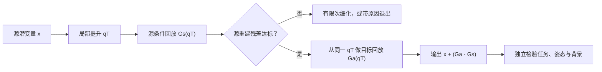

# 源速度局部提升与配对回放：理论闭环与方法定义

日期：2026-11-09。接续[噪声—速度适配](随机噪声与条件速度适配_动态源耦合与局部提升_2026-11-09.md)和[实验归因修订](FlowEdit双方向研究_实验归因与理论修订_2026-11-06.md)。配套[分阶段实验设计](源速度局部提升与配对回放_分阶段实验设计_2026-11-09.md)。

**2026-11-10审查补注：** [数学与问题假设审查](源速度局部提升与配对回放_数学与问题假设审查_2026-11-10.md)确认多数公式为条件性正确，但方法在小源残差极限下趋向部分反演配对，并非原FlowEdit期望映射；主Heun算子的逆条件数尚未验证，不能由源门直接推出适配或语义保证。“闭环”仅指已列前提下的数值命题。P2的绝对连续条件已明确收紧；实验v1缺少主方法开发作业，修订草案另存而不覆盖原协议。

本轮把主方案收敛为：**源速度局部提升 → 源、目标使用同一离散积分器回放 → 源重建残差验收 → 输出源锚定的两分支差。** 不再把径向标量增长当作目标编辑进展，不要求实际网络是某个密度的精确梯度，不需要输入 Jacobian／VJP 优化。

闭环覆盖明确的冻结模型动力学、离散程序、源残差与输出扰动。真实语义保持仍须经过独立评价与观测校准；本文件给出其转移条件及反例，不将该条件藏成一个已知 oracle。本轮已实现 CPU 参考算子，37 项解析／低维检查通过；新方案尚未运行真实 FLUX 编辑。

## 1. 定义、身份与适用范围

源潜变量 x 固定。完整条件 κ_s、κ_a 包括文本、guidance、模型权重、输入布局及影响速度的全部选项。令冻结场为 f_s(q,t)、f_a(q,t)，t=0 为干净端，T∈(0,1) 为预先指定的查询上限。

主方案不训练、不引入空间编辑掩码或源特征注入；复用原 FLUX、VAE、文本编码器。局部提升使用逆动力学信息，身份是**无需完整反演的一阶／二阶局部近似**；若进一步细化源路径或求离散逆解，应明确计为部分反演。不得声称严格完全无反演，也不声称新数学定理或已确认算法原创性。

结构 y=x+z_a−z_s 源自 FlowEdit 对反演编辑的直接路径重写。本轮增加的是近似源提升的验收、匹配离散回放和误差账本，不将原有差分结构重新作为原创贡献。[FlowEdit §4，式 5–7](https://arxiv.org/html/2412.08629v2)

所有范数可统一取 ||u||_D=||u||₂/√D，即潜变量 RMS；诱导算子范数的数值仍与欧氏算子范数相同。推导默认精确算术；数值评价误差单列，不将 FP32 重复值相同当成严格舍入界。

## 2. 命题 P1：与实际场匹配的局部提升

### 一阶提升及其误差

取 k₁=f_s(x,0)，定义 L₁(t)=x+tk₁。若源场在有效区域对状态为 L-Lipschitz、对时间为 M-Lipschitz，则缺陷 r₁(t)=L₁'(t)−f_s(L₁(t),t) 满足

\[
\|r_1(t)\|_D\le (L\|k_1\|_D+M)t=Kt,
\]

\[
\|L_1(t)-\Phi_s^t(x)\|_D
\le K\frac{e^{Lt}-1-Lt}{L^2}=O(t^2).
\tag{1}
\]

L=0 时取 Kt²/2。证明由 Lipschitz 三角界，再将缺陷代入 Grönwall 积分得到。它不要求实际端点恰为理想 RF 的 −x。

### 二阶提升：使用两次速度，不求网络导数

取

\[
k_2=f_s(x+Tk_1,T),\qquad
L_2(T)=x+\tfrac T2(k_1+k_2).
\tag{2}
\]

对应稠密段为

\[
\hat q(t)=x+tk_1+\frac{t^2}{2T}(k_2-k_1),\quad
\hat q'(t)=k_1+\frac tT(k_2-k_1).
\tag{3}
\]

若 f_s 在相关时空区域为 C² 且所需导数一致有界，则端点误差 O(T³)，全段误差 sup_{t≤T}||q̂(t)−Φ_s^t(x)||=O(T³)。

**证明。** 记 a₀=∂_t f_s(x,0)+J_s(x,0)k₁。Taylor 展开给出 k₂=k₁+Ta₀+O(T²)，精确流为 x+tk₁+t²a₀/2+O(t³)。代入 (3)，误差为 O(t²T+t³)，在 [0,T] 上为 O(T³)。所需 Jacobian 仅用于证明，实际构造只用两次前向。

更长区间可分段使用同样构造。段间状态连续、导数可以跳跃，整体绝对连续即可使用后续缺陷分析。零点接口若不可用，必须另给正时刻初始化误差，不能静默替换端点。

## 3. 命题 P2：缺陷、初值和区间误差预算

给定绝对连续的源锚近似 q̂（例如有限分段C¹且连续），初始误差 e₀，及几乎处处定义的缺陷 r=q̂'−f_s(q̂,t)，则

\[
\|\hat q(t)-\Phi_s^t(x)\|_D
\le e^{Lt}e_0+\int_0^t e^{L(t-u)}\|r(u)\|_Ddu.
\tag{4}
\]

**证明。** 两路径相减，误差范数的上 Dini 导数≤L||e||+||r||，积分因子即得。段间连续保证没有遗漏状态跳跃项。

若第 j 段长度 ℓ_j、缺陷上界 δ_j 有效，则递推

\[
e_{j+1}\le e^{L\ell_j}e_j+
\delta_j\frac{e^{L\ell_j}-1}{L}
\tag{5}
\]

可用于分配源提升精度。若只在节点测 r，必须有节点间界 M_{r,j}，才能用 max_i||r(t_i)||+M_{r,j}Δ_j/2 作为上界；没有此界时只报告采样缺陷。

对 (3)，可采用保守但有效的 M_r≤||k₂−k₁||/T+L max(||k₁||,||k₂||)+M。通常比较松，不能以“检查到中点残差很小”自动认证全段。

实际 FLUX 的有效 L、M、M_r 仍未认证。参考代码显式接收这些数学假设；真实实验另设高精度数值参照，仅称数值诊断。

## 4. 命题 P3：匹配离散回放与严格同条件恒等

选定同一下降时间网格 T=t₀>⋯>t_N=0，以及确定性单步积分算子 Ψ^κ_k。它可以是 Euler、Heun 或经独立核对的其他方法。由局部提升得到同一个起点 q_T，定义

\[
z_{s,0}=z_{a,0}=q_T,\qquad
z_{s,k+1}=\Psi^s_k(z_{s,k}),\quad
z_{a,k+1}=\Psi^a_k(z_{a,k}),
\]

\[
\boxed{y_k=x+(z_{a,k}-z_{s,k}).}
\tag{6}
\]

这给出 y₀=x，并使两个查询都严格遵守各自选定的**离散模型动力学**。不再预设一条独立源曲线，再用不一致的 Euler 编辑器插入额外离散强迫项。

Euler 情形，Δt_k=t_{k+1}−t_k<0，有

\[
y_{k+1}=y_k+\Delta t_k[f_a(z_{a,k},t_k)-f_s(z_{s,k},t_k)],
\quad z_{a,k}=z_{s,k}+y_k-x.
\tag{7}
\]

因此保留速度差编辑关系，但源查询由同一离散回放推进，而非每步独立加噪。

**恒等证明。** 若完整条件 κ_a=κ_s、两分支步长／算子相同，则 Ψ^a_k=Ψ^s_k。由共同初值归纳得到 z_a=z_s，故所有 y_k=x，**与提升误差大小无关**。数值实现用 x+(z_a−z_s) 的括号顺序；相同输入且确定性模型产生逐元素相同分支状态时，减法得到精确零。若内核非确定，应以数值恒等关卡验收，不能沿用逐元素相等结论。

同一文本但 guidance 不同不满足 κ_a=κ_s。实验主比较统一 3.5/3.5，作者 1.5/5.5 配置只作独立外部参考。

同条件恒等也是原 FlowEdit 在同 guidance 下已有的性质；这里把它作为必须保持的回归条件，不作为相对原方法的新质量优势。

## 5. 命题 P4：源重建残差提供直接的有限输出约束

令 G_s、G_a 为完整的源／目标回放算子，连续精确流或固定离散程序均可，但一次证明内必须统一。定义

\[
r_s=G_s(q_T)-x,\qquad
y=x+G_a(q_T)-G_s(q_T)=G_a(q_T)-r_s.
\]

因此有精确恒等式

\[
\boxed{\|y-G_a(q_T)\|_D=\|r_s\|_D.}
\tag{8}
\]

**证明。** 两者相减即为 −r_s。若事先设 ρ_max 并只接受 ||r_s||_D≤ρ_max，最终残差修正的潜变量幅度就被直接限制。它是一次完整源回放残差，区别于 D_s(q)=q−tf_s(q,t) 的单次后验均值残差。

若解码器在相关线段上为 L_D-Lipschitz，还可得到解码输出变化≤L_Dρ_max；缺少 L_D 时，可直接测两幅解码图的差，不能声称已有全域界。输出接近原始目标回放，也不意味着该目标回放本身自然或语义正确。

本次主阈值预设 ρ_max=.02 RMS，作为可复查的操作容差；没有将它宣称为已知语义安全半径。

## 6. 命题 P5：循环残差到编辑误差的配对敏感度界

假设存在同一区域中的 q_T* 满足 G_s(q_T*)=x。源算子在相关点间有有效逆 Lipschitz 常数 K_inv；差映射 H=G_a−G_s 在 q_T 与 q_T* 的连线上为 K_Δ-Lipschitz。定义参照目标 y*=G_a(q_T*)，则

\[
\boxed{\|y-y^*\|_D\le K_\Delta K_{inv}\|r_s\|_D.}
\tag{9}
\]

**证明。** y−y*=H(q_T)−H(q_T*)，所以≤K_Δ||q_T−q_T*||。源逆 Lipschitz 性给出 ||q_T−q_T*||≤K_inv||G_s(q_T)−x||。

若算子为 C¹，可用 sup||J_Ga−J_Gs|| 控制 K_Δ；不必使用 sup||J_Ga||+sup||J_Gs|| 的更松上界。这明确保留两分支共同误差的抵消。同条件时 H≡0，P3 给出更强的严格恒等结论。

这解释了如何让源残差同时约束最终编辑，但参照 y* 是**既定模型耦合的目标回放**，不是未知的正确编辑真值。样本 Jacobian 或割线最大值不能自动成为有效的统一 K_Δ、K_inv。

### 连续模型与实际求解误差必须同时结账

设实际数值回放 Ĝ_s、Ĝ_a 相对精确 G_s、G_a 有有效统一误差 ε_s、ε_a，测得源残差为 ρ̂=||Ĝ_s(q_T)−x||。实际候选 ŷ=x+Ĝ_a(q_T)−Ĝ_s(q_T) 满足

\[
\boxed{
\|\hat y-y^*\|_D
\le K_\Delta K_{inv}(\hat\rho+\varepsilon_s)
+\varepsilon_a+\varepsilon_s.
}
\tag{10}
\]

证明先将输出数值误差分离，再用真实源残差≤ρ̂+ε_s 应用 (9)。最终加减的舍入误差若不可忽略，应再加其上界。Heun24／48 之间的差只是经验稳定性指标，不自动等于 ε_s、ε_a。

若只研究固定离散 G_s^h、G_a^h 与其离散逆参照，(9) 本身就是离散结论，无须把连续解误差混入；但这种参照不能被称为精确 ODE 解。

## 7. 命题 P6：离散逆解存在性与可执行参照

对源 Euler 下降步 Ψ(q)=q−h f_s(q,t)，若 hL<1，则

\[
\|\Psi(q)-\Psi(p)\|_D\ge(1-hL)\|q-p\|_D.
\]

给定下一状态 z，逆方程等价于 q=z+h f_s(q,t)，是压缩映射；全空间全局 Lipschitz 条件下存在唯一解。多步组合的逆 Lipschitz 常数不超过 ∏_k(1−h_kL_k)⁻¹。

**证明。** 第一个结论由反三角不等式；逆方程右侧的 Lipschitz 常数为 hL<1，Banach 定理给出唯一固定点。组合的常数相乘。

有限固定点残差 R=q−h f_s(q,t)−z 可给出点误差≤||R||/(1−hL)。参考实现设最大迭代次数，失败返回无逆解候选，不把迭代预算结束当作收敛。

这一高成本路线仅作离散逆参照或单列的部分反演扩展；不偷偷加入低成本主方法的成本账本。源场若仅局部满足条件，必须检查不出有效区域；神经网络实际 hL 未认证时不调用此存在性结论。

该命题只覆盖Euler。主Heun回放的充分可逆条件及反例见[审查第6节](源速度局部提升与配对回放_数学与问题假设审查_2026-11-10.md)；不得将精确ODE可逆或Euler的hL<1直接移用于Heun24。

## 8. 命题 P7：有限流程、源验收与退出身份

固定 T、积分器、源阈值和预算。试验主配置的提升候选顺序为 L1、Heun1、Heun2、Heun4、Heun8、Heun16；后五者是分段源前向 Heun 的端点。每个候选先做源 Heun24 回放，测源残差：

1. 超过 .02 则保留失败记录，尝试下一个源候选。
2. 首次通过后，才运行目标 Heun24，输出 (6)，状态为 `candidate_requires_task_evaluation`。
3. 全部失败返回 `rejected_source_cycle`；超调用预算返回 `budget_exhausted`。
4. T 不因失败静默缩小，不能以欠编辑的低时间结果替换失败案例。

提升最坏源调用数为 1+2+4+8+16+32=63，六次源回放最多 6×48=288 次，目标最多 48 次，合计 **399 次前向调用上限**。没有 VJP。实际缓存共享可减少调用，但必须按实际计数，不能只报最后成功分支的 96 次回放。

**终止证明。** 候选数、每个积分步数、每步调用数均有限；目标分支至多执行一次。所有通过候选按直接测量满足 (8)，其错误模型解释还需 (9–10) 的前提。递增细化并不保证残差单调，也不保证有限预算内一定通过；固定回放网格本身可能形成离散误差地板。

单次 L1 的 Euler24 版本只需 1+24+24=49 次调用，可作为低成本独立方法；L2 版本为 50 次。主 Heun24 版本的纯回放为 96 次，提升与失败开销另计。它们都不能笼统声称与原 FlowEdit 48 NFE 同成本。

## 9. 命题 P8：语义闭环的转移条件与不可省略的反例

即使源残差为零、数值逆解完全准确，也可能改变未请求因素。取任意允许的 T>0、三维源场为零，源点 x=(a,n₁,n₂)；目标场在生成时间中令 a'=-1/T、N'=(π/T)JN，J 为二维 90° 旋转矩阵。自 T 反向返回，目标变成 (a+1,−N)。源重建精确，目标主因素变化正确，非编辑 N 却翻转。37 项检查包含此反例。

因此本方案没有从源重建推出姿态不变的定理。若具体任务确有已校准程序 T̂、C，并满足

\[
|\hat T(y)-T^*(y)|\le\epsilon_T,\qquad
N^*(y)=H(C(y))+e(y),\quad\|e\|\le\epsilon_N,
\]

且 H 为 L_H-Lipschitz，则实际检查 T̂(y)≥τ+ε_T、||C(y)−C(x)||≤δ，能推出 T*(y)≥τ 和非编辑变化≤L_Hδ+2ε_N。证明由三角不等式。没有这些校准条件，只能报告相应代理或人工评测结果。

当前自由文本任务没有通过该关卡的通用姿态／类别读出。因此主实验不把 SigLIP 或新的径向目标当作在线语义 oracle；采用预先冻结的任务许可、盲评及绝对源／目标分数分别记录。确认集拒绝、欠编辑和不可评价均纳入覆盖率／非成功分母。

这给出完整且有边界的闭环：**动力学与离散程序可证明，源扰动可验收；真实语义是独立实验命题。** 原论文也指出精确反演诱导的配对未必理想，本方案不承诺优于 FlowEdit 的运输成本或编辑质量。[FlowEdit §5](https://arxiv.org/html/2412.08629v2)

## 10. 实现、检查与未执行部分

- [reference.py](../experiments/source_coupled_replay_20261109/reference.py)：局部提升、稠密 Heun、缺陷预算、配对回放、源验收和固定点逆参照。
- [verify.py](../experiments/source_coupled_replay_20261109/verify.py)：37 项解析／低维检查，[结果](../experiments/source_coupled_replay_20261109/outputs/math_checks.json)。检查不代替证明，也不证明图像收益。
- [机器可读协议](../experiments/source_coupled_replay_20261109/protocol.json)与[实验队列](../experiments/source_coupled_replay_20261109/plan.json)：仅设计，未执行真实模型推理。

检查覆盖局部误差阶、有效缺陷界、任意提升误差下的恒等、离散一致性、源／目标调用账本、拒绝前不执行目标、预算退出、循环残差到差映射误差的界、连续与离散逆解的区别，以及源重建不等于语义保持。
