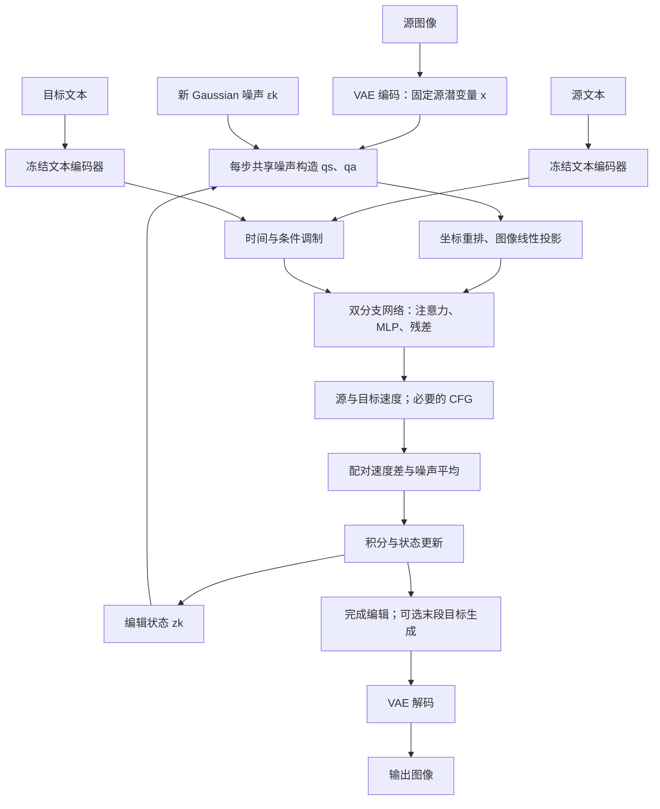

# 生成全过程的信号演变：双维误差传播与推理加速

日期：2026-10-05。对象：冻结扩散／流匹配模型及 FlowEdit；源图、源文本、目标文本已知；零训练、免微调、无反演、无编辑掩码。不采用概率密度测地线约束。本文是流程分析、文献核对与数学推导，没有运行新实验，也没有宣称候选方法已经有效或完成原创性验证。

配套：[目标速度的信号重建、估计与累计误差](FlowEdit目标速度预测_信号重建估计压缩与累计误差_深度调研_2026-10-05.md)。该笔记重点分析输出速度；本文向前展开到编码和网络内部，向后展开到积分与解码。

## 1. “信号演变”需要说明自变量和观测对象

将张量称作信号并不自动产生有效算法。至少应明确：信号在哪个坐标上变化、输入来自哪里、哪些量可观测、哪些规律可验证、近似误差如何传到输出。

| 维度 | 对应信号 | 可采用的分析 | 不能直接赋予的含义 |
|---|---|---|---|
| 空间位置 | 像素、latent、空间 token 场 | Fourier、小波、相位和混叠 | 高频不是伪影标签，低频不是允许编辑标签 |
| 特征通道 | 隐状态、Q/K/V、MLP 特征 | 协方差、奇异谱、低秩表示 | 通道轴不是物理波长或天然语义坐标 |
| 网络深度 $\ell$ | 单次前向中的特征序列 | 非线性级联、残差响应、层间增益 | 不同层不是同一个速度场的均匀时间积分 |
| 生成时间 $t$ | 状态、速度、条件影响 | 时变系统、预测／校正、误差传播 | 调度时间不是物理秒；一般生成路径不是直线 |
| 源／目标／无条件分支 | 多条件预测 | 耦合、差分、相关误差 | 源分支不是目标图真实观测 |
| 噪声样本 $j$ | 同时刻的随机响应集合 | 均值、方差、反变量、控制变量 | Gaussian 输入不保证输出或伪影误差 Gaussian |

**最重要的两个动态维度是网络深度与生成时间。**前者决定一次前向的变换，后者决定每次预测如何累计到最终图像。源目标耦合与噪声集合还会改变误差结构。

## 2. 完整流程：普通生成与 FlowEdit

普通文本生成从先验噪声开始，沿生成 ODE／SDE 演化同一个状态。FlowEdit 的速度差阶段则有三个对象。采用 $t=0$ 清晰、$t=1$ 噪声，递增编辑时间 $\tau=t_{\mathrm{start}}-t$，固定源 latent 为 $x$：

$$
q_{s,k}=(1-t_k)x+t_k\epsilon_k,\qquad
q_{a,k}=q_{s,k}+z_k-x.
\tag{1}
$$

$$
b_k=v_\theta(q_{s,k},t_k,c_s)-v_\theta(q_{a,k},t_k,c_a),
\qquad z_{k+1}=z_k+h_k\widehat b_k,
\quad h_k=t_k-t_{k+1}>0.
\tag{2}
$$

$q_s$ 是重新构造的查询点，不是由源速度积分得到的轨迹；$q_a$ 是目标条件查询点；$z$ 才是被持续积分的编辑变量。若末段转为普通目标生成，需要切换状态定义和误差模型。[FlowEdit §5、附录 F](https://arxiv.org/html/2412.08629)

### 2.1 源图是持续输入

$x$ 每一步参与式 (1)，而不只是初始化时提供一次。后续一直可以读取源图。这与“单个含噪观测只能通过连续去噪恢复原内容”的普通复原问题不同。

重复读取源图仍不提供准确目标图、非编辑区域或语义成功率。信号系统中的已知输入与真实目标观测不能混淆。

## 3. 文本与源图编码：表示变换和一次性误差

### 3.1 固定文本编码与动态文本隐状态

$e_s=T(c_s)$、$e_a=T(c_a)$ 在固定提示词的推理中保持不变，可重复使用。可缓存：

- 原始序列嵌入、pooled 向量、只依赖固定文本的输入线性投影。
- 固定坐标的位置编码。
- 只依赖已知 $(t,e,g)$ 的条件／调制量，可按时间点或按需预计算。

但 SD3 的 MM-DiT 与 FLUX 的联合注意力会更新网络内部的文本隐状态。FLUX 双流块返回新的图像与文本特征，再由单流块处理合并序列。因此深层文本 K/V 或文本特征通常依赖当前图像、时间与前面层的运算，不能全部提前算一次。[SD3 架构论文](https://arxiv.org/html/2403.03206)、[FLUX 官方前向](https://github.com/black-forest-labs/flux/blob/main/src/flux/model.py)、[双流块实现](https://github.com/black-forest-labs/flux/blob/main/src/flux/modules/layers.py)

纯文本静态 K/V 的独立 cross-attention 可以缓存固定投影，但该性质应按计算图确认。文本 token 的 Fourier 频率也不等于图像语义尺度；截断或低通可能改变词序、关系和属性。

### 3.2 VAE 是学习到的非线性编码系统

$$
x=E(I_s),\qquad I_{\mathrm{rec}}=D(x).
\tag{3}
$$

它可借鉴分析／合成滤波器组视角，但不是线性完美重建系统。卷积、下采样、非线性与训练目标共同决定信息保留。

零编辑时输出仍为 $D(E(I_s))$，不一定逐像素等于源图。需区分 VAE 重建损失与编辑漂移。[Latent Diffusion 原论文](https://arxiv.org/abs/2112.10752)

$$
D(x+\delta x)-D(x)
=J_D(x)\delta x+O(\|\delta x\|^2).
\tag{4}
$$

某些 latent 误差会被解码放大，latent MSE 小不保证轮廓、纹理或文字误差小。

**改进与加速：**源图编码一次、复用固定 latent、避免中间反复 decode–encode。若使用 posterior sampling，保持原采样约定与种子；改用 posterior mean 会改变输入定义。新训练的 VAE、蒸馏解码器与重训抗混叠模块超出当前约束。

## 4. 噪声构造：已知扰动通道

### 4.1 可以视为加噪的部分

对 Gaussian 路径

$$
Q_t=a_tX+\sigma_t\epsilon,
\tag{5}
$$

固定时刻的边际可视为有噪观测通道，理想后验均值、score 和流匹配速度存在对应恒等式。

一般流匹配可以使用不同路径与耦合，不必具有物理加噪解释。训练插值是直线，也不证明学习到的边际场积分轨迹严格直。

FlowEdit 的目标查询点由算法构造，不是真实未知目标图经过观测设备得到的测量。

### 4.2 跨步查询可能跳变

$$
q_{s,k+1}-q_{s,k}
=h_kx+t_{k+1}\epsilon_{k+1}-t_k\epsilon_k.
\tag{6}
$$

独立噪声的变化一般不按 $O(h_k)$ 缩小。原始目标速度序列未必是平滑时间信号。

可以讨论平滑性的是：满足正则条件的噪声平均场、固定噪声的短区间代理，或把噪声作为已知输入的条件预测器。

固定噪声多步会改变有限样本算法；状态依赖已用噪声后，仅有 Gaussian 边缘不足以证明条件无偏。

### 4.3 噪声集合上的真实信号结构

共同噪声使源目标响应相关。反变量查询 $\epsilon$ 与 $-\epsilon$ 可以消掉奇响应；控制变量可扣除已知零均值的响应分量。这些操作降低统计误差，不是把伪影直接当作 Gaussian 噪声再次去除。[Antithetic Noise 的 FlowEdit 应用](https://arxiv.org/html/2506.06185)

**加速逻辑：**估计方差降低后，才可能减少平均次数或重新分配样本。多算一对噪声本身不是免费加速。

## 5. 坐标重排与线性投影：明确的等价关系

### 5.1 Packing 不等于信息压缩

FLUX 将 $2\times2$ 邻域折叠进 feature 轴：

$$
P:\mathbb R^{C\times H\times W}
\to\mathbb R^{(HW/4)\times(4C)}.
\tag{7}
$$

它是可逆重排，标量数未减少。token 数减少同时输入通道增多，不能称为有损下采样。[官方 prepare／unpack](https://github.com/black-forest-labs/flux/blob/main/src/flux/sampling.py)

FFT／小波应作用于明确的二维空间，或使用对应的多相坐标解释。沿扁平 token 轴的一维 FFT 会把行边界与文本／图像拼接当相邻位置，通常没有期望的图像频率含义。

### 5.2 输入投影可精确共享

令 $H^0=W_{\mathrm{in}}Pq+b_{\mathrm{in}}$，$\delta=z-x$，则

$$
H_a^0=H_s^0+W_{\mathrm{in}}P\delta,
\tag{8}
$$

$$
H_s^0=(1-t)W_{\mathrm{in}}Px
+tW_{\mathrm{in}}P\epsilon+b_{\mathrm{in}}.
\tag{9}
$$

$W_{\mathrm{in}}Px$ 可预计算。同一步的多个噪声样本共享 $\delta$，因而共享其投影。

该等价只覆盖输入仿射层；后续文本、调制与注意力不同，不能共享全部深层特征。这一层通常只占总成本的一部分，不能由局部加速推出整体大幅加速。

## 6. 网络内部：条件驱动的非线性信号级联

### 6.1 深度上的残差演变

统一记图像和动态文本隐状态为 $H_k^\ell$，抽象一层为

$$
H_k^{\ell+1}
=H_k^\ell+\Gamma_{k,\ell}
\mathcal F_\ell(\mathcal N_\ell(H_k^\ell);m_k).
\tag{10}
$$

$m_k$ 含时间与条件，$\Gamma$ 表示门控或缩放；具体层可能有多个残差。

残差支路可视为对当前载体的修正信号。预测残差／创新并保留当前输入，比整体替换特征更容易检查误差。

不同层权重不同，门控不一定是小步长；网络层号不能直接当成同一 ODE 的时间，跳层也不自动是高阶积分。

### 6.2 归一化与调制是输入相关增益

$$
\widetilde H=(1+s(t,e))\odot\mathcal N(H)+b(t,e).
\tag{11}
$$

固定 $(t,e)$ 的调制量可缓存，$\mathcal N(H)$ 仍依赖当前统计。LayerNorm／RMSNorm 的微分耦合通道，尺度影响局部增益。

固定调制系数不意味着调制后的图像或文本特征固定。按依赖拆开计算，比冻结整个输出更容易保证正确。

### 6.3 注意力是数据相关混合

$$
A(H)=\operatorname{softmax}
\left(\frac{Q(H)K(H)^\top}{\sqrt d}+B_{\mathrm{pos}}\right),
\qquad O(H)=A(H)V(H),
\tag{12}
$$

$$
\delta O=(\delta A)V+A\,\delta V.
\tag{13}
$$

权重按行归一化，但 $A$ 随输入改变，value 与输出投影可有任意符号。它不是固定低通／Wiener 滤波器。注意力权重也不是图像数据概率密度。

**改进：**检查注意力输出变化、残差与后续响应，而不把低权重 token 当无关内容。

**加速：**先采用计算同一注意力的 IO 优化。FlashAttention 保留目标注意力公式、改变分块与数据搬运；浮点累加顺序仍可能不同。[FlashAttention](https://arxiv.org/html/2205.14135)、[FlashAttention-2](https://arxiv.org/abs/2307.08691)

为取得全注意力图而破坏高效 kernel，会引入显存和时间开销，不能忽略。

### 6.4 MLP 是局部非线性通道变换

$$
M(H)=W_2\phi(W_1H+b_1)+b_2,\qquad
J_M=W_2\operatorname{diag}(\phi')W_1.
\tag{14}
$$

MLP 按 token 混合通道，与注意力及残差共同决定响应。非线性还可生成新谱成分，一次频带截断不保证全程频带保持。

输出低秩不表示权重乘法自动能在低秩空间执行。缓存的收益要看相应算子和数据搬运的成本。

### 6.5 空间谱与奇异谱不同

Fourier 分析空间波长和相位；token × channel 矩阵的 SVD 分析线性相关和秩：

$$
H=U\Sigma V^\top+R.
\tag{15}
$$

大奇异值不代表低频，小奇异值不代表非语义变化。

若层的局部 Jacobian $J_\ell$ 与频带投影 $P_j$ 不对易，$(I-P_j)J_\ell P_j$ 描述跨带泄漏。早期频带误差可影响后续其他频带。

### 6.6 稳定子空间如何用于重建

固定局部参考子空间 $U_0,V_0$：

$$
H_k\approx U_0K_kV_0^\top+R_k,\qquad
K_k=U_0^\top H_kV_0.
\tag{16}
$$

若子空间稳定、系数可以预测，就可重建相关特征。$K_k$ 一般不对角；子空间内旋转、模态混合、符号和排序变化仍存在。

真正的子空间主角度满足

$$
\cos\theta_i=\sigma_i(U_0^\top U_k).
\tag{17}
$$

逐列内积的对角值不是一般主角度。重复奇异值下的基旋转也要处理。

[SpectralCache，2026-10-02 预印本](https://arxiv.org/html/2610.02660)已使用稳定奇异子空间与奇异值预测加速世界模型，是明确近邻。其逐列相似性与真正主角度应区分；世界模型经验也不证明 FlowEdit 新噪声查询具有相同稳定性。

保留完整高维余项 $R_k$ 时，存储仍可能接近整个特征；SVD、预测与重建开销要计入。

## 7. 单次前向误差如何进入最终生成

### 7.1 网络深度方向的传播

先假定固定输入和条件计算准确，前端误差可另作初始注入。第 $\ell$ 层近似注入误差 $d_k^\ell$，在完整前向参考附近：

$$
e_k^{\ell+1}=J_{k,\ell}e_k^\ell+d_k^\ell
+O(\|e_k^\ell\|^2),\qquad J_{k,\ell}=D_H\mathcal B_\ell.
\tag{18}
$$

定义网络后缀响应 $B_k^\ell=D_{H^{\ell+1}}v_k$，包含剩余层与输出头，则

$$
r_{v,k}\simeq\sum_\ell B_k^\ell d_k^\ell.
\tag{19}
$$

层变化小、门控小或截断能量小不直接约束 $B^\ell d$。后续放大的方向更危险。

### 7.2 深度与生成时间两条链相乘

设 $b_k^{\mathrm{ref}}$ 是参考算法的本步配对平均速度，冻结参考路径的时间反馈为 $F_k=I+h_kD_zb_k^{\mathrm{ref}}$，传播为 $S_k=F_{N-1}\cdots F_{k+1}$，图像响应为 $C_D=J_D(z_N)$。对固定噪声序列的离散算法比较，$b_k^{\mathrm{ref}}$ 采用指定样本平均；对平均场分析则采用 $\bar b$。二者的参考与导数不能混用。于是网络近似的一阶贡献为

$$
\delta I_N\simeq\sum_{k,\ell}h_kC_DS_k
\left(B_{s,k}^\ell d_{s,k}^\ell
-B_{a,k}^\ell d_{a,k}^\ell\right).
\tag{20}
$$

**一次内部近似要穿过网络后缀和剩余生成轨迹。**这是固定参考的一阶推导；较大扰动、自适应缓存和随机反馈会增加非线性余项与相关性，不是全局保证。

### 7.3 同步缓存也不自动抵消误差

即使 $d_s^\ell=d_a^\ell=d$，误差仍含

$$
(B_s^\ell-B_a^\ell)d.
\tag{21}
$$

两分支的条件与状态不同，后缀增益也可能不同。同步缓存可避免人为失配，但校验对象仍应包含配对速度差。

### 7.4 用传播后的风险分配计算

候选局部风险为

$$
\mathcal R_{k,\ell}=
\mathbb E\left\|h_kC_DS_k
\left(B_{s,k}^\ell d_s^\ell-B_{a,k}^\ell d_a^\ell\right)\right\|^2.
\tag{22}
$$

它关注实现误差，不定义非编辑区域。当前真实 $d$ 与未来 $S$ 常不可直接读取，需校验步、历史残差或短时代理。

层间、时间间误差相关时，不能把这些风险相加称为精确总 MSE；应保留交叉项或用范数上界。变化指标不是未经条件证明的误差界。

式 (20) 为单个配对查询写出；多噪声样本时，还要在每步对样本 $j$ 求平均，每个样本具有自己的后缀响应和误差。式中只列网络近似的贡献，随机估计、积分和编码误差另行记账。

## 8. 输出速度与 guidance：输出估计和条件增益

### 8.1 速度是 latent 关于模型时间的变化率

RF 的 $v$ 不是物理图像运动速度，其尺度受编码、时间映射和 scheduler 约定影响。固定输入的完整网络速度可以读取；噪声平均速度需要估计；能精确完成语义的理想速度没有真值。

### 8.2 CFG 对误差的作用

普通 CFG：

$$
v_w=v_u+w(v_c-v_u)=(1-w)v_u+wv_c,
\tag{23}
$$

$$
r_w=(1-w)r_u+wr_c.
\tag{24}
$$

误差协方差决定实际放大程度。只缓存无条件分支、只降低条件分支精度或采用不同刷新窗口，都可能改变误差抵消。

FLUX guidance embedding 通过网络调制生效，通常不是式 (23) 的显式双分支线性组合；不能据此假设省掉一次无条件前向。[FLUX 官方 forward](https://github.com/black-forest-labs/flux/blob/main/src/flux/model.py)

[FasterCache](https://arxiv.org/html/2410.19355)已有条件／无条件冗余研究。用于 FlowEdit 时，还需区分源／目标分支；两个查询点不同，空文本相同也不意味着无条件速度可精确共享。

### 8.3 滤波应该针对什么

对原速度做全局低通或 EMA，一般改变平均场与必要语义作用。对象更明确的信号包括：

- 速度差的零均值采样波动。
- 相对于廉价预测器的创新。
- 可被新完整前向校正的缓存误差。
- 同一 RHS 的区间积分缺陷。

若要保持平均场，应采用已知零均值控制变量或新残差校正的多保真估计。只用历史预测器替换当前速度，不具有一般无偏性。

### 8.4 低精度可能吞掉小编辑信号

若网络输出已有舍入误差：

$$
\widetilde b=(v_s+r_s)-(v_a+r_a)=b+r_s-r_a.
\tag{25}
$$

$\|b\|$ 比分支幅度小时，相对误差可被放大。差值变小不等于差值准确。

较高精度构造共享查询点、形成速度差并累积状态，可减少新增舍入；不能恢复前向已经丢失的精度。浮点相减在某些条件下甚至可精确，问题常来自两个操作数已被近似。

补偿求和只改善累加舍入，不修复模型、语义或积分截断误差。增加精度也不必然加速。

## 9. 轨迹积分：时间上的区间信号重建

### 9.1 每一步需要区间平均作用

对确定性平均场：

$$
z(\tau+h)-z(\tau)=\int_\tau^{\tau+h}\bar b(z(s),s)\,ds.
\tag{26}
$$

Euler 使用起点值，局部缺陷首项为

$$
d_k=\frac{h_k^2}{2}
\left(\partial_\tau\bar b+D_z\bar b\,\bar b\right)_k
+O(h_k^3).
\tag{27}
$$

高阶求解器、历史多步和预测／校正可理解为重建区间作用。文本 VJP 和单步速度模长不能直接代替式 (27)。

### 9.2 改时间表需要保持导数系数

若实际噪声时间为 $t=\phi(s)$，更新要包含 $dt/ds$。重参数化可以改变数值难度，但不改变同一连续曲线的几何形状，也不消除模型偏差。

非均匀网格下，不应按相等步数间隔直接外推速度。噪声幅度、时间标签和积分权重还需遵循实际 scheduler 映射。

### 9.3 随机查询限制高阶积分含义

固定噪声的 Heun 比较可诊断那个局部代理。但 predictor 状态依赖本步噪声，corrector 再用同一噪声时，

$$
\mathbb E[D_zb_\epsilon b_\epsilon]
\ne D_z\bar b\,\bar b
$$

一般成立。完整平均场的精度要分析阶段间耦合与采样方差；配套笔记给出了二阶偏差项。

### 9.4 少步与少计算要联动

冻结线性参考的终点采样方差含

$$
\sum_k\frac{h_k^2}{m_k}S_k\Sigma_{b,k}S_k^\top.
\tag{28}
$$

少步增大 $h_k$ 可能放大方差；高阶方法增加前向；Jacobian 诊断增加微分。应联合分配步长、平均次数与每步网络计算量。

[SADA，ICML 2025](https://proceedings.mlr.press/v267/jiang25h.html)已联合研究 step／token 稀疏与求解器信息。本研究需具体解决 FlowEdit 的重采样、配对分支及式 (20) 的误差，而不能把“稳定性决定计算”单独当原创。

## 10. 解码与像素输出：最后一级合成系统

$I_{\mathrm{out}}=D(z_N)$。解码中的上采样、卷积、归一化与非线性改变谱和相位，可放大 latent 误差。

预处理、裁剪、尺寸调整、VAE scale／shift、颜色范围与后处理也影响最终一致性。这些一次性误差不能靠增加去噪步数自动消除。

### 10.1 可以改进的工程环节

- 编码与解码遵循同一模型约定。
- 避免不必要的中间 decode–encode。
- 原则上只在终点解码；诊断解码另计成本。
- 分块解码处理 overlap、感受野及可能的全局归一化；不能笼统视为完整解码的精确等价。

### 10.2 抗混叠研究的适用边界

[Alias-Free LDM，CVPR 2025](https://openaccess.thecvf.com/content/CVPR2025/html/Zhou_Alias-Free_Latent_Diffusion_Models_Improving_Fractional_Shift_Equivariance_of_Diffusion_CVPR_2025_paper.html)通过架构与训练约束改善等变。它说明混叠与一致性有关，但给冻结输出加一次低通不能获得其完整能力。

像素低通可能删除合法的新纹理、轮廓和文字。它不提供非编辑内容识别。

## 11. 改进和加速应该放在哪些位置

| 阶段 | 有价值的信号性质 | 质量改进方向 | 加速方向 | 优先判断 |
|---|---|---|---|---|
| 文本／源编码 | 输入固定、依赖明确 | 避免编码／条件约定失配 | 静态结果复用 | 基础工作，收益边界清晰 |
| 噪声查询 | 已知随机输入、分支相关 | 配对统计、方差缩减 | 达标后减少平均或重分配 | 优先，与已有反变量比较 |
| 输入投影／调制 | 线性关系、固定量 | 避免额外舍入和坐标误用 | 式 (8)–(9)、调制预计算 | 工程基础，通常非主要贡献 |
| 残差／注意力／MLP | 局部冗余、深度级联 | 控制后缀放大、跨带泄漏 | 浅层新观测、受控块预测 | 最值得研究，必须约束误差和成本 |
| 输出／guidance | 条件差与相关误差 | 配对误差校准、精度配置 | 多保真预测与校正 | 中高，不直接冻结目标输出 |
| 时间积分 | 区间作用与传播增益 | 缺陷、方差联合控制 | 步长与网络调度联合设计 | 中高，已有强相关工作 |
| 解码 | 固定合成、输出敏感性 | 区分 VAE 与轨迹误差 | 减少重复解码与搬运 | 基础工作，通常不是迭代成本主体 |

### 11.1 等价复用和近似预测分别记账

固定输入的重复运算可按依赖直接复用，主要改变执行成本。动态 K/V、跨步特征、目标速度和低秩预测产生近似误差，需要校验与回退。

数学等价不表示逐位相同；batch 和 kernel 会改变浮点累加顺序。

### 11.2 源侧的任务级复用

固定 $x,c_s,t,\epsilon$ 时，

$$
v_s=v_\theta((1-t)x+t\epsilon,t,c_s)
\tag{29}
$$

与目标文本、编辑变量无关。同一源图的多个目标编辑采用相同时间、噪声及源 guidance 时，可以共享源输出。

对 $K$ 个目标，源／目标单次成本为 $C_s,C_a$，这部分理想算术加速比为

$$
\frac{K(C_s+C_a)}{C_s+KC_a}.
\tag{30}
$$

等成本时为 $2K/(K+1)$。$K=1$ 不减少调用数；提前批算单次编辑的源查询可能改善利用率，但不减少总计算。

时间、样本、源提示词、guidance、模型与精度变化会使精确缓存失效。预计算不能用未来噪声结果选择当前样本而继续沿用独立采样的无偏性证明。

### 11.3 平滑平均特征不能直接替代平均输出

$$
\mathbb E[\mathcal B(H)]\ne\mathcal B(\mathbb EH)
\tag{31}
$$

一般成立。先平均随机 feature 再只跑一次后缀，不等于平均多个完整速度。局部 Taylor 的 Hessian–协方差项解释偏差来源；需要新残差校正或单独分析。

## 12. 相关工作对应的信号过程

| 文献 | 主要位置 | 当前角色和边界 |
|---|---|---|
| [DeepCache，CVPR 2024](https://openaccess.thecvf.com/content/CVPR2024/papers/Ma_DeepCache_Accelerating_Diffusion_Models_for_Free_CVPR_2024_paper.pdf) | U-Net 高层复用、更新低层 | 层间冗余先例，DiT 不能直接照搬该分层 |
| [FreeU，CVPR 2024](https://openaccess.thecvf.com/content/CVPR2024/html/Si_FreeU_Free_Lunch_in_Diffusion_U-Net_CVPR_2024_paper.html) | backbone／skip 信号重加权 | 冻结内部信号调整先例，主要改质量，不是省前向通用方法 |
| [T-GATE](https://arxiv.org/html/2404.02747) | 注意力阶段稳定与缓存 | 不证明 FlowEdit 重采样稳定或深层文本恒定 |
| [ToMeSD，CVPR 2023 工作坊](https://openaccess.thecvf.com/content/CVPR2023W/ECV/html/Bolya_Token_Merging_for_Fast_Stable_Diffusion_CVPRW_2023_paper.html) | 空间 token 合并 | 计算压缩先例，选择不是准确编辑区域 |
| [Importance-based Token Merging，ICCV 2025](https://openaccess.thecvf.com/content/ICCV2025/html/Wu_Importance-Based_Token_Merging_for_Efficient_Image_and_Video_Generation_ICCV_2025_paper.html) | 条件代理分配 token 计算 | 当前主方案不依赖编辑区域／token 权限图 |
| [EEdit，ICCV 2025 作者正文](https://arxiv.org/html/2503.10270) | 编辑 locality cache、索引预处理、反演跳步 | 原方法使用编辑掩码与反演，不能直接作当前方案 |
| [DiCache，ICLR 2026](https://proceedings.iclr.cc/paper_files/paper/2026/hash/78288ef33b18a351c3cd679dc9a15c8d-Abstract-Conference.html)；[正文](https://arxiv.org/html/2508.17356) | 浅层观测、深层预测、残差对齐 | 浅层决定后缀缓存已有直接先例 |
| [SADA，ICML 2025](https://proceedings.mlr.press/v267/jiang25h.html)；[正文](https://arxiv.org/html/2507.17135) | 求解器与时间／token 稀疏 | solver–architecture 联合已有 |
| [SeaCache](https://arxiv.org/html/2602.18993) | 频谱演化与缓存 | 频谱不是正确语义的测量 |
| [SpectralCache，2026-10-02 预印本](https://arxiv.org/html/2610.02660) | 奇异子空间、系数外推 | 稳定子空间复用已有，对象为世界模型 |
| [SpecDiff，2025-09 预印本](https://arxiv.org/html/2509.13848) | 自推测、多级 feature 计算 | 推测缓存已有；主要核对作者方案介绍，经验收益不作保证 |
| [FasterCache](https://arxiv.org/html/2410.19355) | 特征与 CFG 分支复用 | 分支冗余已有 |
| [FlashAttention](https://arxiv.org/html/2205.14135) | 注意力 IO 重组织 | 同一公式的高效执行基础 |
| [Antithetic Noise](https://arxiv.org/html/2506.06185) | 噪声集合、FlowEdit 速度平均 | 必须纳入统计基线 |

上述作者报告不等于本项目验证。“特征变化小”“只更新创新”“低秩系数预测”“浅层决定深层缓存”都不足以单独建立原创性。

## 13. 更符合当前目标的候选组织

### 13.1 按依赖复用固定计算

复用文本、源 latent、可分离位置编码、投影常量、条件量；保证模型、坐标、guidance 与随机输入一致。保持整个图像网格，不构造编辑权限或注意力掩码。

### 13.2 当前噪声经过浅层，深层仅在可校验窗口预测

源目标读取当前共同噪声、运行选定浅层；依据完整校验时的配对变化与风险代理，选择完整后缀、有限块残差预测，或关闭该窗口的近似。

浅层 proxy 与深层相关已有 DiCache；这里需解决 FlowEdit 新噪声与配对速度差的特有条件。这只是候选组织，不是已验证算法。

不算当前后缀就不知道真实误差。触发器只是代理，校验与拒绝后的完整前向是必要成本。

### 13.3 校验配对输出，再分析双维传播

$$
\delta b_k=
(\widehat v_{s,k}-\widehat v_{a,k})-(v_{s,k}-v_{a,k}).
\tag{32}
$$

这个对象比单独目标 feature 的 cosine／重建误差更接近实际更新。再按式 (20) 的传播代理判断哪些层与时段需要计算。

配对数值准确也不证明语义和非编辑内容保护；后者仍需独立判断。

### 13.4 网络与积分预算联动

网络近似误差主导时完整重算，避免用更多步传播同一偏差。积分缺陷主导时缩步或用相容高阶方法。随机方差主导时改进采样或增加有效样本。

这三类操作处理不同误差，不能统一称为增强去噪。

## 14. 总成本与研究价值

端到端成本至少包括

$$
T=T_{\mathrm{text}}+T_{\mathrm{enc}}+T_{\mathrm{dec}}
+\sum_k\left[m_k(T_{s,k}+T_{a,k})
+T_{\mathrm{probe},k}+T_{\mathrm{recon},k}
+T_{\mathrm{AD},k}+T_{\mathrm{fallback},k}\right]
+T_{\mathrm{transfer}}.
\tag{33}
$$

该式是记账；batch、并行与重叠执行会改变实际墙钟。已包括在网络成本中的浅层不得又重复算一次 probe；只有额外观测才单列。

原耗时可加速比例为 $f$、该部分速度提高 $s$ 倍时，理想端到端上限受

$$
\operatorname{speedup}\le\frac1{(1-f)+f/s}
\tag{34}
$$

约束；新增统计、校验、重建开销降低收益。小投影层再快也可能影响有限，内部后缀与重复网络调用更值得关注。

**建议研究核心：把冻结生成器表示为条件驱动的深度—时间级联系统，用当前噪声下的新观测预测有限残差，并按配对误差的最终输出影响分配计算。**

首先应证明或验证实现误差与总成本能否同时降低。真实语义、一致性和伪影仍需独立检验。信号改进不恢复 VAE 已丢失的信息，也不提供未知目标真值；当前数学对象不构成已完成的原创性结论。
