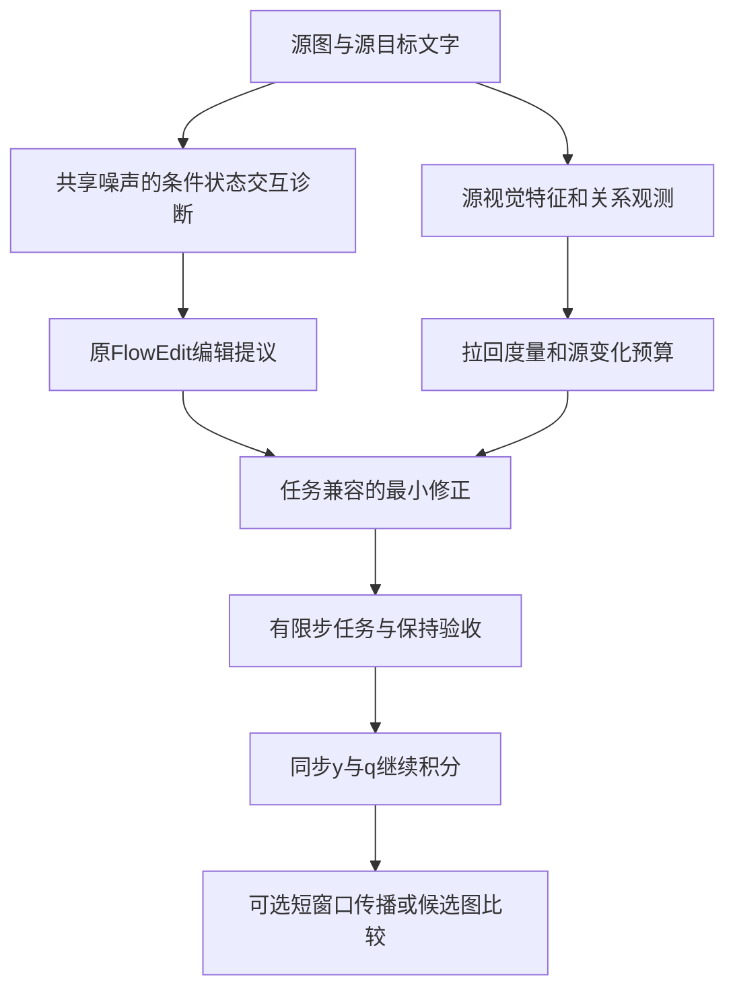

# 编辑耦合的跨学科数学框架

日期：2026-10-14。

研究范围：只输入源图、可能不完整的源描述和目标描述，冻结现有预训练模型；无训练／微调，无额外描述 LLM、参考图、轮廓或空间／注意力编辑区域掩码；优先 FlowEdit 的无反演、干净编辑状态 y 接口。编辑终点自由，不要求输出等于某个预先生成的目标图。

本文结合[源描述关联系统调研](源描述与源图关联_描述偏差校准与未提及内容保持_系统文献调研_2026-10-14.md)与本轮一般科学文献核对，讨论梯度、多目标优化、黎曼几何、流体力学、概率统计、图、最短路径、约束力学与控制。数学公式主要为独立推导和已知工具的迁移，不宣称组合即原创。仅开展理论研究，没有运行新的图像实验。

## 0. 核心问题：限制有害影响，同时允许必要耦合

“棕熊变黑熊”可能要求颜色与毛发外观共同改变；物体移动可能要求遮挡、阴影和反射共同改变。处理编辑耦合时，需要区分必要后果与不相关漂移。

| 层面 | 数学对象 | 可用工具 |
|---|---|---|
| 条件与状态的交互 | 文本条件改变后，速度对当前实例的响应怎样改变 | 四分支交互差、混合响应、统计配对 |
| 表征／坐标纠缠 | 语义梯度改变哪些视觉因素 | 任务—保持算子对、自然梯度、各向异性度量 |
| 计算路由扩散 | 目标文字如何影响多个图像 token | 图关系、模态子块、attention 约束 |
| 随机估计误差 | 同一编辑在不同噪声下的更新波动 | 控制变量、对偶采样、置信区间 |
| 后续传播 | 当下的小误差是否在后面放大 | 非模态稳定性、短窗口传播算子 |
| 有限步误差 | 切向或一阶控制为何仍偏离约束 | 回缩、SHAKE／RATTLE、二阶余项 |
| 路径选择 | 多个可行编辑路径如何选 | 约束最小作用量、候选图搜索、概率路径控制 |

这里最重要的信息瓶颈是：源图中哪些因素需要保持，以及冻结模型是否真正能观测这些因素。数学工具可以控制定义好的量，不能凭空补足缺失的语义辨识。

## 1. 统一符号与 FlowEdit 接口

令 x 为源图 VAE 潜变量，y 为当前干净编辑状态，t 为噪声比例，源／目标条件分别为 c_s、c_a。一步使用相同噪声 epsilon：

$$
q_s=(1-t)x+t\varepsilon,\qquad q_a=q_s+y-x.
$$

令 h=t-t_{next}>0，原始增量为：

$$
\Delta=-h\left[v_\theta(q_a,t,c_a)-v_\theta(q_s,t,c_s)\right],
\qquad \bar y=y+\Delta.
$$

以下在干净空间求状态位移 u，修正后：

$$
y_{next}=y+u,
\qquad q_a(t_{next})=q_s(t_{next})+y_{next}-x.
$$

如果实际时间表使用 sigma(t)，需统一在噪声比例或物理时间坐标内定义速度和步宽。CFG、噪声、尾段和 VAE 重建误差分别核对，不以 y 空间代数闭环替代完整采样正确性。

令 psi(y) 为目标任务响应向量，phi(y) 为源实例观测；它们由冻结模型及源图计算，不额外接收空间区域标签。定义：

$$
C=D_y\psi(y),\qquad A=D_y\phi(y),\qquad
r=\phi(y)-\phi(x),
$$

$$
E_P(y)=\frac12 r^\top W r,\qquad W\succeq0.
$$

psi、phi 都是代理。全局 SigLIP 分数可参与诊断，但此前实验没有证明它足以识别实际任务和实例保持，不能再次作为唯一真值。

## 2. 概率统计与响应分析：先测量交互，再讨论抑制

### 2.1 四个条件—状态分支的精确分解

在同一时间、同一噪声下，定义：

$$
V_{ss}=v(q_s,c_s),\quad V_{sa}=v(q_s,c_a),\quad
V_{as}=v(q_a,c_s),\quad V_{aa}=v(q_a,c_a).
$$

省略 t。定义源位置的条件响应与源条件下的状态响应：

诊断时先让四分支使用相同 CFG（例如 1），再单独研究源／目标 CFG 不对称。否则条件响应和交互也会包含引导强度差异，不能全部解释为文字语义变化。实际主积分是否采用不同 CFG，则按基线配置单独记录。

$$
R_c=V_{sa}-V_{ss},\qquad
R_q=V_{as}-V_{ss}.
$$

交互项为：

$$
H=V_{aa}-V_{as}-V_{sa}+V_{ss}.
$$

于是原速度差有精确关系：

$$
V_{aa}-V_{ss}=R_c+R_q+H.
$$

H 测量“目标条件响应在编辑后的查询与源查询之间发生了多少变化”。若局部模型恰好为 v(q,c)=a(q)+b(c)，则 H=0。

该分解不需要对文本嵌入加扰动，不需要使用 e_a-e_s，也不要求两段文本具有相同 token 对齐。它是计算交互的有限差异，不是语义准确率或因果效应识别。

### 2.2 交互也可以用状态微分表达

令 delta=q_a-q_s=y-x，沿 q(lambda)=q_s+lambda delta。若速度对状态可微，则：

$$
H=\int_0^1
\left[D_qv(q(\lambda),c_a)-D_qv(q(\lambda),c_s)\right]
\delta\,d\lambda.
$$

这只对状态路径求微分，不把文本嵌入插值解释成真实自然语言。可使用状态 JVP 检查局部条件依赖的放大，避免语义条件扰动本身产生跳变。

### 2.3 为什么不能直接去掉 H

目标类别可能需要新的形状、纹理或反射，这些变化必须根据当前状态调整。H 同时包含必要非线性适应与附带变化，范数大不等于错误。

有价值的诊断是：H 是否主要导致源实例观测 A 的变化，是否支持任务响应 C，以及它的后续传播是否稳定。将 H 全部清零会把目标响应固定在源查询附近，可能阻碍大幅编辑。

同样，R_q 也不只是误差：它可能是目标状态形成以后继续完善图像所需的动力学。三个分量均需结合任务与视觉观测解释。

### 2.4 从统计配对得到的有限结论

四个分支使用相同随机量，可以减少比较中的噪声，但只能识别冻结模型的条件—状态交互。没有真实属性标签和充分的观测假设时，它不能自动区分姿态漂移与合理形变。

已有源／目标差分先例包括 [DDS，ICCV 2023](https://openaccess.thecvf.com/content/ICCV2023/html/Hertz_Delta_Denoising_Score_ICCV_2023_paper.html)、[FlowEdit，ICCV 2025](https://arxiv.org/html/2412.08629)。四分支混合差属于通用交互分析，本身不构成已确认的原创算法。

## 3. 梯度思想：将目标响应与保持代价共同纳入优化

### 3.1 单纯沿目标梯度，为什么会漂移

设目标评分为 S(y)，其微分 g=dS 是协向量。欧氏梯度上升选 u 正比于 g，但这个方向受到潜空间坐标与评分器表征的影响，不必保持姿态、身份或背景。

需要显式考察：

$$
\delta\psi\approx Cu,\qquad \delta\phi\approx Au.
$$

这里 A 的作用对象是源视觉观测，不是数据密度的 score Jacobian。因此也没有恢复“大小奇异值自动表示流形切／法向”的旧假设。

### 3.2 一个不冻结终点的局部问题

给定本步期望任务响应 b，考虑：

$$
\min_u
\left\{\frac12\|u-\Delta\|_G^2
+\frac\lambda2\|r+Au\|_W^2\right\},
\qquad Cu=b,
$$

其中 G 为本步固定的正定矩阵，lambda>0。b 可以来自原提议的局部响应，或经过目标辨识验证的期望进展；它不是预先指定的编辑图像终点。

令：

$$
B=G+\lambda A^\top WA,\qquad
f=G\Delta-\lambda A^\top Wr,\qquad u_0=B^{-1}f.
$$

当 b 属于 range(C) 时，约束可行，严格凸问题有唯一解：

$$
u^*=u_0+B^{-1}C^\top
\left(CB^{-1}C^\top\right)^\dagger
(b-Cu_0).
$$

**推导。** 展开目标得到二次型的一阶条件 Bu-f+C^T nu=0，联立 Cu=b 求乘子，再代回即可。冗余约束使用伪逆；B 正定保证唯一状态位移。

它可以同时修正与任务不冲突的源漂移，并在保持约束过强时付出可量化代价。它保证线性代理，不保证自由文本对应的真实编辑成功。

### 3.3 本步任务响应可能无法与保持约束同时满足

若将保持改成 Au=0，则需要 b 属于 C(ker A)。例如 y=(a,z)，目标响应为 a+z，但保持观测也只测 a+z；要求任务增量非零且保持不变显然不可行。

因此，增加约束并不总是改善方法。应检查联合可行性、响应算子的秩和条件数；否则会出现过强约束、欠编辑或数值爆炸。

### 3.4 为什么一阶保持损失可能看不见第一步损害

在源图 y=x 处，r=0，所以：

$$
\nabla E_P(x)=A^\top Wr=0.
$$

但是：

$$
E_P(x+u)=\frac12u^\top A^\top WAu+O(\|u\|^3)
$$

在足够光滑的条件下成立。首步的损害出现在二阶，而不是源损失的线性梯度中。

这是选用特征 Jacobian／Gauss–Newton 二次项的重要理由。仅把源损失梯度和语义梯度做角度分解，在原图附近可能得不到有效纠错信息。

### 3.5 多目标梯度冲突的相关工作

[PCGrad，NeurIPS 2020](https://arxiv.org/abs/2001.06782)在多任务训练中投影冲突梯度，是已有梯度消冲突先例。迁移到推理控制时，优化变量可改为 y，主干权重不变。

但多目标梯度合成不提供保持量本身，也不解决初始源梯度为零的问题。高维编辑需要处理观测算子和有限步，而不能仅根据两个全局梯度的夹角判断真实语义冲突。

## 4. 黎曼几何：用可观测代价定义度量

### 4.1 区分三种流形

| 几何对象 | 定义 | 能回答的问题 |
|---|---|---|
| 数据支持／密度几何 | 预训练图像分布的几何 | 哪些变化更符合生成模型；不独自定义实例保持 |
| 保持量等值集合 | N_x={y:phi(y)=phi(x)} | 哪些变化保持所选源观测 |
| 任务响应纤维 | F_s={y:psi(y)=s} | 哪些变化不影响所选任务响应；其中也可能有不相关漂移 |

若 phi 可微且在邻域常秩，其等值集合局部构成流形，切空间为 ker A。这个切空间由保持量定义，不由密度谱自动决定。

### 4.2 拉回度量

对于冻结视觉观测，定义：

$$
G_y=\epsilon I+A(y)^\top W A(y),\qquad \epsilon>0.
$$

它衡量潜位移引起的源视觉变化。加 epsilon I 避免盲方向导致退化；由此得到真实正定的局部度量。

这与生成器／观测 Jacobian 诱导几何的思想一致，[Latent Space Oddity，ICLR 2018](https://arxiv.org/abs/1710.11379)研究了生成器非线性导致的潜空间距离扭曲。当前迁移不依赖该论文训练的新生成器，也不声称其几何已解决编辑语义。

### 4.3 自然梯度与最小损害方向

对标量任务梯度 g，考虑最小代价的指定进展：

$$
\min_u\frac12u^\top G_yu,
\qquad g^\top u=\beta>0.
$$

当 g 非零时，唯一解为：

$$
u^*=\frac{\beta G_y^{-1}g}{g^\top G_y^{-1}g}.
$$

这说明自然梯度可以看成在既定任务微分下，优先采用较少改变保持观测的方向。[Amari，1998](https://doi.org/10.1162/089976698300017746)的自然梯度思想提供了坐标与度量层面的基础。

但 G 如果用错误或不充分的观测构造，最短方向也可能改变未观测的因素。几何保证依赖代价定义，而不是“使用黎曼几何”这一名称。

### 4.4 注意力概率的 Fisher 度量

若某图像节点的路由概率 p_j(y)>0，定义其局部 Fisher 拉回：

$$
G_{attn}(y)=\sum_j p_j(y)
\nabla_y\log p_j(y)\nabla_y\log p_j(y)^\top.
$$

对于小位移 u，有：

$$
\operatorname{KL}(p(y)\|p(y+u))
=\frac12u^\top G_{attn}(y)u+O(\|u\|^3).
$$

可对模态占比、条件化图像关系分别构造度量，避免全量注意力冻结。推导与明确适用边界见[DiT 注意力关系报告](不完整描述编辑_条件耦合与DiT注意力关系约束_理论调研_2026-10-14.md)。

Fisher 对概率坐标有明确意义，但保持路由不等于保持图像身份，路由盲点与条件纠缠仍需检验。

### 4.5 平行移动、路径依赖和语义循环

不同 y 处的梯度属于不同切空间，直接比较其欧氏方向未必有相同几何意义。平行移动可以提供一致的方向比较，但它首先要求确定可靠度量。

还需注意，逐步最小代价编辑不保证路径无关。例如状态为 (a,b,z)，任务响应为 (a,b)，两个可行编辑向量场为：

$$
X=\partial_a,\qquad Y=\partial_b+a\partial_z.
$$

依次进行 +hX、+hY、-hX、-hY，最终 a,b 回到初值，但 z 增加 h^2。其 Lie 括号为：

$$
[X,Y]=\partial_z.
$$

因此，目标响应闭环也可能积累任务之外的变化。可用语义循环测试诊断，但不能由循环一致性独自证明编辑正确。

## 5. 流体力学与约束力学：压力式最小修正

### 5.1 压力投影的可迁移结构

[Chorin，1968](https://math.berkeley.edu/~chorin/chorin68.pdf)的投影思想是先得到速度提议，再通过压力把它修正到满足不可压缩约束的速度空间。

对编辑，若已选定保持算子 A，原提议为 Delta，可解：

$$
\min_u\frac12\|u-\Delta\|_G^2,
\qquad Au=0.
$$

得到：

$$
u=\Delta-G^{-1}A^\top p,
\qquad
AG^{-1}A^\top p=A\Delta.
$$

推导来自约束乘子。第二个方程相当于压力方程，修正力沿保持约束的法方向施加。必要时用伪逆或显式软约束处理冗余／不可行性。

源偏移已经存在时，可以改为 Au=-k r 来局部恢复源观测。再同时要求 Cu=b，则堆叠算子与右端，使用同一最小修正结构；不能默认堆叠后的约束可行。

### 5.2 不可压缩不等于不改变图像内容

数据概率空间的连续性方程为：

$$
\partial_s p+\nabla_y\cdot(pu)=0.
$$

即使 div(u)=0，也只是局部体积约束。例如常向量场 u(y)=c 的散度为零，却可以把全部实例平移到别的位置。它不保证姿态、颜色、背景或身份保持。

像素坐标上的速度场、潜变量空间的速度场和概率密度的输运速度也是不同对象。不能把某个 latent 张量的空间差分散度直接当作真实图像不可压缩性。

### 5.3 输运—反应分解：区分形变与外观变化

作为局部图像形成模型，可写：

$$
\partial_s I+\boldsymbol a\cdot\nabla I=r_{app}.
$$

a 表示像素平面上的形变，r_app 表示颜色、材质、光照等外观变化。对换颜色任务，较小 a 有意义；对移动／姿势任务，a 必须允许非零。

但从单个变化图同时估计 a 与 r_app 不可自动识别：允许 r_app 任意取值时，总能取 a=0，将全部变化归于外观。因此需要外观弱敏感、位置敏感的冻结特征或额外物理假设；不能把这条方程作为已经完成解耦的算法。

使用源／当前图像的内部特征对应，不引入外部参考图，但仍可能受重复纹理、遮挡和特征外观纠缠影响。

### 5.4 SHAKE／RATTLE：速度与位置都要满足约束

线性约束 Au=0 只给一阶保持。若 phi 二阶可微：

$$
\phi(y+u)-\phi(y)=Au+\frac12D^2\phi(y)[u,u]+O(\|u\|^3).
$$

因此一次大步即使切向也会偏离等值集合。分子动力学的 [SHAKE，1977](https://www.sciencedirect.com/science/article/abs/pii/0021999177900985)与 [RATTLE，1983](https://doi.org/10.1016/0021-9991(83)90014-1)提供了位置与速度分别满足约束的先例。

编辑中的对应做法是：先获得局部位移，再检查有限步的真实 phi、psi，必要时执行小范围回缩／重求解，最后同步 q。回缩须保持任务可行，不能将目标图恢复为原图。

经典分子约束已知；编辑中的保持量有语义不确定性，这是两者保证范围的关键差别。

### 5.5 Onsager 变分思想：外力与耗散分别建模

以当前目标驱动视作广义外力 f_T，源代价为 E_P，可研究 Rayleighian：

$$
\mathcal R(u)=\frac12u^\top G u+
\nabla E_P(y)^\top u-f_T^\top u.
$$

无约束时 u=G^{-1}(f_T-nabla E_P)，并有：

$$
\frac{dE_P}{ds}=f_T^\top u-u^\top Gu.
$$

这一结构区分目标做功与保持恢复／耗散。[Doi，2011](https://doi.org/10.1088/0953-8984/23/28/284118)讨论 Onsager 变分原则如何统一软物质动力学。

当前迁移只是优化结构：源视觉代价不是物理热力学自由能，生成网络也不服从真实流体动量方程。它的价值是明确外力、代价和约束的关系，避免靠任意附加“黏性”项导致纹理模糊。

## 6. 图论与谱：保护实例关系，并分析信息传播

### 6.1 由源图内部建立图

节点可取 DiT 图像 token，边权可由源图内部注意力或冻结 patch 特征的相似度构造。不要将边权解释为准确对象标签，也不生成编辑区域 mask。

对非对称注意力，需要明确对称化规则。设 W_G 对称、非负，D_G 为度矩阵，L=D_G-W_G，则 L 半正定。图上特征增量 U 的 Dirichlet 能量为：

$$
E_G(U)=\operatorname{tr}(U^\top LU)
=\frac12\sum_{i,j}w_{ij}\|U_i-U_j\|^2.
$$

它惩罚相关节点间不协调的变化。其源头是图 Laplacian 与连续几何、热方程的联系：[Belkin–Niyogi，NIPS 2001](https://papers.nips.cc/paper_files/paper/2001/hash/f106b7f99d2cb30c3db1c3cc0fde9ccb-Abstract.html)、[Coifman–Lafon，2006](https://www.sciencedirect.com/science/article/pii/S1063520306000546)。

### 6.2 图平滑不等于源结构保持

所有节点一起增加相同亮度时，U_i-U_j=0，图能量为零。对象整体移动也可能保持许多相似关系。因此仅使用 Laplacian 平滑，仍会放过全局漂移。

还需要位置敏感的源关系观测、适当的锚定或多类特征。完整冻结所有关系可能阻碍物体移动和形状变化；关系保持的范围必须与任务兼容。

可以在第 3 节使用：

$$
G=\epsilon I+J_F^\top(L\otimes I)J_F,
$$

其中 J_F 是当前图像特征对 y 的 Jacobian。该度量衡量图上的特征变化复杂度；是否足以保持姿态，需要实验检查。

### 6.3 图谱与任务响应必须联合分析

L 的大特征值方向代表图上的高变化复杂度，不自动是伪影；小特征值方向也可以对应不必要的全局光照漂移。

更合适的是研究：

$$
\mathcal Q(u)=
\frac{\|Cu\|^2}
{u^\top(A^\top WA+\mu I)u},\qquad \mu>0.
$$

这是任务响应相对保持代价的广义 Rayleigh 商。但任务向量的方向、符号和具体属性仍需说明；只最大化响应范数可能朝错误属性移动。

与此前谱方案不同，本节算子有明确的测量对象。它不需要把数据密度的局部谱赋予“语义／非语义”标签。工具背景与相关文献见[任务—保持算子对报告](任务兼容保持量_奇异谱频谱黎曼几何与流体力学_深度调研_2026-10-12.md)。

### 6.4 注意力图作为信息传播的分析对象

若 P 是行随机图像路由矩阵，可用 P 的幂或 resolvent 分析跨节点影响如何传播。真实 DiT 同时有 value、残差、MLP、文本调制和不同层参数，故 P 的传播不是完整模型因果传播。

生成编辑领域已有 [LOCATEdit，ICCV 2025](https://arxiv.org/html/2503.21541)的 attention 图、[HeadRouter，TOG 2026](https://doi.org/10.1145/3797956)的头级控制。前者的完整方法依赖定位 mask；图分析本身可以借鉴，但不能把完整方法称为无掩码。

### 6.5 最有价值的图用途

优先用图建立比全局图文向量更细的关系观测，检查它是否发现了视角、姿态、物件相对位置的变化。不要首先把图谱用于删掉某个频带或强行平滑整个图像。

2026-10-21 后续专题：[图论视角的扩散与流模型图像生成／编辑调研](图论视角的扩散与流模型图像生成编辑_系统调研与预训练模型优化分析_2026-10-21.md)。详细核对场景图条件、LOCATEdit、图割、图热扩散、PageRank、时间图调度和图驱动训练，区分方法的训练／冻结范围与区域控制依赖，并将本节的图观测和第 8–9 节的传播／路径问题对应到具体文献。

2026-10-21 token 扩展：[DiT token 的质量与速度优化：重要性、锚点、图关系及几何／概率流总结](DiT_token优化_编辑质量与推理加速_图关系几何概率流_文献调研与总结_2026-10-21.md)。纳入合并代表、结构锚、轨迹代理、稀疏速度锚、参考贡献、源特征控制与 token 调制／嵌入优化，比较其对姿态、视角和身份的表达能力。该扩展按用户确认仅做调研和总结，不设计新方案或启动模型实验。

2026-10-22 理论深化：[条件关系、信号观测与每步源结构恢复](逐步图像编辑的条件关系与信号创新_跨学科理论分析与候选方案_2026-10-22.md)。按用户后续请求进入方案分析，以局部外观模型消元、固定坐标相位、条件残差／部分相干性区分允许外观变化与几何偏移；另有[82 条文献逐项数学审查](DiT_token文献逐项数学审查_82条核心方法贡献优势与局限_2026-10-22.md)。仅核对有限维数学，未启动真实模型实验。

## 7. 概率统计：随机误差与系统漂移分别处理

### 7.1 当前时刻的编辑更新是一个随机估计

固定 y,t，令：

$$
D(\varepsilon)=v(q_a(\varepsilon),c_a)-v(q_s(\varepsilon),c_s),
\qquad \mu_D=\mathbb E[D(\varepsilon)].
$$

增加共同噪声的平均次数可以减少估计方差，但不改变 mu_D 中已经存在的条件偏差。真实实例漂移可能由均值本身造成。

### 7.2 控制变量：减少随机量而不额外扭转期望方向

选择具有已知零均值的 Z(epsilon)，例如随机噪声的固定线性变换，而不是未经核实的源速度残差。用：

$$
\widehat\mu_{cv}=\frac1m\sum_{j=1}^m
\left[D(\varepsilon_j)-KZ(\varepsilon_j)\right].
$$

当 K 固定或由独立 pilot 估计时，估计保持无偏。协方差可逆时，最优线性系数为：

$$
K^*=\operatorname{Cov}(D,Z)
\operatorname{Cov}(Z,Z)^{-1}.
$$

它减少能由 Z 预测的波动。若协方差奇异，可在可观测子空间使用伪逆并检查残差。

一般控制变量理论见 [Owen 的 Monte Carlo 章节](https://artowen.su.domains/mc/Ch-var-is.pdf)。本节公式为标准线性控制变量迁移；不是新语义解耦定理。

实际高维 D 不应拟合完整 N×N 系数，可先检查少量预先定义的通道或频带系数。使用同一批样本估计 K 再评价，可能引入估计偏差；独立 pilot 或合适的交叉拟合需要额外计算。

### 7.3 对偶噪声采样

对对称高斯噪声，定义：

$$
\widehat D_{anti}=
\frac{D(\varepsilon)+D(-\varepsilon)}2.
$$

其期望等于 mu_D。若 D 局部近似 mu_D+B epsilon，线性随机项被抵消。

但降方差不是必然的：相对相同两次计算的独立采样，其收益取决于 D(epsilon) 与 D(-epsilon) 的协方差。应以相同 NFE 进行比较。

每步估计无偏不意味着非线性完整轨迹的终点分布保持相同。改变局部方差后，后续状态分布也可能改变。因此只能先声称对局部期望速度的估计性质。

### 7.4 不确定性进入修正约束

若目标梯度估计为 g_hat，且有经证据支持的界：

$$
\|g-g_{hat}\|_{G^{-1}}\le\delta,
$$

则由对偶范数：

$$
g^\top u\ge g_{hat}^\top u-\delta\|u\|_G.
$$

可以要求右端不小于期望进展，得到保守的二阶锥约束。保持算子的误差界也可纳入类似预算。

重复噪声、不同层观测和数值精度对照可估计部分测量不稳定性，却不能建立未知真实语义的覆盖概率。模型的系统性盲点不会因为置信区间窄而消失。

### 7.5 统计方法的明确任务

统计工具优先用于：判断四分支响应是否稳定、区分随机与系统偏移、避免一次噪声导致过大修正。它不应被用来把“模型一致”自动解释为“语义正确”。

## 8. 动力系统与控制：后续放大比瞬时大小更重要

### 8.1 离散传播

固定噪声序列与输入条件，把一步原采样写为 y_{k+1}=F_k(y_k)。局部误差 delta 和附加修正 a_k 满足一阶关系：

$$
\delta_{k+1}=J_k\delta_k+a_k,
\qquad J_k=D_yF_k(y_k).
$$

因此：

$$
\delta_N=\Pi_{N,0}\delta_0+
\sum_{k=0}^{N-1}\Pi_{N,k+1}a_k,
\qquad
\Pi_{N,k+1}=J_{N-1}\cdots J_{k+1}.
$$

空乘积取 I。该关系解释为何同样大小的修正，在不同时间和方向上产生不同后续影响。

### 8.2 非模态放大

例如：

$$
B=\begin{pmatrix}-1&K\\0&-1\end{pmatrix},\qquad
e^{sB}=e^{-s}\begin{pmatrix}1&Ks\\0&1\end{pmatrix}.
$$

两个特征值都为 -1，但 K 大时，仍可发生明显的有限时间放大。这是 [Schmid，2007，非模态稳定性](https://www.annualreviews.org/doi/10.1146/annurev.fluid.38.050304.092139)提供的重要视角。

当前编辑中，网络近似、时间变化及层间组合都使只看某一时刻的谱不充分。速度敏感方向大不自动是错误，瞬时敏感小也不保证后续安全。

### 8.3 用后续视觉风险构造局部代价

若 A_N 是后续状态的源视觉观测 Jacobian，则修正 a_k 的局部风险可以写成：

$$
\|A_N\Pi_{N,k+1}a_k\|_W^2.
$$

对应度量为：

$$
G_k=\epsilon I+
\Pi_{N,k+1}^\top A_N^\top WA_N\Pi_{N,k+1}.
$$

该式控制后续观测变化，并不固定编辑终点。精确长窗口计算成本高，可先研究一至三个后续步骤的 JVP／VJP；短窗口遗漏长期风险，需要显式说明。

### 8.4 控制屏障：给源偏移设置预算

令 s 为正向编辑时钟，dot y=f(y,s)+a，源预算为 E_P(y)<=delta_P，定义 b_P=delta_P-E_P。可要求：

$$
\dot b_P+\alpha b_P\ge0,\qquad \alpha>0,
$$

等价于：

$$
\nabla E_P(y)^\top(f+a)
\le\alpha\left[\delta_P-E_P(y)\right].
$$

在初始状态位于预算内、控制可行、系统正则且解存在的连续系统条件下，它能给解存在区间内预算集合的前向不变性。[Ames 等，2017](https://ames.caltech.edu/ames2017cbf.pdf)提供屏障与性能控制联合 QP 的基础。

实际编辑为离散步，必须检查有限步 E_P；不能只满足连续微分不等式。源点 grad E_P=0 时，一阶屏障也不能发现首步二阶损害。零预算下的退化集合更适合使用向量特征约束与回缩，而非直接套标量屏障。

### 8.5 非交换造成额外误差

设目标生成场为 X，源修正场为 Y。先编辑再恢复与先恢复再编辑，一般有 h^2 量级的 Lie 括号差异。这与第 4.5 节的路径依赖相关。

[Strang，1968](https://epubs.siam.org/doi/10.1137/0705041)的对称分裂为 Y 半步、X 一步、Y 半步，在相应光滑条件且子流足够精确时有二阶整体精度。

若各子步仅用 Euler、约束投影不光滑、场随时间改变或每段换随机噪声，不能自动继承这个阶数。分裂顺序可以作为误差诊断，尚不能直接宣称减步收益。

## 9. 最短路径与最优输运：终点自由，选择代价低的可行路径

### 9.1 到达任务集合，而不是给定目标图

定义任务集合 T={y:psi(y)满足规定条件}。这是代理集合；准确语义集合需要额外辨识假设。

可研究：

$$
\min_{\gamma}\int_0^1
\left[\frac12\dot\gamma^\top G(\gamma,s)\dot\gamma
+\lambda E_P(\gamma)\right]ds,
\qquad \gamma(0)=x,\quad\gamma(1)\in\mathcal T.
$$

终点由优化选择。该问题使用任务集合与视觉代价，不需要指定 x_tar，也不把概率密度测地线当作保持保证。

若 G 随时间变化、含源势能或速度依赖的控制成本，严格说是最优控制／最小作用量问题，不能都称为普通黎曼测地线。

### 9.2 静态纯度量的路径长度

在无势能、静态度量的简化情形，长度为：

$$
\ell(\gamma)=\int_0^1
\sqrt{\dot\gamma^\top G(\gamma)\dot\gamma}\,ds.
$$

由 Cauchy–Schwarz，固定时长的能量满足 E>=ell^2/2；常度量速度参数化时取等号。这解释最短长度与最小能量的关系，不说明所选度量具有正确语义。

所谓“最短编辑”必须说明代价：像素短、视觉关系变化短、控制能量短及概率代价短是不同目标。

### 9.3 在实际推理中用候选图近似

节点可取 (k,y)，每条边对应原 FlowEdit 提议、不同预算的几何修正或可信范围内的缩步。只由当前输入和冻结模型产生候选。

例如非负边成本为：

$$
c_k=\frac{\|y_{k+1}-y_k\|_{G_k}^2}{2h_k}
+\lambda h_k E_P(y_{k+1}).
$$

任务要求通过终端可行性或单独响应预算处理。成本与步宽一致归一化，避免减少步数仅因少累加了几个损失。

[Dijkstra，1959](https://doi.org/10.1007/BF01386390)保证非负边有限图上的最短路径；时间展开图也可用动态规划。它保证的是**候选图内**的最小成本，不是所有潜空间路径的最优，也不是准确编辑。

完整候选树指数增长；beam search 没有全局最优保证。较现实的是短窗口内比较少量提议，把图搜索用于处理“不同局部修正走向不同后续状态”的风险。

### 9.4 Fast Marching 为什么不能直接搬到整个潜空间

[Sethian，1996](https://math.berkeley.edu/~sethian/2006/Papers/sethian.fastmarching.pdf)用 fast marching 求静态 Eikonal 到达时间。在静态各向同性简化下，代价可对应速度 F，满足 F||grad T||=1。

当前 y 维度极高、目标区域未知、生成场时变，并不具备适合直接网格求解的条件。它对低维可验证控制坐标或短窗口候选图有启发，不能据此宣称低成本求出完整编辑测地线。

### 9.5 概率密度输运与实例配对的区别

[Benamou–Brenier，2000](https://www.cmls.polytechnique.fr/~brenier/pagesweb-cmls/kantor.pdf)将分布最优输运写为动能最小化与连续性方程。这对研究不同条件分布的耦合有理论价值。

但 source／target 边缘分布不能唯一指定这只熊应对应哪只黑熊。实例视觉代价仍不可缺少。本节不重新恢复此前未通过验证的“密度测地线稳定保护源内容”假设。

## 10. 概率路径控制：适合长期方向，当前应保留范围

### 10.1 相对参考生成过程做最小控制

令参考过程 P 为：

$$
dY=f(Y,s)ds+\sqrt{2D}\,dW_s,\qquad D>0.
$$

控制过程 Q 将漂移改为 f+a，保持同扩散系数与同初始分布。在绝对连续、可积和相应 Girsanov 条件下：

$$
\operatorname{KL}(Q\|P)=
\frac1{4D}\mathbb E_Q\int_0^1\|a\|^2ds.
$$

可最小化相对路径代价、期望源偏移和目标任务代价，终点继续自由。这提供“尽量保留原生成能力，仅做必要控制”的概率解释。

Schrödinger 路径问题与最优输运的系统联系见 [Léonard 综述](https://arxiv.org/html/1308.0215)。完整路径控制通常需要后向价值函数、粒子估计或反复采样，当前仅作为长期方向。

### 10.2 不能把随机过程公式直接用于确定性 ODE

当 D=0 时，不同控制产生的确定性路径测度可能互相奇异，不能把上述 KL 公式机械延续到无噪声 ODE。确定性编辑可以使用最小控制能量，但需要独立的最优控制解释。

路径 KL 小也不保证源实例保持：参考生成过程若已偏离源实例，接近它仍可能保留偏差。目标与源视觉代价依旧决定语义意义。

## 11. 这些领域怎样组合成一个可检验方案

### 11.1 最小版本的推理流程

1. 编码源图；保持现有源／目标条件，不补全 caption。
2. 从源图取得中性条件的视觉观测，先确认数值稳定和实例敏感性。
3. 生成原 FlowEdit 提议 Delta；机制研究阶段计算四分支交互，成熟算法不必保留全部额外调用。
4. 在干净 y 处求任务与保持算子乘积，使用正定度量，解小范围任务兼容修正。
5. 检查有限修正后的真实代理变化，而非只检查预测的一阶变化；无法满足预算时调整强度／步宽。
6. 更新 y，按原查询关系同步 q。
7. 如果发现局部改善在后面被放大，再引入短窗口传播风险与候选比较。

所有梯度用于状态或推理变量，不更新主干和辅助网络参数。JVP／VJP 允许无需显式存储完整 Jacobian；内存、反向传播精度和额外模型调用仍需实际测量。

### 11.2 分阶段研究优先级

| 优先级 | 研究问题 | 原因 |
|---|---|---|
| 第一 | 四分支交互与源视觉观测的可观测性 | 先确定耦合表现与约束是否真正发现实例漂移 |
| 第二 | 拉回度量＋任务兼容最小修正＋有限步验收 | 数学结构闭合，直接适配 y 空间 |
| 第三 | 对偶噪声或小型控制变量 | 分离随机波动，在相同NFE下评价 |
| 第四 | 短窗口传播与少量候选图搜索 | 解决局部修正后来失效，但增加成本 |
| 长期 | 自由终点的最优路径／概率桥 | 需要更强任务识别与路径估计，暂不作为首个实现 |

### 11.3 必须保留的对照

每组图像对比继续包含原始 FlowEdit。还应分开对照：对称 CFG、简单源特征复用、只改度量、只做梯度冲突消除、局部修正、有限步验收、统计降方差和短窗口控制。

相近实际任务完成程度由限定任务与盲评支持，不能只依赖 SigLIP 分数。保持结果分别检查姿态、视角、身份、关系和纹理，避免用全图平均指标掩盖某一因素恶化。

## 12. 哪些结论可以证明，哪些还不能

**可证明或核对的部分：**四分支分解、微分交互表达、正定二次问题唯一解、给定观测约束的最小修正、局部度量下的最小进展能量、控制变量的局部无偏性、有限候选图的最短路径性质。

**需要额外假设的部分：**观测等值集合的流形性质、连续预算集合不变、有限步回缩收敛、传播线性化有效范围、真实语义与代理之间的误差界。

**尚未得到的部分：**所有自由文本任务的准确辨识、全部未提及因素的通用保持保证、真实图像收益、少步加速及最终算法原创性。

若真实应保持因素 Z 满足：

$$
\|D Z(y)u\|\le K\|A(y)u\|_W,
$$

才可从 Au=0 得到局部一阶 Z 保持。若 A 漏掉姿态变化，该保证就不成立。进一步，代理代价总和下降只给某些偏移上界，不保证每个真实实例因素都比基线更好；需要逐项观测或更强校准。

这也说明跨学科组合的研究价值应放在明确机制上：**识别条件—状态交互，建立充分而任务兼容的源视觉观测，在正确的状态度量与离散积分下执行最小必要修正。**

## 13. 与已有理论及公开工作的关系

- [已有任务兼容保持量数学报告](任务兼容保持量_可证明修正与终点响应闭环_数学研究_2026-10-12.md)提供投影、兼容性和代理识别条件。本轮不采用其中固定终点响应的历史设计。
- [已有一般科学谱／几何／流体调研](任务兼容保持量_奇异谱频谱黎曼几何与流体力学_深度调研_2026-10-12.md)提供更多数值线性代数与相位结构文献。本轮新增交互分解、首步二阶盲点、统计控制与候选路径分析。
- [源描述系统综述](源描述与源图关联_描述偏差校准与未提及内容保持_系统文献调研_2026-10-14.md)整理编辑侧公开先例，包括 FIA-Edit、FlowAlign、ResEdit、ALE、ReFlex 与 sync-SDE。

梯度投影、自然梯度、图正则、压力投影、统计降方差和最短路径均为已知方法。公开工作也已有源特征注入、近端／轨迹控制。原创性需要针对最终观测定义、任务兼容机制、无反演状态接口及实证优势逐项比较；本文没有确认不存在相同方法。

文献阅读范围：主要核对一手论文、作者稿、官方出版社和作者教程；部分经典出版页仅提供摘要，本文对这些论文只作相应范围内的归纳，具体迁移公式以本报告显式假设与推导为准。模型、环境、数据及已有实验保留。

数学核对：80 个小型线性案例，其中 40 个检查冗余约束的一致性；闭式解与独立 KKT 联立解的最大差为 3.6e-15，任务约束残差小于 1.6e-14，压力投影约束残差小于 3.7e-14。自然梯度指定进展核对通过，所有可行提议对照的二次目标未增加。52 个展示公式块配对完整，本地文档链接均存在。该核对验证局部代数，不涉及预训练模型或真实图像质量。

