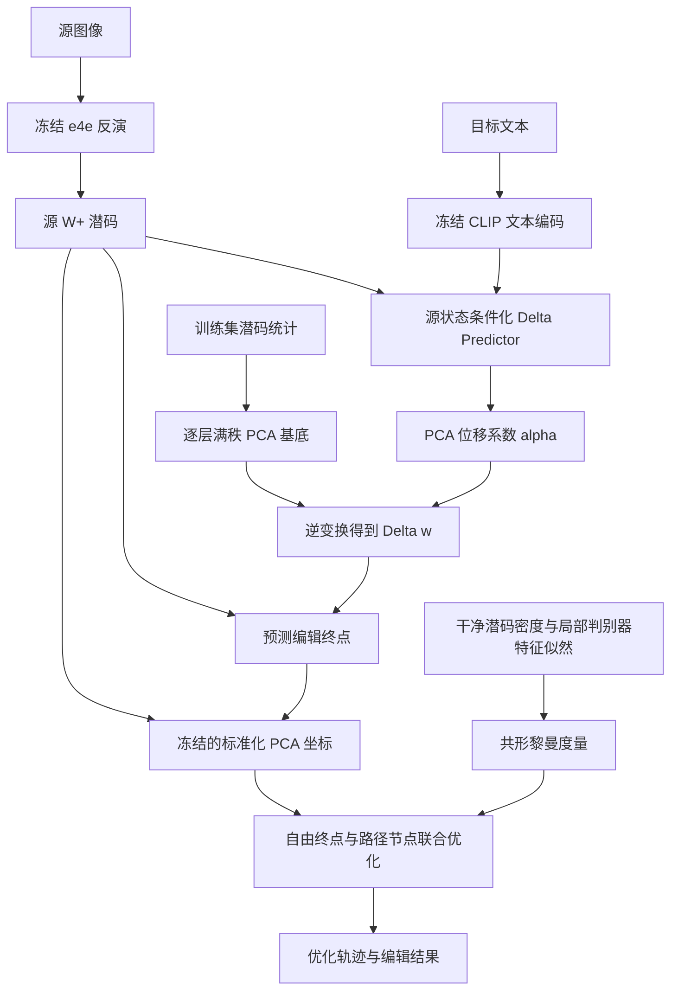

# 基于 PCA 系数预测与概率密度测地线的 StyleGAN 文本编辑：阶段实验计划

> 更新日期：2026-10-20
>
> 仓库：[`5704-Lab/2024-Wu-Yiwei`](https://github.com/5704-Lab/2024-Wu-Yiwei)
>
> 当前交付：论文方法大纲、三阶段实验方案与论文已报告结果汇总。本文可作为阶段实验 README 使用。

**结果来源说明：下文所有已有数值均摘自论文，属于复现参考值；本次尚未在本仓库执行训练、推理或指标计算。实验脚本、模型权重、数据划分和运行日志仍待补齐，不能把这些参考值标记为本仓库已复现结果。**

论文：Yiwei Wu, Wei Zeng, Caihua Chen, Junsong Liu, Qing Zhao, *Coefficient-space text-guided GAN editing with probability-density geodesic optimization*, Neurocomputing 706 (2026), 134995。来源：[论文 DOI](https://doi.org/10.1016/j.neucom.2026.134995)。本文对应论文第 3 节方法、第 4 节实验及附录 A、B；不将论文原始 PDF、数据集或预训练权重纳入本次提交。

## 1. 研究目标与论文大纲

研究目标是在响应文本编辑指令的同时，保持人脸身份、图像质量和组合编辑可控性，并通过优化连续编辑路径及其终点减少局部伪影。

| 阶段 | 核心问题 | 方法 | 核心交付 |
| --- | --- | --- | --- |
| 一：潜空间统计分析 | 如何在保留表达能力的前提下组织编辑坐标？ | 对 StyleGAN2 的逐层反演潜码做满秩 PCA，建立层-分量坐标与响应验证的系数组 | PCA 基底、统计报告、组合干预与层级分析 |
| 二：系数预测网络 | 如何让编辑同时依赖源图像状态和完整文本？ | Delta Predictor 预测 PCA 坐标中的位移系数，再还原为物理潜空间位移 | 文本编辑模型、单属性与组合编辑结果、消融报告 |
| 三：密度测地线优化 | 如何使编辑路径和终点避开不合理区域？ | 在冻结的标准化 PCA 坐标中构造复合干净数据密度，联合优化路径节点与自由终点 | 七节点轨迹、终点修复、可行性证书与几何消融 |

论文叙事大纲：

1. **研究背景**：文本响应与身份保持之间的权衡；直接潜码编辑缺少显式组合接口；直线插值可能经过低密度区域。
2. **相关工作**：文本引导 GAN 编辑、扩散编辑、潜空间结构发现及生成模型的几何分析。
3. **方法一**：逐层满秩 PCA 表示，提供可检查、可缩放、可组合的层-分量变量。
4. **方法二**：源状态条件化的 Delta Predictor，通过独立门控语义查询预测分布式系数位移。
5. **方法三**：复合密度诱导的共形黎曼度量，以及带语义、身份和保真约束的自由终点测地线优化。
6. **实验与讨论**：端点编辑比较、PCA 对照、组合控制、层级干预、预测网络消融、轨迹比较和密度几何消融。

整体流程：



## 2. 统一实验约定与准备工作

### 2.1 数据与模型

- 使用预训练 StyleGAN2 生成器与 e4e 反演编码器。论文配置为 $L=18$ 层，每层 $D=512$ 维，$W^+$ 总维数为 $9216$。
- Delta Predictor 在 CelebAMask-HQ 上训练，在留出的 CelebAMask-HQ 和 FFHQ 上评估。训练、验证、测试按身份隔离，防止同一身份泄漏。
- 第一阶段 PCA 使用身份隔离训练划分的 **19,178 个 e4e 反演潜码**。这些逐层 $W^+$ 统计不能用把一个 $W$ 向量重复到 18 层的样本替代。
- 第三阶段潜码密度使用 **20,000 个干净源反演样本**拟合，在 **4,000 个身份隔离干净样本**上选型；局部特征密度使用 **1,000 张干净源图像**，另有 **300 对开发样本**用于选择判别器块和温度。各集合的来源、重叠关系和隔离规则需要随数据清单明确记录。
- 固定生成器、反演器、CLIP、ArcFace、LPIPS 和判别器的权重版本与哈希；固定噪声、图像预处理、文本规范化和随机种子。
- 论文未在所提供的正文中给出完整环境锁定文件、全部样本 ID 和提示词清单。这些属于正式复现前的待补材料，不能自行填成已知配置。

### 2.2 评价口径

| 类别 | 指标 | 解释 |
| --- | --- | --- |
| 文本与身份 | CLIP-T ↑、Directional-CLIP、ArcFace ↑ | 分别衡量目标文本对齐、编辑方向响应和人脸身份保持 |
| 源图保持 | CLIP-I ↑、LPIPS ↓、DINOScore ↑ | GAN 方法以各自的反演重建图为参考；扩散比较以原始输入图为参考 |
| 外观与分布 | Aesthetics ↑、FID ↓ | FID 使用编辑结果与确定性反演参考的特征分布；小样本值需谨慎解释 |
| 编辑幅度 | $W^+$ RMS | $\|\Delta w\|_2/\sqrt{LD}$；需与语义响应共同解读 |
| 组合控制 | Own response ↑、Control margin ↑、Cross-talk ratio ↓、Invariance ratio ↓ | 依据固定系数组的干预响应衡量控制与串扰 |
| 连续轨迹 | PPL ↓、PDV ↓、Mean ArcFace ↑、CLIP-T gain ↑ | 衡量总感知行程、相邻变化均匀性、路径身份及终点文本增益 |
| 轨迹质量 | TOPIQ ↑、NIQE ↓、Repair ↑ | 前两者仅用于评估；Repair 诊断指定局部色度过量的终点恢复 |

轨迹 PPL 在本文特指相邻节点 LPIPS 之和，PDV 是这些距离的**总体标准差**，不是其他实现中随机采样的 StyleGAN PPL。所有对照共享样本、评估器和参考图口径；不同样本集合的表格不能直接混合比较。

## 3. 阶段一：StyleGAN 潜空间统计分析与满秩 PCA 表示

### 3.1 假设与数学表示

对第 $\ell$ 层的训练反演潜码 $w_\ell\in\mathbb{R}^{512}$ 估计均值与协方差，以双精度特征分解得到按方差降序排列的正交基 $U_\ell\in\mathbb{R}^{512\times512}$：

$$
y_\ell=U_\ell^\top(w_\ell-\mu_\ell),\qquad
w_\ell=\mu_\ell+U_\ell y_\ell,\qquad
U_\ell^\top U_\ell=I.
$$

对编辑系数 $\alpha_\ell$：

$$
\Delta w_\ell=U_\ell\alpha_\ell,\qquad
\|\Delta w_\ell\|_2=\|\alpha_\ell\|_2.
$$

保留每层全部 512 个分量，使坐标变换可逆并保留 $W^+$ 的完整表达能力。这里的“满秩”指完整正交变换；经验协方差是否病态或出现近零特征值，需要单独报告。PCA 的方差排序不自动等同于语义解耦，组合控制必须通过图像响应验证。第三阶段的标准化也不再保留上述未标准化坐标的欧氏范数等式。

### 3.2 实验步骤

1. **建立潜码库**：预处理源图、执行 e4e 反演并保存 `[N,18,512]` 潜码、身份划分、重建图和失败样本清单。
2. **逐层统计**：计算均值、协方差、特征值谱、累计解释方差、有效数值秩和条件数；保存完整基底，不按累计方差阈值截断主实验。
3. **数值验证**：检查正交误差、往返重建误差及位移范数误差。建议工程验收阈值为 float64 相对误差不高于 $10^{-8}$，转 float32 后不高于 $10^{-5}$；这些是本计划的验收建议，并非论文报告值，近零分母必须加保护。
4. **主成分遍历**：在多个身份上遍历不同层和分量，导出图像网格，观察姿态、表情、头发、妆容和纹理响应，并记录伴随变化。
5. **组合接口验证**：先完成基底和静态遍历；待第二阶段预测器训练后，对相同联合提示词的预测系数执行下述系数组干预。第一阶段与第二阶段在此形成一次验证闭环。
6. **补空间修正**：固定每层绝对值最大的 20 个预测系数，只优化其余坐标，在完整提示词和原子语义响应不低于预设阈值时，评估身份与非目标变化改善。

组合干预对每个属性在每层选出标准化正负类均值差最大的 10 个坐标，得到支持集 $S_A,S_B$。构造不相交组 $G_A=S_A\setminus S_B$、$G_B=S_B\setminus S_A$ 和补集 $G_F$，共享坐标保留在补集中：

$$
c(s_A,s_B)=c\odot\left(\mathbf{1}_{G_F}+s_A\mathbf{1}_{G_A}+s_B\mathbf{1}_{G_B}\right).
$$

取缩放集合 $\{0,0.5,1,1.5,2,3\}$，每次改变一个组、另一组固定为 1；$(1,1)$ 必须精确恢复原联合预测。用 Directional-CLIP 的自身响应斜率、交叉响应斜率计算控制指标。PCA 与直接 $W^+$ 预测器在各自坐标中采用完全相同的支持构建规则。

论文组合控制协议覆盖 78 个属性对、1,815 个配对单元和 374 个身份簇；置信区间采用 5,000 次身份聚类 bootstrap。低关联属性对只能在验证集上筛选，不能利用测试响应选组。

### 3.3 论文参考结果

**满秩端点对照，论文表 4**：两种预测器仅输出坐标适配器不同，其余网络、数据、损失与预算匹配；CelebAMask-HQ 为 350 次编辑，FFHQ 为 272 次编辑。

| 数据集 | 表示 | CLIP-T ↑ | ArcFace ↑ | LPIPS ↓ |
| --- | --- | ---: | ---: | ---: |
| CelebAMask-HQ | PCA | 0.2766 | 0.8783 | 0.1389 |
| CelebAMask-HQ | 直接 $W^+$ | 0.2760 | 0.8788 | 0.1383 |
| FFHQ | PCA | 0.2582 | 0.8845 | 0.1381 |
| FFHQ | 直接 $W^+$ | 0.2578 | 0.8868 | 0.1381 |

**结构化控制，论文表 5**：下表是 PCA 减去直接 $W^+$ 的配对差异，并非各方法的绝对指标。

| 指标 | 配对差异 | 95% 置信区间 |
| --- | ---: | --- |
| Own response | +0.000803 | [0.000492, 0.001109] |
| Control margin | +0.000752 | [0.000345, 0.001159] |
| Cross-talk ratio | -0.2788 | [-0.4293, -0.1242] |
| Invariance ratio | -0.2757 | [-0.4294, -0.1134] |

**补空间修正，论文表 6**：48 个留出身份的配对结果中，ArcFace 增加 0.002640，LPIPS 降低 0.002897，非目标残差降低 0.000345，完整提示词增益增加 0.000203。

上述结果支持“端点能力接近、有限系数预算下的组合控制更明确”。它们不支持“PCA 增加了潜空间维度”或“每个主成分都是独立语义”的结论。

### 3.4 阶段交付与验收

- 基底文件包含逐层均值、特征向量、特征值、排序约定、拟合样本数及样本清单哈希。
- 输出统计谱图、正交与重建检查、单分量遍历、组合干预和补空间修正报告。
- 完成与直接 $W^+$ 的匹配对照；可补充截断 PCA 作为容量消融，但必须标明它与主方法的满秩表示不同。
- 验收重点是完整坐标可逆性及经响应验证的组级控制，不要求 PCA 在所有端点指标上超过直接预测。

## 4. 阶段二：预测 PCA 空间位移系数的 Delta Predictor

### 4.1 网络设计

网络接收源潜码 $w_0$、冻结 CLIP 的池化文本特征 $e_t$、完整 token 特征 $E_t$ 及 padding mask $M_t$，预测每层 PCA 位移系数：

$$
\widehat{\alpha}=F_\theta(w_0,e_t,E_t,M_t)\in\mathbb{R}^{18\times512},\qquad
\widehat{w}_{1,\ell}=w_{0,\ell}+U_\ell\widehat{\alpha}_\ell.
$$

实现大纲：

1. 将文本池化特征、token 序列和由源潜码生成的 edit token 组成上下文。
2. 使用学习到的独立语义查询提取多个文本子句的信息。
3. 将各层源潜码投影为 layer token，加入层编号和合成尺度嵌入，通过自注意力交换层间信息，再通过交叉注意力接收语义查询。
4. 为每个“层-查询”对生成系数候选和独立 sigmoid 门值；采用非竞争式门控聚合，允许多个语义查询同时参与。
5. 使用平滑 RMS 约束控制输出幅度，最后通过固定 PCA 基底还原 $\Delta w$ 并渲染。

聚合形式对应论文式 (5)-(6)：

$$
g_{\ell n}=\epsilon_g+(1-\epsilon_g)\operatorname{sigmoid}(\rho_{\ell n}),\quad
\widetilde{\alpha}_\ell=\frac{\sum_n g_{\ell n}a_{\ell n}}{\sqrt{\sum_n g_{\ell n}}},\quad
\widehat{\alpha}_\ell=\frac{\widetilde{\alpha}_\ell}{\sqrt{1+(\operatorname{RMS}(\widetilde{\alpha}_\ell)/b_\alpha)^2}}.
$$

### 4.2 训练目标与协议

论文式 (10) 的完整目标为：

$$
\mathcal{L}_{DP}=\lambda_{sem}\mathcal{L}_{sem}+\lambda_{proj}\mathcal{L}_{proj}
+\lambda_{layer}\mathcal{L}_{layer}+\lambda_{effect}\mathcal{L}_{effect}
+\lambda_{replay}\mathcal{L}_{replay}+\lambda_{id}\mathcal{L}_{id}
+\lambda_{perc}\mathcal{L}_{perc}+\lambda_{energy}\mathcal{L}_{energy}.
$$

- **语义项**：监督编辑图相对源重建图的图文相似度增益；使用语义集合的 Jaccard 亲和度构造双向 soft contrastive targets，避免把共享属性的提示词当作完全负例。
- **局部结构锚点**：只有通过交叉验证方向稳定性、双向渲染和因果层验证的属性才加入方向、层分配、效果保持和 replay 监督。论文最终只保留 Eyeglasses；不能将该锚点推广为所有属性的通用标签。
- **保持项**：用 hinge 惩罚限制 ArcFace 身份损失、LPIPS 偏移及原始预测的自由残差 RMS。
- **训练与推理边界**：锚点坐标及因果层替换仅用于部分训练渲染损失；推理时不额外注入锚点方向。能量项应作用于原始预测计算出的自由残差，而不是替换后的变量。

| 配置项 | 论文配置 |
| --- | --- |
| 文本特征 | CLIP 池化与 token 特征均为 512 维 |
| 隐藏维度 / 注意力头 | 896 / 14 |
| 语义查询 / 查询提取块 / 层-语义块 | 16 / 2 / 3 |
| proposal / gate 维度 | 256 / 128 |
| 门值下限 / 输出 RMS 平滑界 | $\epsilon_g=0.03$ / $b_\alpha=2.0$ |
| 语义温度 | 0.07 |
| 损失权重 | 按上述八项顺序为 (1.0, 0.5, 1.0, 0.5, 1.0, 1.0, 0.5, 1.0) |
| 身份 / LPIPS / 自由残差边界 | 0.90 / 0.14 / 0.15 |
| 训练预算 | 20 epochs；每轮 19,200 次采样；batch size 8；共 48,000 updates |
| 优化器 | AdamW，学习率 $10^{-4}$，betas=(0.9,0.99)，weight decay=$10^{-4}$ |
| 学习率与梯度 | 100 步 warm-up 后 cosine decay；梯度范数上限 1 |

生成器、e4e、CLIP、ArcFace、PCA 基底及验证锚点保持冻结。19,200 表示每轮采样次数，与 PCA 使用的 19,178 个反演潜码不是同一统计量。若先用小模型或缩短预算验证流程。

### 4.3 实验安排

1. 先完成少量固定样本的前向、反向和系数逆变换检查，再进行完整训练。
2. 评估单属性、双属性、多子句及“源图已满足目标属性”的状态条件化编辑；保留失败案例。
3. 对比 TediGAN、StyleCLIP、CLIPInverter 和 DeltaEdit。论文 GAN 对照分别使用 100 对 CelebAMask-HQ 和 272 对共同 FFHQ 样本；FFHQ 表未包含缺少匹配输出的 StyleCLIP。
4. 保持同一数据顺序、随机种子与预算，分别去除 ArcFace、LPIPS、两种保持项和能量正则。
5. 完成阶段一的匹配输出坐标对照和组合干预。补充源条件、token 信息和独立门控的消融可列为扩展实验，所提供论文没有给出这些扩展的量化结果。
6. 按粗层 0-3、中层 4-7、细层 8-17，进行 group-only 与 leave-one-group-out 干预。论文采用 100 个身份、12 个提示词，共 1,200 对、8,400 次图像级评价。

### 4.4 论文参考结果

**GAN 编辑比较，论文表 1、2**：

| 数据集 | 方法 | CLIP-T ↑ | ArcFace ↑ | LPIPS ↓ |
| --- | --- | ---: | ---: | ---: |
| CelebAMask-HQ，100 对 | TediGAN | 0.3788 | 0.5609 | 0.1849 |
| CelebAMask-HQ，100 对 | StyleCLIP | 0.1967 | 0.8694 | 0.1061 |
| CelebAMask-HQ，100 对 | CLIPInverter | 0.2999 | 0.6153 | 0.1771 |
| CelebAMask-HQ，100 对 | DeltaEdit | 0.2268 | 0.7881 | 0.1584 |
| CelebAMask-HQ，100 对 | Delta Predictor | 0.2821 | 0.8705 | 0.1393 |
| FFHQ，272 对 | TediGAN | 0.3377 | 0.6713 | 0.1856 |
| FFHQ，272 对 | CLIPInverter | 0.2690 | 0.6577 | 0.1604 |
| FFHQ，272 对 | DeltaEdit | 0.2172 | 0.8601 | 0.1201 |
| FFHQ，272 对 | Delta Predictor | 0.2582 | 0.8845 | 0.1381 |

**损失消融，论文表 9，100 对 CelebAMask-HQ**：

| 变体 | CLIP-T ↑ | ArcFace ↑ | LPIPS ↓ | $W^+$ RMS |
| --- | ---: | ---: | ---: | ---: |
| 完整模型 | 0.2821 | 0.8705 | 0.1393 | 0.2414 |
| 去除 ArcFace | 0.2944 | 0.4307 | 0.1687 | 0.2352 |
| 去除 LPIPS | 0.2833 | 0.8612 | 0.2990 | 0.2533 |
| 去除两种保持项 | 0.2985 | 0.3081 | 0.4729 | 0.2423 |
| 去除能量正则 | 0.2858 | 0.8665 | 0.1457 | 0.7041 |

**层级行为，论文表 7、8**：粗、中、细层的平均能量占比分别为 9.40%、22.55%、68.05%，但能量大小不等同于语义因果贡献。移除层组的干预显示，眼镜主要依赖粗层，微笑和卷发主要依赖中层，口红、发色和雀斑主要依赖细层；这是该模型与评估协议下的属性规律，不能外推为所有 StyleGAN 编辑器的固定分工。

论文表 3 另报告 RTX 4090、batch size 1 下 Delta Predictor 流程耗时 0.0371 秒，含预处理、文本编码、反演、生成和内存输出转换，不含模型加载和文件写入；该值来自另一组 100 对 FFHQ 扩散对照样本，**不包含第三阶段测地线迭代优化成本**。

### 4.5 阶段交付与验收

- 保存模型、训练配置、冻结依赖哈希、每步/每轮损失及验证曲线。
- 输出单属性与组合编辑网格、逐样本指标、损失消融和层级干预报告。
- 输出与基底版本绑定的预测系数和初始编辑终点，作为第三阶段输入。
- 验收同时关注语义、身份和保真度，不能仅通过提高 CLIP-T 判定成功。

## 5. 阶段三：基于黎曼几何的概率密度测地线优化

### 5.1 冻结坐标与复合密度

将逐层 PCA 系数展平为 $y\in\mathbb{R}^{9216}$，使用干净训练潜码的均值和正尺度建立固定仿射坐标：

$$
z=T(w)=(y-m_y)\oslash s_y,\qquad d=9216.
$$

该坐标及其所有统计在轨迹优化前冻结。这里的 $z$ 是标准化 PCA 坐标，不是 StyleGAN 映射网络输入空间 $Z$。

复合密度由两部分组成：

1. **跨层潜码密度 $p_{lat,\sigma}$**：在全部 9,216 维联合建模。使用带高斯平滑的混合因子分析模型，并对正交补保留正的残差方差，使其仍是严格正的全维概率密度，不能把低秩子空间上的密度直接当作全空间密度。
2. **局部图像特征似然**：对干净源图的冻结 StyleGAN2 判别器局部特征拟合对角高斯，计算 patch NLL，以温度平滑最大值聚合，使用干净源统计标准化为 $\widetilde E(z)$。

$$
p_{\eta,\sigma}(z)=\frac{1}{Z_{\eta,\sigma}}p_{lat,\sigma}(z)\exp[-d\eta\widetilde E(z)],\qquad
s(z)=\nabla_z\log p_{\eta,\sigma}(z).
$$

局部 NLL 有下界，使指数因子有上界；配合正规化的潜码密度，复合密度具有有限且正的归一化常数。实际使用未归一化密度 $\widetilde p$，未知常数在 score 和参考归一化作用量中消去。判别器特征似然与独立的 Repair 诊断需要分开实现。

### 5.2 密度诱导度量与自由终点优化

构造共形因子和黎曼度量：

$$
q(z)=\exp\left[-\frac{2\beta}{d}(\log\widetilde p_{\eta,\sigma}(z)-c_{ref})\right],\qquad
g(z)=q(z)I_d.
$$

当 $\beta>0$ 时，低密度区域中的运动代价更高；$\beta=0$ 给出同一标准化坐标中的欧氏度量。最小化密度作用量：

$$
\mathcal A[\gamma]=\frac{1}{2d}\int_0^1q(\gamma(t))\|\dot\gamma(t)\|_2^2\,dt.
$$

固定源点 $z_0=T(w_0)$，以预测端点 $\widehat z_1=T(\widehat w_1)$ 为终点参考，同时优化终点偏移 $\delta_T$ 和内部路径残差：

$$
z_k=(1-t_k)z_0+t_k(\widehat z_1+\delta_T)+\delta_k,\qquad
t_k=k/K,\quad K=6,\quad\delta_0=\delta_K=0.
$$

因此主方法有 **7 个节点**，终点可以在信赖域和约束内调整；它不等同于固定端点的路径平滑。对节点对数密度 $\varpi_k=\log\widetilde p(z_k)$，论文式 (34) 的离散作用量为：

$$
\mathcal A^K=\frac{1}{2\Delta t\,d}\sum_{k=0}^{K-1}
\exp\left[-\frac{\beta}{d}(\varpi_k+\varpi_{k+1}-2c_{ref})\right]
\|z_{k+1}-z_k\|_2^2,\qquad\Delta t=1/K.
$$

语义、身份、结构、端点保真、密度支持、PPL、PDV 和局部色度指标均作为相对 LERP 基线的不等式可行性约束，**密度作用量是唯一的轨迹目标**。使用归一化作用量、乘子及 hinge 违反量形成增广优化函数；约束满足时，对应 hinge 梯度为零。完整求解和约束定义应按论文式 (27)-(36) 与附录 B 实现。

### 5.3 论文配置与可行性检查

| 配置项 | 论文配置 |
| --- | --- |
| 潜码密度候选 | 因子秩 {64,128,256}；混合数 {1,4,8,16}；按验证集每维 NLL 选型 |
| 选定潜码密度 | 秩 256、4 个混合分量；残差方差 0.539754；留出每维 NLL 1.193337 |
| 局部特征 | 32×32 判别器特征图、512 通道；拟合时每图采样 16 个 patch |
| 局部密度校准 | $\tau_{patch}=0.2$；$(m_E,s_E)=(2.233402,0.281391)$；$\eta=0.02$ |
| 密度几何 | $\beta=0.5$，平滑尺度 $\sigma=4$ |
| 轨迹与求解器 | 7 节点；全 9216 维；Adam 160 iterations；学习率 0.002；betas=(0.9,0.99) |
| 信赖域 | 终点系数 $r_T=0.5$；路径系数 $r_P=0.1$，按论文式 (33) 投影 |
| 约束求解 | 增广系数 $\rho=8$；乘子从零初始化，每 5 步更新；每例梯度范数上限 1 |
| 指数保护 | 指数裁剪到 [-12,12]，记录是否触发；论文正式返回轨迹未触发该保护 |
| 端点目标语义 | 保留正向文本增益的至少 98%；非正增益采用 0.001 容差 |
| 编辑/结构签名 | 编辑投影与余弦阈值 (0.80,0.85)；结构阈值 (0.80,0.88) |
| 身份/密度容差 | 相对预测端点 ArcFace 容差 0.002；复合 NLL 每维容差 0.01 |

论文还对端点 LPIPS、像素 $\ell_1$、低频色度漂移、总色度变化、不受亮度结构支持的色度边缘及各节点局部色度响应设置基线相对非退化边界；内部节点语义和身份不能低于对应 LERP 响应。数值分母、签名阈值、多视图语义和全部局部响应定义需写入配置，不能仅凭上表替代完整协议。

每例先验证 LERP 对冻结约束的参考可行性；只接收满足全部容差且作用量、PPL、PDV 不超过 LERP 的候选。记录每项违反量及接受状态；若没有可行改善，应回退到已验证的基线并报告，不能剔除困难样本后仅汇总成功案例。论文正式 100 例的 LERP 均通过参考可行性检查。

### 5.4 对照、消融与伪影诊断

1. **轨迹比较**：LERP、SLERP、完整概率密度测地线共享源点、预测端点参考、7 个时间节点、生成噪声与评估器。LERP/SLERP 固定参考端点，完整方法允许可行终点移动。
2. **严格几何对照**：$\beta=0$ 保留自由终点、初始化、预算、求解器与全部约束，仅移除度量对密度的依赖，是判断几何贡献的关键对照。
3. **局部密度消融**：$\eta=0$ 同时从作用量密度和复合 NLL 约束移除局部特征项。论文该消融使用解析潜码密度的段中点积分，完整方法使用节点对数密度梯形积分；两者均二阶一致，但这一差异需要记录，不能把差值全部归于度量项。
4. **边界消融**：分别移除 PPL、PDV、身份、语义和局部伪影约束，检查各边界保护的指标。
5. **敏感性**：比较 $\beta=1$、$\sigma=0$、$\sigma=8$；固定其他条件。
6. **局部与稠密检查**：保存眼镜、耳机、项链、衣物等区域的同时间裁剪；完成七节点主协议后，可补充更密集节点的事后渲染检查，标明为扩展验证。

Repair 按论文式 (43)-(44) 计算：先仅用源图和冻结预测端点确定活跃的“样本-响应”集合，满足端点响应超过源响应保护值的 1.8 倍且绝对增量大于 0.05。对该固定集合统计优化终点剩余色度过量相对预测端点过量的比例，并用 1 减去其均值。LERP 的 Repair 按构造为 0；活跃集合为空时记为未定义，不能填 0。Repair 针对三类指定局部色度响应，不代表任意伪影的通用修复率。

### 5.5 论文参考结果

**轨迹比较，论文表 10，固定 100 次 FFHQ 编辑**：

| 方法 | PPL ↓ | PDV ↓ | Mean ArcFace ↑ | CLIP-T gain ↑ | TOPIQ ↑ | NIQE ↓ |
| --- | ---: | ---: | ---: | ---: | ---: | ---: |
| LERP | 0.073397 | 0.003437 | 0.954345 | 0.064494 | 0.772838 | 5.930181 |
| SLERP | 0.234067 | 0.020180 | 0.911944 | 0.064503 | 0.762408 | 6.046704 |
| 概率密度测地线 | 0.071510 | 0.002720 | 0.960866 | 0.068624 | 0.768558 | 5.891521 |

与 LERP 相比，论文报告的测地线在路径规律性、身份、文本增益和 NIQE 上改善，但 TOPIQ 从 0.772838 降至 0.768558，应保留这一权衡。

**关键消融，论文表 11**：

| 变体 | PPL ↓ | PDV ↓ | Repair ↑ |
| --- | ---: | ---: | ---: |
| 完整优化 | 0.071510 | 0.002720 | 42.66% |
| 无密度几何，$\beta=0$ | 0.070027 | 0.002699 | 10.33% |
| 仅潜码密度，$\eta=0$ | 0.070053 | 0.002722 | 11.45% |
| 去除局部伪影约束 | 0.071186 | 0.002691 | 42.53% |

完整 Repair 的 95% bootstrap 区间为 [35.31%,49.07%]；相对 $\beta=0$ 的配对增益为 32.33 个百分点，区间 [24.61,38.85]；相对去除局部伪影约束的增益仅 0.13 个百分点，区间 [-0.76,1.20]。该对照表明局部恢复在移除显式伪影边界后仍保留，也说明更低的 PPL/PDV 不能单独证明密度几何有效。

### 5.6 阶段交付与验收

- 保存冻结的标准化坐标、密度参数、局部特征统计和选型记录。
- 保存每例预测端点、优化端点、全部节点、作用量曲线、逐项约束和最终可行性状态。
- 输出轨迹比较、严格几何消融、局部密度消融、Repair 置信区间及失败样例。
- 数值可行性证书只适用于离散问题；非凸求解不保证全局最优，七节点通过检查也不能排除节点之间出现不规则变化。密度依赖具体生成器和数据域，换域需要重新验证。

## 6. 实施顺序与建议目录

以下为后续实现建议，**当前尚不存在这些脚本与产物**，因此本文件不提供不可运行的训练命令。

```text
plan.md                         # 本阶段说明
configs/                        # 数据、模型、训练、几何与评估配置
src/
  inversion/                    # 反演与潜码缓存
  latent/                       # PCA、系数变换、支持集与层组干预
  models/                       # Delta Predictor
  losses/                       # 语义、锚点、保持与能量损失
  geometry/                     # 密度模型、度量、轨迹求解与约束
  evaluation/                   # 端点、组合控制、轨迹与 Repair
scripts/                        # 数据准备、拟合、训练与评估入口
manifests/                      # 样本 ID、身份划分、提示词及校验摘要
reports/                        # 阶段报告和汇总图表
results/                        # 本地实验结果，逐样本指标与运行记录
checkpoints/                    # 本地权重缓存，后续按授权约定分发
```

| 里程碑 | 工作 | 完成标准 | 当前状态 |
| --- | --- | --- | --- |
| M0 | 论文梳理与实验协议 | 三阶段目标、结果来源和参考值可核对 | 本文档已整理 |
| M1 | 数据及反演准备 | 划分、提示词、模型版本和反演质量可追溯 | 待实施 |
| M2 | 满秩 PCA 与统计 | 完整基底、数值验证和遍历报告 | 待实施 |
| M3 | Delta Predictor | 训练、端点评估、损失消融和模型产物 | 待实施 |
| M4 | 组合与层级控制 | 匹配坐标对照、组干预、补空间及因果分析 | 待实施 |
| M5 | 密度拟合与几何求解 | 密度选型、可行求解和七节点轨迹 | 待实施 |
| M6 | 完整复现报告 | 基线、消融、置信区间和失败案例统一汇总 | 待实施 |

## 7. 本仓库实验结果登记

此处仅登记实际运行结果；未运行的指标保持“待运行”，不能用前文论文参考值填充。

| 实验 | 运行标识 / 提交 | 划分与配置 | 本仓库实测结果 | 日志与产物 |
| --- | --- | --- | --- | --- |
| PCA 正交与往返验证 | 未运行 | 待建立潜码库 | 待运行 | 待生成 |
| PCA / 直接 $W^+$ 匹配对照 | 未运行 | 待训练两个预测器 | 待运行 | 待生成 |
| 组合控制与层级干预 | 未运行 | 待冻结属性支持与提示词 | 待运行 | 待生成 |
| Delta Predictor 及损失消融 | 未运行 | 待补数据和训练入口 | 待运行 | 待生成 |
| 测地线 / LERP / SLERP | 未运行 | 待冻结共同轨迹集合 | 待运行 | 待生成 |
| 密度几何、局部密度与约束消融 | 未运行 | 待实现统一求解协议 | 待运行 | 待生成 |

每次运行至少记录：代码提交、UTC 或注明时区的时间、配置文件与哈希、随机种子、数据清单哈希、预训练权重哈希、软件与 GPU 环境、逐样本指标、失败和回退状态、耗时及峰值显存。复现报告应将“论文参考值”和“本仓库实测值”并排展示，并解释差异来源。

## 8. 初步结论与后续重点

论文已有结果为三阶段路线提供以下依据：完整 PCA 坐标保留端点表达能力，并支持经响应验证的组合干预；源条件化的系数预测可在文本响应与身份保持之间取得平衡；密度几何结合可行性约束，可改善七节点编辑轨迹并减轻指定局部色度伪影。

后续实现首先保证数据、坐标、评估和约束协议一致，再验证数值趋势。当前待完成的工作是把上述协议落实为可运行代码与可追溯实验，不将论文结论视为本仓库已经获得的复现结论。
